# Puzzle Lead Scoring: Documentation

This tool checks a list of companies against Puzzle's ideal customer profile, scores the ones that fit, and tells sales how to approach each one. Free Python scraping, pattern matching and free official directories (YC, SEC, IRS) do most of the work; AI is only used for what's left. Puzzle's sales team uses it mainly through Clay; one engineer sets it up once.

| Section | What it covers |
|---|---|
| [1. Overview](#1-overview) | What it does, ground rules, the two ICP pipelines, the three ways to use it |
| [2. Setup](#2-setup) | Install, keys and settings, configuration files, project files, first test run |
| [3. Commands](#3-commands) | Every command and option, tips before a big run |
| [4. How the pipeline works](#4-how-the-pipeline-works) | Step by step with diagrams: downloading, rules, verdict, AI, scoring, outputs, storage, architecture |
| [5. The ICP models](#5-the-icp-models) | Roles, points and how the score adds up; services signals by category; routes; changing the model; the services decisions |
| [6. Data point reference](#6-data-point-reference) | How each of the 69 data points (57 + the services facts S1–S12) is checked, the waterfall per data point, how they depend on each other |
| [7. Integrations](#7-integrations) | The API, Clay, the MCP server, Claude Code skills, the list viewer |
| [8. Testing](#8-testing) | Smoke test, AI run, trace, waterfall, manual review, accuracy, regression checklist, connection tests |
| [9. Decisions and reviews](#9-decisions-and-reviews) | The manual review, decisions per data point, the services build plan, the 26-deal test |

Also separate: [HANDOFF.md](HANDOFF.md), the guide for the Puzzle team.

---

## 1. Overview

### What it does

You give it company domains. It reads each company's website and free public records (YC, SEC, IRS, DNS), then uses AI only for what is still unknown. Every answer comes with a short quote and the page it came from. If something can't be found, it stays Unknown: a company is never marked down for missing information.

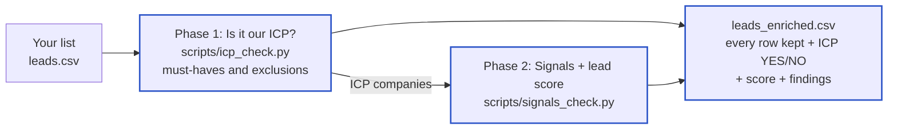

Each company gets:

| Column | Example |
| --- | --- |
| ICP | YES, NO or PENDING (still being checked) |
| Reason | All 4 must-haves confirmed, no exclusion found |
| Lead score and tier | 7, Weak fit (Strong fit, Good fit, Weak fit) |
| Route | Qualify on the call: Full Service or Expert Review; Platform + MCP; Partner referral |
| Value angle | Clean monthly closes across processors, subscriptions, refunds and deferred revenue |
| Proof | The quote and link behind every answer |

### Ground rules

These come from the ICP profile ([config/icps/product/profile.yaml](../config/icps/product/profile.yaml)) and shape everything else.

- **"We don't know" is not "no".** A company is never failed, excluded or marked down because something couldn't be found. Only proof counts.
- **Every answer comes with proof:** a short quote and the page it came from.
- **Cheap checks first.** Free scraping and rules run first, then free directories (YC, SEC, IRS); AI and web search only run for companies still in the running and questions still open.
- **Code does the scoring.** The same input always gives the same score, and changing a weight rescores everything in seconds without downloading again.
- **Your list is never trimmed.** Every original row stays in the final file, in order, with your original columns.

### Two ICP pipelines: services (default) and product

Most data points find **facts** about a company (US-based, has payroll, runs several entities); [config/datapoints/](../config/datapoints/) holds how each one is answered. A **pipeline** decides how each fact counts: its group (must-have, exclusion, fit, buying, weak), its weight, the conditional runs and the opposites. "Runs several entities" is a fit signal for the product, and a hard stop for services. So there is one fact-finding engine with two scoring pipelines on top.

| Pipeline | Who | Config | Chosen with |
|---|---|---|---|
| **services** (default) | Operators (founders up to Series C, SMB owners) who want the bookkeeping done for them | `config/icps/services/` | nothing (default), or `--icp services` |
| product | Early-stage startups (pre-seed to Series B) for the platform | `config/icps/product/` | `--icp product`, MCP `icp="product"`, API `?icp=product` |

- **Only one pipeline runs at a time.** Never both in the same run, so there is no combined verdict or "best route". Results are stored per pipeline, and output files carry the name of a non-default pipeline (`<list>_enriched.csv` for services, `<list>_product_enriched.csv` for product), with a `Pipeline` column.
- **Every list or company tool takes `icp`** (MCP: `check_company`, `check_companies`, `enrich_list`, `list_ai`, `open_questions`, `submit_answers`, `explain_company`; API: `/v1/check`, `/v1/check/batch`, `/v1/lists`, or `?icp=product` on any call; without it, services is used). Use the same `icp` for every call on a list (check, questions, answers, results). Clay: the pipeline goes with the push.
- **A company can pass one ICP and fail the other.** A funded seed-stage AI startup can be a Strong product fit and a Weak services fit (likely DIY). A 12-person agency with books behind is the reverse. Run the other pipeline on the same list to see its view.
- **Each pipeline has its own stop-when-decided and conditional runs**, and asks only the questions it needs.
- **Running the other pipeline later on the same list is cheap.** The downloads and free checks are cached. AI answers to fact questions are reused too, as long as those prompts stay pipeline-neutral: they ask for facts, and the ICP summary is not part of the system prompt or the cached answer.
- **Prospeo stays at 1 credit per company**, whichever pipeline runs, and never a second credit for the same company. One search brings both the finance person (product) and the buyer titles (services).

| Shared (done once per company, reused by either pipeline) | Separate per pipeline |
| --- | --- |
| Download, job boards, code scan, Wappalyzer, DNS | `profile.yaml`: who the ICP is |
| Directories (YC, SEC, IRS, Wayback) | Each fact's role: must-have, exclusion, fit, buying or weak |
| Rules and the 57 data points, plus the services facts (S1–S12) | Weights and the Strong-fit cut-off (`scoring.json`) |
| AI answers to fact questions (reused if the other pipeline runs on the same list later) | Conditional runs and opposites (for example, F12 after F1 is product only) |
| Segment, vertical, partners, competitors, Prospeo data | Value proposition, route column, which contacts to look for |
| Speed work, learning loop, MCP, API, Clay | |

```
Download + free checks (cached)
        │
        ├── --icp services (default): hard stops ──► score up / score down ──► score, tier, route
        │
        └── --icp product (when chosen): must-haves / exclusions ──► fit, buying, weak ──► score, tier
        │
AI questions = only what the chosen pipeline still needs
        │
Output: that pipeline's verdict, score, tier and proof
```

| Output column | Example |
| --- | --- |
| Pipeline | Services or Product |
| ICP, Score, Tier | YES · 14 · Strong fit |
| Route (services only) | See [Routes and value angle](#routes-and-value-angle) |
| Why | The proof behind the verdict |

Clay, the CSVs, MCP and the API all get the same columns, with the pipeline named, so services and product results never get mixed up.

**Cost per pipeline:** free steps cost nothing extra, since they run once. AI: each run asks only what its pipeline needs; running the other pipeline later reuses the fact answers already bought.

How each fact counts in services, and why it differs from product: [section 5](#5-the-icp-models).

### Three ways to use it

Most of the team only needs Clay. The other two are for ops and engineering.

| Who | How | What they need |
| --- | --- | --- |
| Sales and GTM team | Scores appear as columns in Clay tables | The API running on a server (set up once) |
| Ops or GTM lead | Ask Claude in plain English: "check acme.com", "score this list" | The repo and Claude Code or Claude Desktop on their computer |
| Engineer | Command line or API for big lists, schedules, or the CRM | The repo on a server or laptop |

Everyday use of each: [section 9](HANDOFF.md).

---

## 2. Setup

### Install and first test run

An engineer needs about an hour. Use Puzzle's own accounts and keys; keys live only in the `.env` file, which is never committed.

1. Clone the repo and install:
   ```bash
   python3 -m venv .venv
   .venv/bin/pip install -r requirements.txt
   ```
2. Add the keys with `python -m enrich settings`: OpenAI (AI step for big lists), Prospeo (company data and contacts) and the Clay webhook URLs (see [Keys and settings](#keys-and-settings)).
3. Run the 14-company test list to check it works, then the automated tests:
   ```bash
   .venv/bin/python scripts/icp_check.py examples/sample_leads.csv
   .venv/bin/python scripts/signals_check.py sample_leads
   .venv/bin/python -m unittest discover -s tests
   ```
   **Windows** (PowerShell or Command Prompt): the same steps with `py -m venv .venv` and `.venv\Scripts\python` (and `.venv\Scripts\pip`) in place of `.venv/bin/python`. All files are read and written as UTF-8 on every system (a test checks it). Install Google Chrome for sites that need JavaScript, or run `.venv\Scripts\python -m playwright install chromium`.
4. For the team: start the API on a small always-on server: `python -m enrich serve --host 0.0.0.0`, with HTTPS in front. It needs disk space for saved pages, and Chrome for sites that only load with JavaScript (or the `--no-browser` option).
5. Show the API key with `python -m enrich settings --show-key` and give it only to people setting up Clay.

Your CSV needs a domain or website column. A company name and employee count column are used if present (common names like "Domain", "Website", "Company Name", "Employee Size" are recognised).

### Keys and settings

All keys live in `.env` at the project root, each with a comment saying what it's for and where to get it. `.env` is readable only by you and never committed to git. `.env.example` is the blank copy in git, so teammates see which keys to fill in.

| Group | Key | Used for | Status |
|---|---|---|---|
| This project | `PUZZLE_API_KEY` | Key callers send to our API | Created automatically |
| AI | `OPENAI_API_KEY` | AI step (gpt-4o-mini) and its web search | Used |
| AI | `ANTHROPIC_API_KEY` | Claude as an alternative AI provider | Not used yet |
| Clay | `CLAY_WEBHOOK_URL` | Default Clay table to push results to | Used |
| Clay | `CLAY_WEBHOOK_TOKEN` | That webhook's auth token, if it has one | Used |
| Clay | `CLAY_CONTACTS_WEBHOOK_URL` | Clay table for contacts (`push_contacts_to_clay`); same token | Used |
| Clay | `CLAY_API_KEY` | Clay Public API (pull and push work without it, through `clay login`) | Not used yet |
| Data providers | `PROSPEO_API_KEY` | Prospeo: company data (last layer of the waterfall) and people | Used when set |
| Data providers | `PROVIDER_MONTHLY_CREDITS` | Cap on provider credits per month | Optional |
| Free directories | `SEC_CONTACT_EMAIL` | Contact email SEC EDGAR asks automated tools to send (YC, SEC and IRS need no key) | Optional |
| Other data tools | `CRUNCHBASE_API_KEY`, `APOLLO_API_KEY`, `PDL_API_KEY`, `SEARCH_API_KEY` | Funding, headcount, company data, a separate web search service | Planned |

Other settings in `.env`, explained where they apply: `AI_MONTHLY_BUDGET_USD` and `API_AI_MAX_COST_USD` (cost limits), `SHARED_*_DAYS` and `SHARED_CACHE` (the shared company cache), `DATA_DIR` (data folder), `LEARNING_AUTO_APPLY` (the learning loop).

Fill them in by editing `.env`, or from the terminal:

```bash
.venv/bin/python -m enrich settings                                   # every key and whether it's set
.venv/bin/python -m enrich settings --openai-key sk-...               # AI step
.venv/bin/python -m enrich settings --clay-webhook https://...        # default Clay table for pushes
.venv/bin/python -m enrich settings --clay-webhook-token ...          # only if that webhook has an auth token
.venv/bin/python -m enrich settings --clay-api-key ...                # Clay Public API (from `clay api-keys create`)
.venv/bin/python -m enrich settings --set APOLLO_API_KEY=...          # any other key
.venv/bin/python -m enrich settings --show-key                        # print the full API key for callers
.venv/bin/python -m enrich settings --rotate-api-key                  # replace the API key (callers need the new one)
```

The API key is created once and stays the same until you rotate it.

**Clay command-line tool:** installed at `~/.local/bin/clay` and signed in with `clay login`. Check with `clay whoami`. For Clay's own skills in Claude Code, type these two lines in the Claude Code chat:

```
/plugin marketplace add clay-run/agent-plugins
/plugin install clay@clay-plugins
```

Connecting Claude Code or Claude Desktop (MCP): [section 7](#mcp-server-claude-code-claude-desktop).

### Configuration files

The ICP profile (`config/icps/<pipeline>/profile.yaml`) is written in sentences. It was turned into things you can read and change:

| File | What it holds | Change it when |
|---|---|---|
| [enrich/checks/rules.py](../enrich/checks/rules.py) | The pattern-matching rules: what counts as proof for each data point | A rule finds wrong answers or misses clear ones |
| [config/datapoints/](../config/datapoints/) | Each data point's own waterfall (69 files): which layers run and when (rules, directories, AI on pages, AI web search, provider). See them all: `python -m enrich datapoints` | You want a data point answered differently, cheaper or more thoroughly |
| [config/prompts/](../config/prompts/) | One JSON prompt file per data point (62), plus shared rules, the AI provider and model names in `_shared.json` | AI should judge a data point differently, or you want another model |
| `config/icps/<pipeline>/roles.json` | How each data point counts in that pipeline: group, conditional runs (`run_if`), opposites | You want a fact to count differently (see [Changing the model](#changing-the-model)) |
| [config/icps/product/scoring.json](../config/icps/product/scoring.json), `config/icps/services/scoring.json` | Points per signal (high 3, medium 2, low 1, weak fit -2), Strong fit cut-off (12), size bands | You want different weights or tiers |

The model lives in config files, not code, so a change is usually one line. After changing rules or scoring, `python -m enrich rules <list> --phase both` re-scores saved lists in seconds for free, without downloading again.

### Project files

```
README.md             start here (high level)
scripts/icp_check.py          runs phase 1
scripts/signals_check.py      runs phase 2
scripts/ai_check.py           runs the AI step for either phase
.mcp.json             registers the MCP server for Claude Code
.claude/              Claude Code skills, the /enrich-chat command and the company-answerer subagent
.env                  your keys, set once (not in git)
.env.example          blank list of every key, for teammates
cache/                free directory downloads, shared by all lists (not in git)
requirements.txt
config/               everything you edit to change behaviour
  icps/               one folder per ICP pipeline (services, product), each with:
    profile.yaml      the ICP definition (never changed by the tool)
    roles.json        how each data point counts: group, conditional runs (run_if), opposites
    scoring.json      lead score weights, cut-off, size bands
  datapoints/         each data point's waterfall: how the fact is found (one file each, shared by pipelines)
  prompts/            one AI prompt per data point + _shared.json
docs/
  DOCUMENTATION.md    this file
  openapi.json        the API description, importable into any API tool
  viewer/             the password-protected GitHub Pages build of the list viewer
viewer/               the local list viewer (server.py, index.html, style.css, app.js, build_static.py)
examples/
  sample_leads.csv    14-company test list
enrich/
  __main__.py         all commands (python -m enrich ...)
  core/               shared foundations
    settings.py       keys from .env, set once
    paths.py          where data lives (DATA_DIR)
    icp.py            which ICP pipeline runs, and how each data point counts in it
    learning.py       what the runs learned: errors, rejected answers, proposals
    timing.py         seconds per stage, for the bench command
    shared.py         one company cache for all lists: pages and AI answers
    ratelimit.py      rate limits shared by every process (SEC, Internet Archive)
    versions.py       version stamps for rules and prompts
    usage.py          monthly AI cost and budget
    store.py          per-list storage: pages, results (per pipeline), AI answers, directory findings
    inputs.py         reads the CSV, cleans domains
    runlog.py         run log per list (runs.jsonl)
    dashboard.py      live terminal view
  sources/            where data comes from
    crawl.py          finds and downloads pages, job feeds; real-browser and public DNS fallbacks
    directories.py    free directories: YC, SEC EDGAR, IRS non-profit list
    history.py        old copies of company sites (Internet Archive)
  engine/             the waterfall: layers in order, one set of merge rules
    layers.py         the five layers: name, cost, which data points each can answer
    merge.py          how answers from different layers are combined; the ICP verdict
    resolve.py        one company through the layers: rules, directories, then AI and provider answers
  checks/             free checks
    rules.py          pattern-matching rules for every data point
    datapoints.py     reads config/datapoints/: each data point's waterfall settings
    scoring.py        lead score from the pipeline's scoring.json
  ai/                 the AI step
    prompts.py        loads prompt files and builds AI messages (single and grouped)
    runner.py         calls OpenAI: step 1 then web search, accurate and cheap modes, cost estimate
    apply.py          turns AI answers into signal values with the confidence, quote and date checks
  pipeline/           the two phases and their outputs
    phase1_icp.py     phase 1: ICP check
    phase2_signals.py phase 2: signals and score
    final.py          the final list: every original row + findings + reasoning
    common.py         shared helpers for both phases
    evaluate.py       accuracy against labels
    trace.py          one company through every step, one at a time
    waterfall.py      each data point through every layer, and which layer decided
    review.py         you mark each data point right or wrong; review.csv and labels.csv
  providers/          paid data, the last layer
    prospeo.py        Prospeo: company data, people search, email reveal, credit balance
    apply.py          provider data into answers (medium strength: never makes a company NO alone)
    run.py            the providers and people steps for a list; contacts file
  integrations/       using it from outside
    api.py            HTTP API (python -m enrich serve)
    service.py        runs the pipeline from code, for the API and MCP
    mcp_server.py     MCP server (python -m enrich mcp); AI answered by the chat model
    client_ai.py      open questions out to the chat model, its answers back in through the quality checks
    clay.py           pull from / push to Clay
lists/<list>/         created per list: input.csv, raw/, cache.sqlite, runs.jsonl, output/  (not in git)
```

---

## 3. Commands

```bash
# PHASE 1: is it our ICP? Must-haves and exclusions, for every company
.venv/bin/python scripts/icp_check.py leads.csv                 # same as: python -m enrich icp leads.csv

# AI for phase 1: settles PENDING companies (asks before spending; needs OPENAI_API_KEY)
.venv/bin/python scripts/ai_check.py leads --phase icp          # same as: python -m enrich ai leads --phase icp

# PHASE 2: fit, buying and weak signals + lead score, only for companies phase 1 passed
.venv/bin/python scripts/signals_check.py leads                 # same as: python -m enrich signals leads
.venv/bin/python scripts/signals_check.py leads --only-yes      # skip companies still waiting on an AI check

# AI for phase 2: AI-only signals, industry, company size (asks before spending)
.venv/bin/python scripts/ai_check.py leads --phase signals

# phases 1 and 2 without AI, one after the other
.venv/bin/python -m enrich run leads.csv
```

The AI step uses OpenAI (gpt-4o-mini), with the key set once in `.env` (`python -m enrich settings --openai-key sk-...`).

AI options:

| Option | What it does |
|---|---|
| `--limit 20` | First 20 companies only |
| `--no-web` | Skip the web search step |
| `--mode cheap` | Group a company's questions: up to 5 per call on its pages, and its web questions share one web search call. About 4 times cheaper on web search. Default `accurate` (one call per question), set in `config/prompts/_shared.json`. Check with `copy` + `compare` before using it on a big list |
| `--no-search-signals` | Phase 2: skip the 9 signals only web search can answer (recent funding, new investor, QuickBooks complaints...). They are the most expensive part, about $0.10 to $0.30 per ICP company |
| `--redo` | Ask again where an answer is saved |
| `--yes` | Don't ask before spending |

| You want to | Run |
|---|---|
| See all lists: ICP yes / needs check / no, signals done, disk use | `python -m enrich lists` |
| See every answer and its proof for one company | `python -m enrich explain linear.app` |
| See each must-have (or any group) through every layer: rules, directories, AI on pages, AI web search, Prospeo | `python -m enrich waterfall linear.app` (add `--ai`, `--providers`; each asks before spending; `--group exclusions/fit/buying/weak/all`) |
| See every data point's waterfall settings, or one in full | `python -m enrich datapoints`, `python -m enrich datapoints --show M3` |
| Check each data point's waterfall yourself and mark it right or wrong (Enter / n / s / q); saved to `review.csv`, and as labels for `evaluate` | `python -m enrich review accuracy_test` (or one company: `review linear.app`; `--group all`) |
| Fill data points still open with Prospeo company data (1 credit per matched company) | `python -m enrich providers leads --phase icp` (asks first) |
| Find decision-makers at ICP companies (founder/CEO, finance lead), with emails if wanted | `python -m enrich people leads --emails` (asks first; writes `leads_contacts.csv`) |
| Follow one company through every step, one at a time (input, download, rules, directories, verdict, AI, signals, score) | `python -m enrich trace linear.app` (add `--ai` for the AI steps; asks before spending). Saved as a report in `lists/trace_linear_app/output/` |
| Re-check saved pages after changing a rule (no downloading) | `python -m enrich rules leads` (add `--phase icp`, `--phase signals` or `--phase both`) |
| Re-read open jobs for a list downloaded before (13 job boards, careers pages; free) | `python -m enrich jobs leads` |
| Calibrate the services weights on labelled companies (help / review / DIY buyers, closed-won deals) | `python -m enrich calibrate leads --labels labels.csv` (report only; `--apply` writes the weights if the tests pass; `--template labels.csv` for a blank file) |
| Use the product ICP instead of services (the default) for any command | add `--icp product`, for example `python -m enrich run leads.csv --icp product` |
| Time the free steps on a CSV, per stage, and compare two runs answer by answer (free) | `python -m enrich bench leads.csv --label before`, then `python -m enrich bench --compare before after` |
| Re-open pages that only load with JavaScript (a "Loading blog..." page) in the real browser; free | `python -m enrich render leads` |
| Continue a stopped run | Run the same command again; finished companies come from the cache |
| Delete raw pages no longer needed (always asks first) | `python -m enrich clean leads` |
| Measure accuracy against the right answers | `python -m enrich evaluate leads --labels labels.csv` (blank file: `python -m enrich evaluate --template labels.csv`) |
| See every run of a list: when, counts, AI cost | `python -m enrich runs leads` |
| AI cost and companies checked this month, per list, and the budget left | `python -m enrich usage` |
| The shared company cache: size, add existing lists, delete old entries (asks first) | `python -m enrich cache`, `cache --import`, `cache --clean-older 90` |
| Compare AI modes on the same companies | `python -m enrich copy leads leads_cheap`, run `scripts/ai_check.py leads_cheap --mode cheap`, then `python -m enrich compare leads leads_cheap` |
| List the AI prompts | `python -m enrich prompts` |
| See the exact AI message for a company | `python -m enrich prompts --show fit/venture_backed_stage --domain resend.com` (add `--step 2` for the web search step) |
| See the free directories, or look up one company in YC, SEC and IRS | `python -m enrich directories` / `python -m enrich directories acme.com --legal-name "Acme, Inc."` |
| See the API key and save keys once (OpenAI, Clay webhook) | `python -m enrich settings` |
| Start the API for Clay, scripts and other tools (docs at http://127.0.0.1:8787/docs; all calls in [section 7](#api), importable description in [openapi.json](openapi.json)) | `python -m enrich serve` |
| List Clay tables / run one as a list | `python -m enrich pull` / `python -m enrich pull t_abc123 --list q4` |
| Send a finished list to a Clay table | `python -m enrich push leads` |
| Use it from Claude Code or Claude Desktop (the chat model answers the AI questions itself: no OpenAI cost) | Approve **puzzle-lead-scoring** once in `/mcp` (registered in `.mcp.json`); setup in [section 7](#mcp-server-claude-code-claude-desktop) |
| Open an enriched list as a table in the browser (read-only) | `.venv/bin/python viewer/server.py` ([section 7](#list-viewer)) |

| Option | What it does |
|---|---|
| `--limit 100` | Phase 1: only the first 100 rows |
| `--list q4_leads` | Phase 1: choose the list folder name (default: the CSV name) |
| `--workers 100` | More companies at the same time (default 50) |
| `--refresh` | Download again, ignoring the cache |
| `--keep useful / none / all` | What the clean-up question offers to delete (see [Storage and clean-up](#412-storage-and-clean-up)) |
| `--yes` | Clean-up: delete without asking. AI step: run without the cost question (only for scheduled runs) |
| `--no-directories` | Skip the free directories (YC, SEC, IRS) and old-site snapshots for this run |
| `--no-browser` | Don't use the real browser (your Google Chrome) for sites that need JavaScript or check for bots |
| `--icp product` | Use the product pipeline instead of services (the default) |

Results land in `lists/leads/output/`. The main file is **`leads_enriched.csv`** (`leads_product_enriched.csv` for the product pipeline); [Outputs](#411-outputs) lists every column.

### Tips before a big run

- **DNS problems are handled.** This Mac's DNS sometimes fails on real domains (6 of 10 in one test). The tool now falls back to public DNS (Google, then Cloudflare) automatically, with the usual certificate checks.
- **Pilot first.** Run 500 rows with `--limit 500` to see speed, block rate and the column mapping before the full list.
- **Check the scoring.** "Tax deadline coming up" adds points around the April 15 and October 15 deadlines (2 in product, 3 in services), only for companies confirmed as C-Corps. Set it to `"none"` in the pipeline's scoring.json if you don't want it.
- **Optional: set `SEC_CONTACT_EMAIL`** in `.env`. SEC then serves Form D documents, which add the amount raised (a $100M+ round excludes as Series C or later) and the year of incorporation ("Incorporated in the last 12 months").

---

## 4. How the pipeline works

Every step from your CSV to the scored list: what starts each step, what it decides, and what it hands to the next one.

**Reading the diagrams:** dashed boxes are the AI steps, which run separately with `scripts/ai_check.py` (OpenAI); everything else runs in the phase scripts. Green = ICP YES, red = ICP NO, amber = PENDING. Diagrams use Mermaid; they render on GitHub and in VS Code with a Mermaid preview extension.

### 4.1 The whole flow

The work runs in **two separate phases**, each with its own script. Phase 1 decides whether a company is our ICP. Phase 2 only runs on companies that passed, so no time or AI is spent on signals for companies we'd never contact.

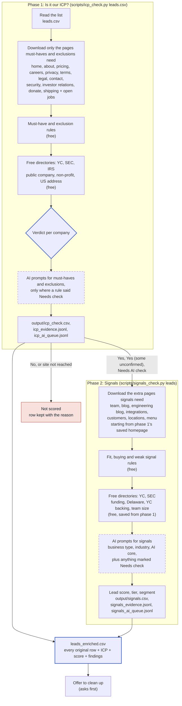

|  | Phase 1: ICP check | Phase 2: signals |
| --- | --- | --- |
| Runs on | Every company in the list | Only companies that passed phase 1 |
| Pages downloaded | 12 page types needed for must-haves and exclusions | 7 more page types, added to phase 1's pages |
| Rules | 4 must-haves, 6 exclusions | 21 fit, 14 buying, 12 weak signals |
| AI prompts | Only where a must-have or exclusion needs a check | About 10 to 20 per company |
| In the 14-company test | 6 prompts in total | About 15 prompts per company |

The phases come from the pipeline: phase 1 is that pipeline's must-haves and exclusions (hard stops), phase 2 the rest. F17 (several entities), for example, is phase 2 in product and a phase 1 hard stop in services. Each phase works on about 50 companies at the same time. Every row of your list ends up in the final file, in its original order.

**How one company flows** (free work first; phase 2 only for companies that can still be ICP YES, and it stops as soon as no answer can change the tier):

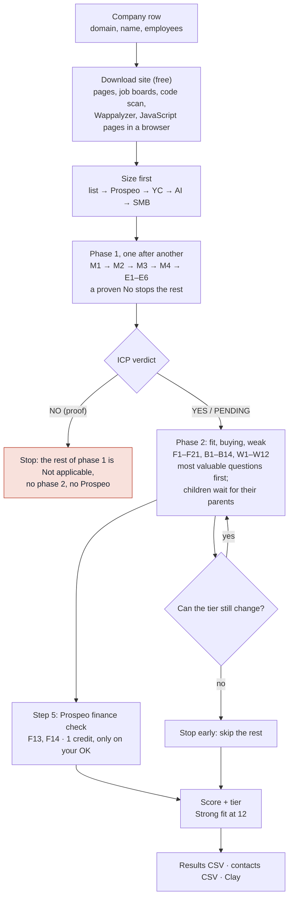

**To see every step for one company:** `python -m enrich trace acme.com` runs the whole flow for that company and stops after each step, showing what it received, found (with proof) and decided. `--ai` adds the AI steps (it shows the cost and asks first). The trace is saved as a Markdown report.

### 4.2 The waterfall per data point

Every data point is answered by the cheapest layer that can, and a layer only runs when the ones before it left the answer open:

| # | Layer | Cost | Strength |
|---|---|---|---|
| 1 | Rules on the scraped pages | free | proof from the company's own site |
| 2 | Free directories (YC, SEC, IRS, Internet Archive) | free | strong when tied to the domain or legal name |
| 3 | AI reading our saved pages (Claude through MCP, or OpenAI) | $0 through MCP; about $0.0008 a question with OpenAI | needs an exact quote |
| 4 | AI web search (job sites and LinkedIn posts included) | $0 through MCP; about $0.011 a search with OpenAI | needs a quote and a domain match to exclude |
| 5 | Provider: Prospeo, only the finance-person check (F13, F14) | 1 credit per company at most, only when you agree | team or finance-department search; the contacts go to `<list>_contacts.csv` |

**Each data point has its own waterfall file** in `config/datapoints/<group>/<name>.json`. Change a file to change how that data point is answered; the run still schedules everything together (pages downloaded once per company, free layers for all data points at once, AI questions in parallel, one provider call per company covering all its data points, and each data point stops at the first layer that confirms it).

| Setting | Values |
|---|---|
| `rules.on`, `directories.on` | `true` / `false` |
| `ai_pages.run` | `if_open` (still empty or Needs check), `if_clue` (only when a rule found a clue), `always`, `off`; optional `requires_page` (e.g. `team`) |
| `ai_web.run` | `after_pages` (when the page answer found nothing), `if_open` (whenever still open, also when the page answer was rejected), `if_clue` (only when the rules or the page answer saw a hint), `first` (web only), `off`; `when_site_unreached` (`true`: also for sites that couldn't be read) |
| `provider.run` | `if_open` / `off` |
| `run_if` (in `config/icps/<pipeline>/roles.json`, not in this file) | Conditional run between data points, e.g. `{"F1": ["yes"]}`: the paid steps run only when each parent's answer is one of the listed values; the data point waits while a parent still has a question, and is **Not applicable** when a parent ends on another value. Free proof already found is kept. The whole map: [Waterfall per data point](#69-waterfall-per-data-point) |

`python -m enrich datapoints` lists all 69 (57 + the services facts S1–S12); `python -m enrich datapoints --show M3` shows one. The waterfall and review views show each data point's settings and the file to edit. **The default for every data point with an AI question:** if the rules and directories leave it open, AI reads our pages (`ai_pages.run: if_open`); if it is still open after that, AI searches the web (`ai_web.run: if_open`). Sites that couldn't be read get no web search unless `when_site_unreached` is `true`. Change one file to make a data point differ.

**Opposites** (`opposites` in `config/icps/<pipeline>/roles.json`): when one data point is proven Yes, its opposite is No for free; the full list is in [Waterfall per data point](#69-waterfall-per-data-point).

Prospeo is switched on only for F13 and F14 today. It could cover: based in the US, fintech tools (from its technology data: Stripe, Gusto, Rippling, Deel, Mercury, Brex, Ramp, Carta, Pulley), open roles, public / non-profit, outside the US, funding stage and date, QuickBooks and NetSuite, headcount (company size) and industry. Then, for companies that pass, `people` finds decision-makers (founder or CEO first, then the finance lead), which also answers "Has a finance lead" and "No finance person visible". `python -m enrich waterfall acme.com` shows all five layers for each data point. Provider credits per month are capped by `PROVIDER_MONTHLY_CREDITS`, and responses are cached for 90 days (Prospeo doesn't charge again for those either).

### 4.3 What runs at the same time

Measured with `python -m enrich bench` on the 100-company lead list, free steps: 255 s before these changes, 93 s after, every answer the same or better.

| Level | At the same time |
|---|---|
| Companies | 50 at a time (`--workers`); through MCP `check_companies` up to 25, `enrich_list` 20 |
| Phases | Each company goes on to phase 2 as soon as its own phase 1 passes (free steps), instead of waiting for the whole list |
| Inside one company | Pages in parallel; the job boards and the payment-code scan side by side; the directories (YC, IRS, SEC, DNS, Wayback) all at once |
| Heavy CPU work | Wappalyzer's 7,600 fingerprints run in separate processes, so they never stall the downloads; the payment-code and job-board patterns only run on text that can match |
| Rules and directory lookups | A pool of 64 threads (the default had 14) |
| Chrome (JavaScript pages, bot checks) | **At most 3 pages at a time**, unchanged |
| OpenAI (bulk) | Starts at 8 calls at once, one more after every 20 without a rate limit (up to `--concurrency`, 24), halves on a rate limit. Phase 1 and phase 2 AI stay separate: each phase's cost is estimated and capped before anything is sent |
| Rate limits kept | SEC 8 per second and the Internet Archive 2 per second, shared by every thread |

Before these changes the CPU work ran on the event loop and blocked it for half of a run, so 31 of 100 companies hit the 90-second download limit and came back "site not reached"; now all of them are read.

### 4.4 What starts what

| When this happens | It triggers |
| --- | --- |
| You run phase 1 (`scripts/icp_check.py leads.csv`) | Steps 4.5 to 4.12 for the whole list |
| You run phase 2 (`scripts/signals_check.py leads`) | Steps 4.6 to 4.12 for companies phase 1 passed |
| The list folder doesn't exist yet | A new folder `lists/leads/` and a copy of your CSV |
| A company was already downloaded in this list | Downloading is skipped; the saved pages are reused |
| You add `--refresh` | Downloading runs again, even for cached companies |
| The homepage loads | The search for the page types the phase needs |
| Important pages are missing from homepage links | A sitemap check |
| Phase 1 pages are still missing after the sitemap | Common addresses are tried (`/pricing`, `/about`, `/careers`, `/privacy`, `/terms`) |
| A downloaded page links to a page that's still missing | One more level of downloading |
| A page links to Greenhouse, Lever, Ashby or Workable | That job board's free public feed is read |
| The homepage doesn't load | Downloading stops for that company; public DNS decides its status |
| A rule finds a clue but can't be sure | "Needs check", and that data point's AI prompt is added |
| The rules finish for a company | The free directories are looked up (once per company, then saved in the list) |
| A directory settles a Needs check or Unknown | That data point's AI prompt is dropped, so it isn't paid for |
| The rules already made the company a NO | The SEC lookup is skipped (YC and IRS are local files, so they still run) |
| You add `--no-directories` | The directories are skipped for that run |
| Phase 1 verdict is No or site not reached | The company is left out of phase 2 |
| Phase 1 verdict is Needs AI check | Included in phase 2, unless you add `--only-yes` |
| Phase 1's pages for a company were deleted | Phase 2 downloads that company again from scratch |
| Every company in a phase is done | Outputs are written, then the clean-up offer |
| You answer **y** to the clean-up question | Raw pages of companies that aren't ICP are deleted |
| You answer anything else, or there's no terminal | Nothing is deleted |
| You change a rule and run `rules leads` | Rules run again on saved pages, without downloading |
| A data point's parent (`run_if`) still has a question | The data point waits; it is asked in the next round |
| A parent ends on a value the child doesn't run on | The child is Not applicable: no AI, web search or Prospeo for it |
| A must-have is proven No, or an exclusion Yes | Every phase 1 data point still open is Not applicable |
| A data point is proven Yes | Its opposite is No for free |
| No open question can move the lead tier | The rest of phase 2 is skipped (stop when decided) |

### 4.5 Read the list

**Code:** [enrich/core/inputs.py](../enrich/core/inputs.py)

1. Finds the columns by name. Any of these work:
   - domain: Domain, Website, URL, Company Domain
   - name: Company Name, Company, Name
   - size: Employee Size, Employees, Headcount
2. Cleans every domain: `https://www.acme.com/about?x=1` becomes `acme.com`.
3. Checks each domain once. Duplicates and rows without a usable domain are still kept in the final list (see [Outputs](#411-outputs)).
4. Creates the list folder `lists/leads/` and copies your CSV into it as `input.csv`.

### 4.6 Download each website

**Code:** [enrich/sources/crawl.py](../enrich/sources/crawl.py) (`crawl` for phase 1, `crawl_more` for phase 2)

**Real-browser fallback:** when a homepage needs JavaScript to show its text, or shows a short "checking your browser" page, the site is read again with your installed Google Chrome (headless, at most 3 pages at a time), and every other page of that site is read the same way. Khan Academy went from 209 to 8,682 characters of text. Hard blocks (Cloudflare "Attention Required") usually stay blocked and are reported as such. `--no-browser` turns it off. Any downloaded page that comes back empty or with a placeholder ("Loading blog...") is opened again in the real browser and the rendered copy is kept; `python -m enrich render <list>` does it for lists downloaded before (free). Example: Argon AI's blog went from a placeholder to its 4 dated announcements.

**DNS fallback:** when this computer's DNS can't find a real domain, the address comes from public DNS (Google, then Cloudflare), with the usual certificate checks.

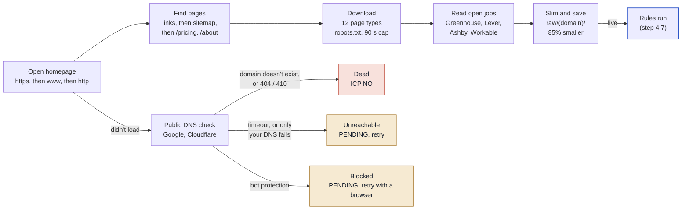

**Site status.** A site is only marked dead when public DNS also says the domain doesn't exist. In testing, the local router failed on 4 of 14 real domains; those stay PENDING instead of being failed.

| Status | Meaning | Effect |
| --- | --- | --- |
| Live | Homepage loaded | Rules run |
| Dead | Domain doesn't exist (confirmed by public DNS), or 404 / 410 | ICP = NO (no live website). In services, a coming-soon page or a 404 leaves M2 Unknown instead (see [M2](#m2-live-website-with-a-real-product-or-service)) |
| Blocked | Bot protection (Cloudflare and similar) | PENDING, retry with a real browser |
| Unreachable | Timeout, other error, or only your network's DNS fails | PENDING, retry later |

**Pages it looks for.** Phase 1 downloads the first group; phase 2 adds the rest. Pages that turn out to be the homepage again, or "not found" pages, are thrown away. If the team, careers, privacy, terms, legal or security page is still missing, the links on already-downloaded pages are followed one level deeper.

| Page | Phase | Used for |
| --- | --- | --- |
| About, Pricing, Careers, Contact | 1 | Location, paid pricing, checkout, hiring, job board link |
| Privacy, Terms, Legal, Security | 1 | Legal name, state of incorporation, tools used (vendor lists) |
| Investor relations, Donate, Shipping | 1 | Possible public company, non-profit, physical stock |
| Team | 2 | Team members, finance people |
| Blog, Engineering blog, Customers | 2 | Growth numbers, funding news, early adopter signs |
| Integrations | 2 | Tools the product connects to (kept apart from tools the company uses) |
| Locations, Menu | 2 | Local or physical business |

**Open jobs.** If any page links to a known job board, its free public feed is read: Greenhouse, Lever, Ashby and Workable give every open role with title, location, remote flag and full description. Rippling is detected only (which also proves they use Rippling). The full list of 13 boards and the careers-page fallback is in [Waterfall per data point](#69-waterfall-per-data-point).

**Saving.** Each page is slimmed before saving (styles, inline scripts, icons and unused code removed; text, links, script addresses and structured data kept). Pages are about 85% smaller and give the same rule results.

**Politeness and speed.** Follows each site's `robots.txt`, skips files over 3 MB, gives each company at most 90 seconds, and keeps at most 200 requests in flight. Measured in the 14-company test: 11 to 16 requests per site in phase 1 and about 5 more in phase 2; about 30 seconds for the whole list.

### 4.7 Apply the rules

**Code:** [enrich/checks/rules.py](../enrich/checks/rules.py). **Cost:** nothing, it's pattern matching on saved pages.

Each check gives one of four answers. Every Yes and No is saved with a short quote and the page it came from.

| Answer | Meaning | Effect |
| --- | --- | --- |
| **Yes** | Proof found | Counts |
| **No** | Proof of the opposite found. Never a guess, and never "nothing found" | Counts |
| **Needs check** | A clue, but not certain, or two sources disagree | That data point's AI prompt is added |
| **Unknown** | Nothing found, or only a guess | Never counts against the company. Left **empty** in the output columns |

Yes and No are only given when confirmed. A clue that points one way but isn't proof (for example "Inc." with California law in the terms, which many Delaware companies use) is a Needs check, never a No.

The checks run in this order, because later checks use earlier answers:

| \# | Check | Looks at |
| --- | --- | --- |
| 1 | Website | Live, parked, "coming soon", needs JavaScript |
| 2 | Location and entity | US address, governing law, legal name, entity type |
| 3 | Pricing and sales | Prices, checkout, app store, waitlist |
| 4 | Tools | Stripe, Gusto, Rippling, Deel, Mercury, Brex, Ramp, Carta, Pulley, Chase, Wise; competitors such as QuickBooks, Xero, NetSuite |
| 5 | Jobs | Number of roles; finance, ops, bookkeeper roles; remote |
| 6 | Funding | Stage on own site, investors, stock ticker, YC, Techstars |
| 7 | Non-profit | 501(c)(3), donations, government domain |
| 8 | Physical stock | Store platform, stock labels, shipping, print-on-demand |
| 9 | Business type | Accounting firm clues, local business, opening hours |
| 10 | Other fit signals (phase 2) | Growth numbers, early adopter, holding company, tax deadline |
| 11 | Must-haves | Combines the answers above into the four must-haves |
| 12 | Weak signals (phase 2) | e.g. LLC with no funding found |

**How the rules avoid false matches:**

| Situation | What the rule does |
| --- | --- |
| "Connect your Stripe account" | Integration wording, so **Needs check**, not Yes |
| "The payment processors we work with are: Stripe" | Real usage, so **Yes** |
| "VibeGrade (YC X25)" in a customer story | Not the company's own backing, so ignored |
| A YC partner listed as an angel investor | **Needs check**, not Yes |
| "QuickBooks" in a job post | The company uses it, so **Yes** |
| "QuickBooks" on the integrations page | Probably an integration, so only noted as "mentioned" |
| "Series A, B and C" in one sentence | Not a confirmed early stage, so **Needs check** |
| "Inc." in the footer but no Delaware law, or another state's law | **Needs check** (could still be a Delaware company); SEC can confirm it |
| The site says the company is shutting down ("Pulley is shutting down on 12/8/26") | Live website with a real product: **No** (it's not an operating business going forward) |
| "Series C or later, or public" still open after the free checks | The AI is asked in phase 1, for every company still in the running, with web search if needed. Linear's site never mentions funding; the web shows a Series C. If phase 2 later confirms a Series C or later round anyway, the final list marks the company PENDING |
| Only weak foreign clues (a .de domain, a foreign city, prices in euros) | **Needs check**. Outside the US only becomes proof with an official clue (foreign legal entity such as Ltd or GmbH, foreign governing law, or a foreign country in the site's structured data) plus another clue |

#### Free directories: YC, SEC, IRS

**Code:** [enrich/sources/directories.py](../enrich/sources/directories.py). **Cost:** nothing; no account or key needed.

Right after the rules, every company is looked up in three free official sources. A directory answer fills what the rules left open (Needs check or Unknown). When a strong directory match **disagrees** with the website (say the site's clues point to the UK but the YC directory says San Francisco), neither wins: the answer becomes Needs check with both proofs, and the AI step decides. The company is not made a NO on contested evidence. One exception: an IRS listing overrules the "it has Inc. in its name, so it's for-profit" guess, because many non-profits are incorporated.

| Directory | Matched by | Answers |
| --- | --- | --- |
| YC directory (about 6,300 companies; a daily copy of ycombinator.com/companies, refreshed weekly) | Website domain, and the YC entry's name must match the company and not be marked Acquired (Paribus's YC page points to ramp.com) | YC-backed, funded (YC invests in all), public, non-profit, US location (outside the US raises a Needs check), team size |
| SEC EDGAR (company search and company records) | Legal name from the company's own site | Public (stock ticker on a US exchange), raised private funding (Form D), Delaware corporation, US business address; with `SEC_CONTACT_EMAIL`, the Form D year of incorporation, entity type, previous names and amount raised |
| IRS Publication 78 (1.4 million tax-exempt organisations, refreshed monthly) | Legal name from the company's own site, plus the same state | Non-profit |

The DNS check (domain verification records, SPF senders, email provider) also runs in step 2.

**How strong a match has to be:**

| Match | When | Can do |
| --- | --- | --- |
| Strong | YC by domain; SEC or IRS by the legal name found on the company's own site (IRS also needs the same state, or a single organisation with that name in the US) | Anything, including making a company NO |
| Medium | The list's company name plus the same city or state as the site's address | Yes or No on fit signals; an exclusion only becomes a Needs check |
| Weak | The list's company name alone | Nothing, except an exclusion clue becomes a Needs check for the AI step |

Examples from the test list:

| Company | Found | Effect |
| --- | --- | --- |
| hubspot.com | SEC: HUBSPOT INC, NYSE: HUBS (legal name match) | Excluded as public. The site alone had missed it, so it used to pass |
| puzzle.io | SEC: Puzzle Financial Inc., Delaware, Form D 2021 and 2023 | Delaware C-Corp and venture-backed confirmed; score 9 to 15 |
| resend.com | YC Winter 2023, 45 people | Confirms YC backing and funding; team size for the segment if the list has none |
| linear.app | SEC: "Linear LLC", a housewares company in California (name only) | Weak match, ignored and not shown |

**Phase 2 adds old copies of the site** from the Internet Archive (free), only where they could show a change: for a company that is an "Inc." today (was it an LLC a year ago?) and one that publishes prices today (did it a year ago?). Only a real snapshot counts; "the Archive has no copy" proves nothing.

**Buying signals the free sources answer:**

| Signal | Proof |
| --- | --- |
| Raised money in the last 6 months | A Form D filed on SEC EDGAR in the last 183 days |
| New investor or accelerator | A YC batch in the last 12 months |
| Converted from an LLC to a C-Corp | SEC record renamed from "Acme LLC" to "Acme Inc" in the last 18 months, or the site's footer 6 to 18 months ago said LLC and says Inc. today |
| Incorporated in the last 12 months | Form D year of incorporation (needs `SEC_CONTACT_EMAIL`), with funding and a live product |
| Recently launched paid pricing | 6 to 18 months ago the pricing page had no prices, or the homepage had no pricing link; today it shows prices |
| Series C or later (exclusion) | A Form D for $100M+ in one offering (needs `SEC_CONTACT_EMAIL`) |

The rest (new subsidiary, QuickBooks complaints, board members, the accountant picking the tools) are web-search questions in phase 2's AI step.

Shared downloads live in `cache/` at the project root (git-ignored): the YC list (2 MB), the IRS list (29 MB, stored as name fingerprints) and saved SEC answers. Each list saves its own companies' findings in its `cache.sqlite`, so `rules` never looks them up again. `python -m enrich directories` shows what's downloaded; `python -m enrich directories acme.com --legal-name "Acme, Inc."` looks up one company.

SEC asks automated tools to include a contact email. Set `SEC_CONTACT_EMAIL` in `.env` (optional; lookups work without it). SEC allows 10 requests a second, and the tool stays at 8, which is about 3 lookups per company.

### 4.8 Decide the ICP verdict (phase 1)

The verdict is decided top to bottom. The first "yes" wins.

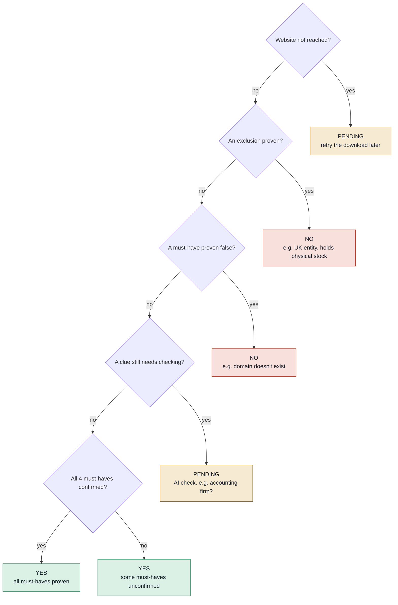

Must-haves are asked one after another (M1, then M2, M3, M4), then the exclusions, so a proven No stops the paid questions after it; the data points left open then show **Not applicable**.

"Unknown" never makes a company a NO; only proof does. A company still unconfirmed on some must-haves is a YES, as profile.yaml requires. With `website_optional: true` in roles.json (off in both pipelines since 2026-11-13), a company with no website and no must-have proven would be "Needs a call: no website" (PENDING).

### 4.9 AI: one prompt per data point, in two steps

**Code:** [enrich/ai/prompts.py](../enrich/ai/prompts.py) and the [config/prompts/](../config/prompts/) folder; [enrich/ai/runner.py](../enrich/ai/runner.py) calls OpenAI; [enrich/ai/apply.py](../enrich/ai/apply.py) turns answers into signal values. **Runs for:** companies that aren't a NO and whose site was reached. Through MCP the chat model answers the same questions instead ([section 7](#mcp-server-claude-code-claude-desktop)).

#### Running it

The AI step runs separately, after each phase, so you can see the cost first:

```bash
.venv/bin/python scripts/ai_check.py leads --phase icp       # after phase 1 (key from .env)
.venv/bin/python scripts/ai_check.py leads --phase signals   # after phase 2
```

**Two modes** (`--mode`, default in `config/prompts/_shared.json`):

| Mode | Step 1 (our pages) | Step 2 (web search) | Example: one ICP company in phase 2 |
| --- | --- | --- | --- |
| `accurate` (default) | One call per data point | One call per data point | 35 calls |
| `cheap` | Up to 5 data points of the company per call; page text sent once | Up to 5 web questions share one call and its searches | 8 calls |

Both modes use the same prompt files, rules and answer formats, and each data point still gets its own saved answer, so every check in this section applies to both. A grouped call's cost is split evenly across its data points. The estimate before a run shows both modes. To check the cheap mode on your own companies: `python -m enrich copy leads leads_cheap`, `scripts/ai_check.py leads_cheap --mode cheap` (both phases), then `python -m enrich compare leads leads_cheap` lists every answer that differs.

Phase 2 also asks the signals only web search can answer (recent funding, new investor, QuickBooks complaints...): 9 web searches per ICP company, about $0.10 to $0.30. `--no-search-signals` skips them; those buying signals then stay empty.

1. It counts the companies and prompts still unanswered and shows an estimated cost, then **asks before sending anything** (`--yes` skips the question).
2. It runs about 8 AI calls at the same time, with a live view of calls, tokens, cost and the latest answers.
3. Each answer is saved in `cache.sqlite`. A stopped run picks up where it left off, and re-running the rules keeps the answers.
4. The verdicts, scores and the final list are recalculated. For example, a company marked PENDING as a possible accounting firm becomes YES if the AI finds it sells software, or NO if it confirms bookkeeping services.

Models and prices are set in `providers.openai` in `config/prompts/_shared.json`: `gpt-4o-mini` for both steps ($0.15 per 1M input tokens, $0.075 cached, $0.60 output; web search $10 per 1,000 searches). The prompts and the page text each one needs are also written to `icp_ai_queue.jsonl` and `signals_ai_queue.jsonl` for inspection.

#### Prompt files

Every AI question lives in its own JSON file, one per data point (62 in total). Shared rules for all of them are in `config/prompts/_shared.json`.

| Folder | Files | Phase |
| --- | --- | --- |
| `must_haves/` | 4, e.g. `based_in_us.json` | 1 |
| `exclusions/` | 6, e.g. `nonprofit_or_government.json` | 1 |
| `fit/` | 21, e.g. `uses_stripe_billing.json` | 2 |
| `buying/` | 13, e.g. `raised_last_6_months.json` | 2 |
| `weak/` | 12, e.g. `pre_revenue.json` | 2 |
| `fields/` | 4: vertical, segment, legal entity type, competitors used | 2 |
| `output/` | 2: reasoning (with the funding stage line), fit message | after scoring |

Every file has the same sections:

| Section | What it holds |
| --- | --- |
| `data_point`, `group`, `weight` | What is being decided and how much it counts |
| `run_when` | The condition that triggers this prompt |
| `input` | Which saved pages step 1 reads |
| `prompt` | `task`, `definition`, `yes_when`, `no_when`, `unknown_when`, `watch_out_for`, `where_to_look` |
| `output` | The exact JSON the AI must return (answer, confidence, quote, source, reason) |
| `web_search` | Step 2: when it runs, search queries with company variables, good sources |
| `examples` | Sample text and the correct answer |

#### Which prompts a company gets

**AI is only used for what scraping, the rules and the lookups didn't answer.** After the list below is built, a final filter drops every question whose answer the free checks already confirmed (Yes or No), plus company size when your list or the YC directory gives a headcount, and legal entity type when it's known. The one exception: when SEC or YC proves a company is funded but nothing free shows the stage, the funding question is still asked, for the stage only. No pipeline asks AI questions about data points worth 0 points in it (services: funding, AI, YC and the like).

| Trigger | Prompts added |
| --- | --- |
| Every company in phase 2 (judgement calls no formula can make) | Startup selling nationally, B2B SaaS, Local professional services, Billed labour, Vertical, AI core, Manufacturing, Heavy invoicing |
| A rule returned **Needs check** | That data point's prompt (e.g. Accounting firm, Non-profit, Uses Stripe) |
| Location unclear | Based in the US |
| Funding unknown, or funding proven but stage unknown | Venture-backed stage |
| Entity type unknown | Legal entity type |
| No headcount from your list or the YC directory | Segment (company size) |
| Team page found | No finance person visible, Finance lead present |
| Phase 2, buying signals the free sources left open | Raised in 6 months, new investor, LLC to C-Corp, incorporated recently, new subsidiary, QuickBooks complaints, launched pricing, board member, accountant picks tools (web search) |
| Competitor tools mentioned | Competitor tools used |

#### Two steps: our data first, then the internet

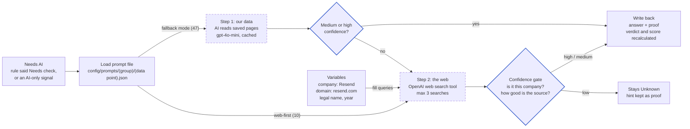

| Variable | Filled with | Example |
| --- | --- | --- |
| `{company}` | Company name from your list | Resend |
| `{domain}` | Cleaned domain from your list | resend.com |
| `{legal_name}` | Legal name found in phase 1, else the company name | Resend |
| `{year}`, `{last_year}` | Current and previous year | 2026, 2025 |

Example query for "Venture-backed": `"Resend" raises seed OR "Series A" OR "Series B"`.

| Web search mode | When step 2 runs | Data points |
| --- | --- | --- |
| `fallback` | Only if step 1 found nothing or only low confidence | 47 (e.g. Delaware C-Corp, venture-backed, accounting firm, headcount) |
| `primary` | Always; step 1 is skipped because the answer normally only exists on the web | 10 (e.g. raised in the last 6 months, new board member, QuickBooks complaints) |
| `off` | Never; the web can't prove it | 5 (live website, no finance person visible, no fintech tools, reasoning, fit message) |

**Is it the same company?** Many companies share names, so step 2 reports an entity match: `domain` (a source mentions the domain), `name_and_location`, `name_only` (unreliable for common names) or `none`.

| Confidence | Means | Counts? |
| --- | --- | --- |
| High | The source clearly states it in words (the quote shows it), with a domain match, not older than about 2 years. Any source type: news, the company, an official record | Yes, including making a company NO |
| Medium | Clearly stated, but matched only by name and location or founders | Yes, but can't make a company NO |
| Low | Only implied or indirect, name-only match, old information, or sources disagree | No; stays Unknown, kept as a hint |

On top of these, these checks apply to every AI answer (in [enrich/ai/apply.py](../enrich/ai/apply.py)):

| Check | Why |
| --- | --- |
| A Yes or No needs an exact quote as proof; without one it stays empty | In testing, the AI called a bootstrapped consultancy "venture-backed (estimated)" with no quote at all |
| "The text doesn't mention X" is never a No | The AI answered "not Series C" for companies whose pages simply didn't mention funding |
| An estimated funding stage is shown in "Funding stage" but earns no points | Only a confirmed stage counts toward the score |
| "Recent" signals (raised in 6 months, new investor, LLC to C-Corp, incorporated, launched pricing, board member) are decided by the date in the AI's own quote: Yes needs a dated, matching event inside the window | The AI found "closed a $45M Series B on 4/17/2026" and still said "not in the last 6 months"; it also called "the pricing page shows three tiers" a recent launch |
| A confirmed recent round sets the funding stage | Mintlify's site says Seed; its April 2026 round is a Series B |
| "Series C or later" needs the proof in the quote: the round letter, an IPO or listing, or one round of $100M+ / a $1B+ valuation. A tender offer is not a round | For Linear the AI quoted a "$99 million tender offer"; the deciding words came later in the same quote ("alongside our Series C at a $1.25 billion valuation") |
| The funding stage and "Venture-backed, pre-seed to Series B" must agree: a stage of Series C or later makes it No | Linear was given +3 for pre-seed to Series B while its stage read "Series C or later" |
| A tool named in a list of customers isn't a tool the company uses | "40,000 companies (including OpenAI, Coinbase, and Ramp)" was read as "uses Ramp cards" |
| A company size estimate needs a headcount in the quote, and can't be below the number of open roles | "31 open roles" was read as "15 people" |

Step 2 never runs for a company that's already a NO, phase 2's AI only runs on companies phase 1 (with its AI answers) hasn't ruled out, and each call is capped at 3 searches. The rules are in `config/prompts/_shared.json` (`two_steps`, `web_search_step`); each data point's queries and good sources are in its own file.

#### How a message is built

| Part | Content | Same for every call? |
| --- | --- | --- |
| System | Role, ground rules (no ICP description: the questions ask for facts, the same for every pipeline) | Yes |
| Context | Company, today, facts code already proved, page text | Yes, for all prompts of one company, so it's cached after the first call |
| Instruction | One data point's sections, examples and JSON schema | No, changes per data point |

Passing in the facts code already proved stops the AI from contradicting them.

### 4.10 Lead score (phase 2)

**Code:** [enrich/checks/scoring.py](../enrich/checks/scoring.py). **Weights:** the pipeline's scoring.json ([product](../config/icps/product/scoring.json), [services](../config/icps/services/scoring.json)), editable without touching code. This section describes the product scoring; the services points per signal are in [section 5](#5-the-icp-models).

Each signal answered Yes adds points by its weight in profile.yaml. Needs check, Unknown and Not applicable add nothing.

| Weight | Points |
| --- | --- |
| High | +3 |
| Medium | +2 |
| Low | +1 |
| Weak fit signal | \-2 |

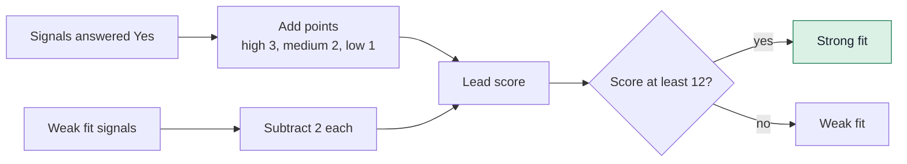

Profile rules built into the score:

- **Segment** from the employee count in your list: 1 to 5 SMB, 6 to 25 MM, 26+ ENT; on a boundary the lower band; SMB if missing. When the list has no count: the Prospeo headcount (if already bought), then the YC team size, then the AI estimate, then SMB.
- "No finance person visible" counts medium for SMB, low for MM and not at all for ENT. "Has a finance lead" counts only for MM and ENT.
- A company is either a startup selling nationally or a local professional services firm, never both. A local services firm isn't also penalised for being local.

The two real scores from the 14-company test:

| Company | Score | Tier | Breakdown |
| --- | --- | --- | --- |
| linear.app | **21** | Strong fit | Stripe +3, Delaware C-Corp +3, Paid pricing +3, Several open roles +2, Growth numbers +2, Remote-first +2, Early adopter +2, Hiring +2, Tax deadline +2 |
| resend.com | **15** | Strong fit | Venture-backed +3, Stripe +3, Paid pricing +3, YC +2, Remote-first +2, Tax deadline +2 |

```
linear.app  ██████████████████████████████████████████ 21
resend.com  ██████████████████████████████             15
            0          6          12         18         24
                                   ↑ Strong fit cut-off
```

Scores are lower than they will be: "Startup selling nationally" and "B2B SaaS" (3 points each) wait on the AI step. Signals the AI decides count 0 points until the AI step has run for that phase, so scores straight after the free checks are lower than final ones.

### 4.11 Outputs

```
lists/leads/output/
  leads_enriched.csv       the main file: every original row and column + ICP, score and findings
                           (leads_product_enriched.csv for the product pipeline)
  icp_check.csv            phase 1: one row per company, the verdict and why (YES first)
  signals.csv              phase 2: one row per ICP company, its signals (most signals first)
  icp_evidence.jsonl       phase 1: every answer with its quote and page link
  signals_evidence.jsonl   phase 2: every answer with its quote and page link
  icp_ai_queue.jsonl       phase 1: prompts waiting for AI, with the page text they need
  signals_ai_queue.jsonl   phase 2: the same for signals
  evaluation.csv           after `evaluate`: every disagreement with the right answers, with our proof
  leads_contacts.csv       after `people` or Prospeo: decision-makers, one row per person
```

**The main file,** `leads_enriched.csv`**,** is your list exactly as you gave it (same rows, order and columns), with findings added on the right. It's rewritten after each phase.

| Added column | Example |
| --- | --- |
| Pipeline | Services or Product |
| ICP | YES, NO or PENDING |
| ICP status, Why | "All 4 must-haves confirmed"; "Mainly operates outside the US: foreign legal entity: API Hero Ltd." |
| Reasoning | A short summary in plain words, ending with the profile's line, e.g. "Funding stage: Seed (confirmed)". Values: Pre-Seed, Seed, Series A, Series B, Series C or later, Bootstrapped, Unknown; basis: confirmed, estimated, not found. Built by code, no AI cost |
| Lead score, Lead tier | 21, Strong fit (or Not ICP, or "Not scored: website not reached (retry)") |
| Score breakdown | Uses Stripe for billing +3; Delaware C-Corp +3; Several open roles +2; ... |
| Segment, Segment based on | ENT, "120 employees from the list" |
| Fit / Buying / Weak fit signals found | Plain lists of the signals answered Yes |
| Found in directories | "YC: Winter 2023, Active, 45 people"; "SEC (strong match on legal name): Puzzle Financial Inc., incorporated in Delaware, Form D 2023, 2021" |
| Website, legal entity, funding, partners, competitors, open roles, prices | The facts found |
| Route, Arrival, Value angle (services only) | See [Routes and value angle](#routes-and-value-angle) |
| One column per data point | "Fit: Uses Stripe for billing" = Yes |

| Special row | What you'll see |
| --- | --- |
| Duplicate domain | Same findings as the first row, plus "Duplicate of row N" |
| No usable domain | ICP = NO, "Domain is empty or not a valid domain" |
| Website not reached | ICP = PENDING, retry later |
| Possible exclusion waiting for AI | ICP = PENDING, scored with "(pending AI check)" |

### 4.12 Storage and clean-up

Every list gets its own folder, so lists never mix. A company that's in two lists is stored in both (pages hard-linked from the shared company cache, see [Architecture](#414-architecture)).

```
lists/leads/
  input.csv               copy of your list
  raw/<domain>/           slim pages (*.html.gz) + jobs.json.gz
  cache.sqlite            answers and proof for both phases (compressed), results per pipeline
  runs.jsonl              run log: when, what, counts, AI cost (`python -m enrich runs leads`)
  status.json             options of a list started through the API
  output/                 the files in 4.11
```

Shared by all lists: `cache/` with the free directory downloads (about 31 MB, refreshed automatically).

About 85 KB of pages and 4 KB of results per company; roughly 4 GB of pages and 200 MB of results for 50,000 rows, less after clean-up.

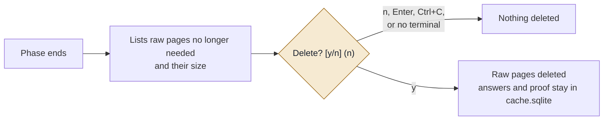

| Option | What's offered for deletion |
| --- | --- |
| `--keep useful` (default) | Companies phase 1 marked NO |
| `--keep none` | All raw pages in the list |
| `--keep all` | Nothing, no question asked |
| `--yes` | Deletes without asking (only for scheduled runs) |

After deletion, `rules` keeps that company's earlier result; `--refresh` downloads it again. If phase 2 needs a company whose pages were deleted, it downloads it again automatically.

### 4.13 What the terminal shows

Each phase has a live dashboard (the numbers below are an illustration, not a real run).

```
┌ Phase 1, is it ICP?  leads ─────────────────────────────────────────┐
│ Download pages   ████████████░░░░  812/1,200   12.4 sites/s         │
│ ICP rules        ███████████░░░░░  790/1,200   AI needed 140        │
└─────────────────────────────────────────────────────────────────────┘
┌ Running totals ─────────────────────────────────────────────────────┐
│ Sites live 701   Dead 48   Blocked / unreachable 39 / 24            │
│ Is it ICP?  Yes 210  Yes (some unconfirmed) 251  Needs AI check 140 │
│             No 151  Unknown: site not reached 63                    │
│ Must-haves  US ✓540  Live ✓701  Fintech ✓388  Sales ✓602             │
│ Exclusions  Outside US 61/40  Non-profit 12/30  Holds stock 18/22    │
└─────────────────────────────────────────────────────────────────────┘
┌ Latest companies ───────────────────────────────────────────────────┐
│ linear.app   Yes             ✓ ✓ ✓ ✓   Delaware C-Corp   31         │
│ puzzle.io    Needs AI check  ✓ ✓ ✓ ✓   -   Accounting firm?         │
│ trigger.dev  No              ✗ ✓ · ✓   Non-US entity   Outside US   │
└─────────────────────────────────────────────────────────────────────┘
```

Phase 2 shows the same progress bars, then running counts of fit, buying and weak signals and partners, and per company its fit, buying and weak counts, funding, open roles and number of AI prompts. Both phases end with a summary table, the output files and disk use.

### 4.14 Architecture

**In one paragraph:** every data point (69 of them: 57 + the services facts S1–S12) is answered by a waterfall of five layers, cheapest first: rules on the company's website, free official directories, AI reading the website, AI web search, and a data provider. A layer only runs while the data point is still open, and every answer must pass the same quality rules (proof required, guesses never count, official sources over inferences). Each data point's waterfall is a small settings file, so how a data point is answered can be changed without touching the code. The engine runs all companies and data points together, so the website is downloaded once, free layers answer everything they can at no cost, and paid layers only get what is left.

| Part | What it does | Where |
|---|---|---|
| Waterfall engine | Runs a company through the layers in order and combines their answers with one set of quality rules | `enrich/engine/` (`layers.py`, `merge.py`, `resolve.py`) |
| Layer 1: rules | Pattern checks on the scraped pages | `enrich/checks/rules.py` |
| Layer 2: free directories | YC, SEC, IRS, Internet Archive | `enrich/sources/directories.py`, `history.py` |
| Layers 3 and 4: AI | Questions about the pages, then web search; answers checked for proof | `enrich/ai/` |
| Layer 5: provider | Prospeo company data and people | `enrich/providers/` |
| Each data point's settings | Which layers run for it and when | `config/datapoints/` |
| Which pipeline runs | Each data point's group, weight, conditional runs and opposites in the chosen pipeline | `enrich/core/icp.py`, `config/icps/` |
| Collecting the website | Pages, job boards, real browser and DNS fallbacks | `enrich/sources/crawl.py` |
| Verdict, score, final list | ICP YES / NO, lead score, tier, reasoning | `enrich/engine/merge.py`, `enrich/checks/scoring.py`, `enrich/pipeline/final.py` |
| Ways in | Terminal, API, MCP, Clay | `enrich/__main__.py`, `enrich/integrations/` |

**Adding a data point:** a settings file in `config/datapoints/`, a prompt in `config/prompts/`, its role in each pipeline's `roles.json`, and optionally a rule. **Adding a provider:** a module in `enrich/providers/` and its entry in `enrich/engine/layers.py`.

Built for Puzzle at up to about 50,000 rows a month on one machine. Every piece below works the same whether the tool is run from the terminal, the API or MCP, and all of them can run at the same time.

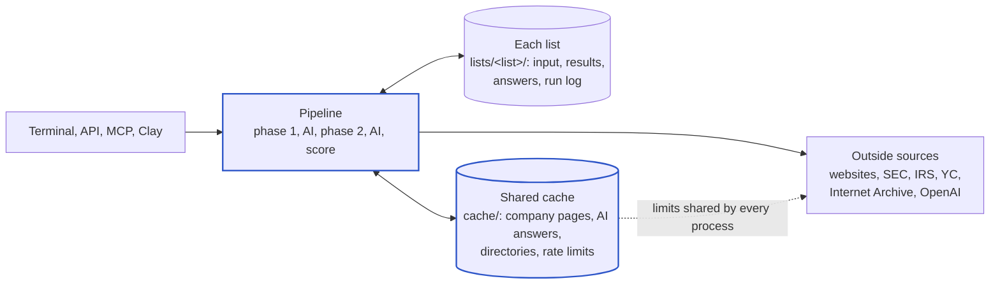

| Piece | What it does | Where |
|---|---|---|
| One company cache for all lists | A company in several lists is downloaded and AI-checked once. Pages are hard-linked into each list (no extra disk); AI answers are reused only when made with the same prompt version and still fresh: pages 30 days, answers from pages 60, web answers 30, "recent" signals 14 (`SHARED_*_DAYS` in `.env`). `--refresh` skips it; `SHARED_CACHE=off` turns it off | `enrich/core/shared.py`, `cache/companies/`, `cache/ai_answers.sqlite` |
| Shared rate limits | SEC (8 a second) and the Internet Archive (2 a second) are limited across every process on the machine, so the terminal, API and MCP together stay inside them. The Archive steps aside for 2 minutes after repeated refusals instead of slowing every company | `enrich/core/ratelimit.py`, `cache/ratelimits.sqlite` |
| Version stamps | Every result records the rules version and every AI answer its prompt version, so a changed prompt is never answered from an old cache entry | `enrich/core/versions.py` |
| Jobs that survive restarts | Lists started through the API keep their options in `status.json`; when the server starts it carries on with any list left queued or running, using the caches for work already done | `enrich/integrations/service.py` |
| Cost controls | Per request: `max_cost_usd` (API) or the cost question (terminal). Per month: `AI_MONTHLY_BUDGET_USD` across everything. `python -m enrich usage` shows the month | `enrich/core/usage.py` |
| Data folder | `DATA_DIR` in `.env` moves all lists and caches to another folder or disk | `enrich/core/paths.py` |

**What stays simple on purpose:** one process per command, SQLite files (one per list, plus the shared ones), files on disk. At this volume they are fast and need no upkeep.

**Next steps when needed:**
1. **Docker** (no server needed): the same code as containers on this Mac (API, workers, browser) with one command.
2. **A server** (Fly.io, Render or AWS): the same containers, so Clay can call the API row by row.
3. **Postgres and a job queue**, only if volume grows well past 50,000 rows a month or several machines are needed. The storage and caches are kept behind small modules so this is a contained change.

---

## 5. The ICP models

The product model and its points (high 3, medium 2, low 1, weak -2, Strong fit at 12) are in [Lead score](#410-lead-score-phase-2), with each signal's product weight in the [Quick reference](#62-quick-reference). This section covers the services model (the default) and how it was decided.

### Roles

Every signal has one role in the services pipeline. The role decides what the signal does to a company.

| Role | What it means | Effect |
|---|---|---|
| **Must-have** | Something every customer needs. All 4 must be proven. No working website (parked, coming-soon, 404, dead) is a No in both pipelines: cold outreach skips leads without a website. | All 4 proven: ICP YES (if no hard stop). One proven No: ICP NO. Not proven yet: PENDING. |
| **Hard stop** | Something that makes the company a poor fit for the services offer. | Proven Yes: ICP NO, with the reason. Unknown never stops a company. |
| **Fit signal** | The company looks like a good customer. | Adds points: +3 (high), +2 (medium) or +1 (low). |
| **Buying signal** | Something suggests they need help now (timing). | Adds points: +3, +2 or +1. |
| **Weak signal** | The company is a weaker fit, but not ruled out. | Takes 2 points off. |
| **0 points** | Checked and shown to sales, but does not change the score. | No points. Some change the Route, e.g. "Does its own books" goes to Platform + MCP. |

How it adds up:

- Only signals proven Yes count. Unknown or not found is 0, never a minus.
- Fit, buying and weak signals are scored only for companies that are ICP YES.
- Lead score = points from fit and buying signals, minus 2 for each weak signal. 12 or more is a Strong fit.
- "Too big for services" is one hard stop with three triggers: Series D or later (S6), 100 or more people (S7), or already on NetSuite with a finance team (W10). In the output they are one rule: the exclusion reason reads "Too big for services (<the check>): <proof>" (`reason_groups` in `config/icps/services/roles.json`).
- The services hard stops: accounting firm (E3), outside the US (E4), non-USD books (W6), manufacturing (W7), sole proprietorship or partnership (S1), and "too big" (S6, S7, W10). Holding stock (E6), non-profit (E5), marketplace (S2), several US companies (F17) and a new subsidiary (B8) are weak signals (-2, check on the call): the cold-outreach decision of 2026-11-13 ([9.7](#97-cold-outreach-test-on-82-real-leads-2026-11-13)).
- Pre-launch companies (a waitlist or coming-soon page) don't fail M2 or M4 (`soft_musts` in roles.json): they pass as "Yes (pre-launch)", get outreach priority C and the route "Pre-launch: Expert Review or Platform + MCP". A parked, for-sale, shut-down or non-resolving domain is still a hard No.
- **Outreach priority** (scoring.json `outreach_priority`): A at a lead score of 6 or more, B at 3 or more, else C; pre-launch and no-website leads are C. It is the order to contact approved leads in.
- The services weights score the situation, not the startup profile: a failed bookkeeper, a tax deadline, investor updates and an audit are high; funding, AI and YC count 0.
- Weights and the Strong-fit cut-off are kept as set (2026-11-13). They can be recalibrated with `calibrate` when labelled companies exist. The decisions are listed under `provisional` in `config/icps/services/roles.json`.

### Services signals by category

Role: Must-have, Hard stop, +3/+2/+1 (fit or buying signal), -2 (weak signal), 0 (checked, no points). Hard stops marked "too big" are the three "Too big for services" triggers.

#### Location and legal entity

| ID | Signal | Role |
|---|---|---|
| M1 | Based and operating in the US | Must-have |
| E4 | Mainly operates outside the US | Hard stop |
| F3 | Delaware C-Corp | +3 (fit) |
| S1 | Sole proprietorship or partnership | Hard stop |
| W4 | LLC or sole owner, no venture funding | 0 |
| F17 | Runs several US companies | Hard stop |
| B8 | Registered a new subsidiary | Hard stop |
| B6 | Converted from an LLC to a C-Corp | 0 |
| B7 | Incorporated in the last 12 months | 0 |
| W6 | Needs more than one currency | Hard stop |

#### Type of business

| ID | Signal | Role |
|---|---|---|
| M2 | Live website with a real product | Must-have |
| F6 | B2B SaaS or tech-enabled service | +3 (fit) |
| F7 | Local professional services firm | +3 (fit) |
| F10 | AI is core to the product | 0 |
| F5 | Startup selling nationally | 0 |
| W1 | Serves one local area | 0 |
| W2 | Sells hours of labour, not a product | 0 |
| W3 | Physical or single-location business | 0 |
| E3 | Accounting or bookkeeping firm | Hard stop |
| E5 | Non-profit or government body | Hard stop |
| E6 | E-commerce holding physical stock | Hard stop |
| W7 | Manufacturing or hardware | Hard stop |
| S2 | Marketplace | Hard stop |
| W9 | Shopify store without stock | -2 |

#### Revenue and payments

| ID | Signal | Role |
|---|---|---|
| M4 | Real transaction activity | Must-have |
| S9 | Takes payments through several processors | +2 (fit) |
| S10 | Subscription or membership revenue | +2 (fit) |
| F8 | Publishes real paid pricing | 0 |
| B12 | Recently launched paid pricing | 0 |
| F15 | Publishes revenue or growth numbers | +1 (fit) |
| W5 | Not making money yet | -2 |
| W8 | Heavy invoicing and bill-paying | -2 |

#### Finance tools

| ID | Signal | Role |
|---|---|---|
| M3 | Uses a fintech tool Puzzle connects to | Must-have |
| F2 | Uses Stripe for billing | +1 (fit) |
| F4 | Uses QuickBooks Online | +1 (fit) |
| F9 | Payroll on Gusto, Rippling or Deel | +3 (fit) |
| F19 | Banks with Mercury or Brex | +1 (fit) |
| F20 | Uses Ramp or Brex cards | +1 (fit) |
| F21 | Cap table in Carta or Pulley | +1 (fit) |
| S11 | Uses field-service or construction software | +2 (fit) |
| F18 | Early adopter | 0 |
| W10 | Already on NetSuite or similar | Hard stop (too big) |
| W11 | Accountant picks the tools | -2 |
| W12 | No fintech tools, spreadsheets and a traditional bank | -2 |
| B11 | Complaining about QuickBooks | +1 (buying) |

#### Funding, stage and age

| ID | Signal | Role |
|---|---|---|
| F1 | Venture-backed, pre-seed to Series B | 0 |
| F11 | YC or similar accelerator | 0 |
| B1 | Raised money in the last 6 months | +3 (buying) |
| B2 | New investor or accelerator | 0 |
| B13 | New board member or investor updates | +3 (buying) |
| E1 | Series C or later, or public | 0 |
| S6 | Series D or later, or public | Hard stop (too big) |
| E2 | New company, no website, no funding | -2 |
| S12 | In business 10 or more years | +1 (fit) |

#### Size and team

| ID | Signal | Role |
|---|---|---|
| S7 | 100 or more people | Hard stop (too big) |
| S8 | 50 to 99 people | -2 |
| F13 | No finance person visible (up to 25 people) | +2 (fit) |
| F14 | Has a finance lead (mid-size and up) | 0 |
| F16 | Remote-first or hybrid | 0 |
| F12 | Several open roles | +1 (fit) |

#### Hiring

| ID | Signal | Role |
|---|---|---|
| B3 | Hiring for several roles | +1 (buying) |
| B4 | Hiring a finance lead | +2 (buying) |
| B5 | Hiring ops or chief of staff | +2 (buying) |

#### Books and bookkeeping

| ID | Signal | Role |
|---|---|---|
| S3 | Books behind or messy | +3 (buying) |
| S4 | Looking for bookkeeping help | +3 (buying) |
| S5 | Does its own books, DIY (routes to Platform + MCP) | 0 |
| B9 | Lost or replacing a bookkeeper | +3 (buying) |
| B10 | Tax deadline coming up | +3 (buying) |
| B14 | Preparing for a first audit | +3 (buying) |

### Routes and value angle

The services output adds three columns, from proven facts:

| Column | Values |
|---|---|
| Route | Catch-Up, then Full Service (books behind) · Full Service (looking for help, or a failed bookkeeper) · Platform only (does its own books) · Qualify on the call (nothing proven yet) · Partner referral (hard stop) · Firm ICP (accounting firm) · Retry (site not reached) · Not ICP |
| Arrival | Reactive (books behind, a failed bookkeeper, a tax deadline or an audit) · Proactive (just raised or newly formed) · empty when not known |
| Value angle | The opening line for outreach, picked from the strongest proof (a reliable replacement, Catch-Up, deadline-ready, investor-ready, accountability for DIY, or the default outcome line) |

Examples: "Qualify on the call: Full Service or Expert Review", "Platform + MCP", "Partner referral"; value angle "Clean monthly closes across processors, subscriptions, refunds and deferred revenue". Real estate and legal companies pass; their Route tells sales to ask how and by whom the books are handled.

Partners and competitors are filled for every company that was read, ICP NO included. Rho counts as a partner and fintech tool; Gradient and Minerva are competitors (only in an accounting context). The one Prospeo search per company (1 credit) ranks the buyers first: founder, owner or CEO, then the finance person, then COO, chief of staff or operations.

### Changing the model

The model lives in config files, not code, so a change is usually one line. After a change, `python -m enrich rules <list> --phase both` re-scores saved lists in seconds for free.

| To change | File |
| --- | --- |
| Points per signal (high 3, medium 2, low 1) | config/icps/services/scoring.json |
| Must-haves, hard stops and which signals count | config/icps/services/roles.json |
| Customer types and the profile text | config/icps/services/profile.yaml |
| How one data point is found | config/datapoints/ |

To check the weights against real results, label companies Puzzle already knows are good or bad fits and run `python -m enrich calibrate` ([section 8](#calibrate-the-services-pipeline-calibrate)). It suggests weights and changes nothing until you add `--apply`.

### The services (operator) decisions

Source of truth for the services ICP: the updated Notion ICP page (Oct 22–23, 2026) and Alexey's thread. This was written as a plan before the build ([build stages](#95-build-plan-for-the-services-pipeline)); it maps that ICP onto the lead scoring model.

The change is more than a re-weighting. The founder (product) model rewards a funded early-stage startup. The operator ICP rewards an **operator who wants the bookkeeping done for them**, so several signals flip direction.

#### What changed

|  | Founder ICP (product) | Operator ICP (services) |
| --- | --- | --- |
| Who | Early-stage, venture-backed founders | Founders up to Series C and SMB owners who want the work off their plate |
| What we sell | The platform | Services (Full Service, Catch-Up, Expert Review) plus the platform |
| What decides fit | Funding stage, modern startup profile | **The situation:** books behind or a provider failed them, wants to hand the work off, can pay |
| Funding | High-weight fit signal | Context only, not intent |
| Early-stage companies | Core target | Scored lower, not blocked |
| LLCs and S-Corps | Penalised (W4) | Qualify; C-Corps are still the clearest fit |
| First lanes | SaaS, AI, fintech | **SaaS and professional services** |

Why: early-stage founders mostly want to do their own books and rarely become services customers. Operators who already have real books to deal with want to hand the work off (Alexey's analysis of 500 sales calls: 69% of help-seekers had books behind, against 18% of DIY buyers).

#### What still fits as it is

- **The engine:** the waterfall per data point, the proof rules, conditional runs, the MCP and OpenAI paths, the learning loop and the speed work all stay unchanged.
- **Must-haves:** M1 (US-based), M2 (live product) and M4 (real activity) still apply. M3 (reachable source data) still applies; only its tool list changes (Rho added; Chase was already there).
- **Exclusions:** E3 (accounting firm), E4 (outside the US) and E6 (holds stock) are still hard stops.
- **Signals that keep their meaning, with a new weight:** B9 (left a bookkeeper), B10 (tax deadline), B14 (audit), B13 (investor reporting), F9 (payroll), F13 (no finance person), B5 (hiring ops or chief of staff).

#### The planned changes

**Hard stops: new exclusions (routed to a partner referral)**

| New ICP disqualifier | In product | Change |
| --- | --- | --- |
| Sole proprietorship or partnership | Part of W4 (weak) | New exclusion. LLCs and S-Corps are no longer penalised |
| Non-USD or multi-currency books | W6 (weak, −2) | Becomes an exclusion |
| More than one entity | **F17 is a fit signal (+2), B8 a buying signal (+2)** | Both flip to exclusions |
| Inventory or physical goods | E6 covers holding stock | Widen to physical goods; decide about W7 (manufacturing) |
| Marketplaces | Not covered | New exclusion |
| Over $500K monthly expenses | Not covered | Not public, so it needs a proxy: about 50+ people, Series D or later, or NetSuite with a finance team |
| Series C or later (E1) | Exclusion | "Up to Series C" needs one answer: is Series C itself in or out? |
| New company, no website, no funding (E2) | Exclusion | Becomes "no activity yet": anti-ICP, scored down, not blocked |

**Score up**

| From Alexey's "score up" list | In product | Plan |
| --- | --- | --- |
| Books behind or messy | Nothing | **New data point.** Mostly found in job posts (a "catch-up bookkeeper" role) or public posts asking for help |
| Needs tax filing | B10 (medium, calendar rule) | Raise it, and add stated filing needs |
| Preparing for investors or a raise | B13 and B14 (low) | Raise to high |
| Just left a bookkeeper or firm | B9 (medium) | High: 34% of help-seekers against 7% of DIY buyers |
| Asking for help, willing to hand it over | Nothing | **New data point:** hiring a bookkeeper or accountant (contract or part-time), or posting "looking for a bookkeeper" |
| Budget | Nothing | A proxy: payroll (F9, raised to high), 6–25 people, published revenue (F15) |
| Payroll | F9 (medium) | High: 41% of help-seekers against 22% of DIY buyers |
| Professional services is a first lane | F7 medium; W1 and W2 penalise it | F7 up to high; drop W2, and probably W1 and W3 |

**Score down**

| From Alexey's "score down" list | In product | Plan |
| --- | --- | --- |
| DIY types | Nothing; **F10 (AI core) and F18 (early adopter) score up** | Flip both. New DIY signal: AI, MCP or API workflows for their own books, a finance-literate founder (CPA), "we do our own books" |
| No activity yet | W5 (weak) | Keep; absorbs E2 |
| Brand-new company | B7 (+2) | Flip to neutral or down: 28% of DIY buyers against 6% of help-seekers. It stays positive only when they want managed finance from day one |
| Owner with an accountant they trust | W11 (weak) | Keep |
| Early-stage | F1 (+3), B1 and B2 (+3) | F1 becomes "operating company up to Series C", any funding or bootstrapped, low weight. B1 and B2 become low |

**Lower or change the startup signals**

- **Lower:** F2 Stripe (it becomes part of the reachable stack); F4 QuickBooks Online (context only); F8 paid pricing, F11 YC, F12 open roles, F16 remote; F19–F21 kept low, as part of the reachable stack.
- **Change:** F3 becomes "C-Corp (any state) high; LLC or S-Corp qualifies"; F5 and F6 stay as the SaaS lane; B11 (QuickBooks complaints) becomes context; B6 and B12 become low or none.

**The other profile sections**

- **Segments:** keep 1–25 employees as a hypothesis. Add the $500K monthly-expense ceiling (through the proxy) and note that $10K–$50K a month is the sweet spot.
- **Verticals:** SaaS and professional services are the first lanes. Other verticals are marked "qualify the workflow first".
- **Partners:** add Rho. The accelerators matter less now.
- **Competitors:** add Gradient, Minerva and Kick (AI-native firms selling the outcome). Pilot, Bench and freelancers become signals of a provider that failed.
- **Value proposition:** rewrite it around the outcome: current, dependable books without owning the work.

**New output columns:** Route (Full Service, Catch-Up, Expert Review, Platform only, or Partner referral, taken from the ICP's routing table), Arrival (reactive: something broke; or proactive: delegating early), and Contacts (Prospeo): search the buyer titles (founder, owner, CEO, COO, chief of staff, operations or finance lead), not only the finance person; still 1 credit per company.

**How to roll it out**

1. Rewrite the services `profile.yaml` from the Notion page, which stays the source of truth.
2. Change the data points: add about 5 (books behind, wants help, DIY signal, sole proprietorship or partnership, marketplace), flip about 6, re-weight the rest in `scoring.json`.
3. Update the prompts, rules, conditional runs, the data point reference and the workflow page.
4. Review only the new and changed data points by hand, the same way as the original 57.
5. **Calibrate on real outcomes:** run the model on Alexey's 152 coded companies (help / DIY / review) and the 17 closed-won services deals. Tune the weights and the Strong-fit cut-off until help-seekers score above DIY buyers. This is the first labelled set we have.
6. Re-run the lead list, compare the tiers before and after, and post the change to the team.

#### Questions and answers

| Question | Answer |
|---|---|
| 1. **Series C:** is it in ("up to and including") or out? | **Decided (2026-11-03): in, up to and including Series C.** Series D and later, and public companies, are excluded (S6). E1 is info only |
| 2. **The $500K expense ceiling:** is a proxy acceptable (50+ people, Series D or later, NetSuite with a finance team)? | **Decided (2026-11-03): the proxy as built.** A hard stop only on strong proof (NetSuite with a finance team, Series D or later, or 100+ people); 50–99 people scores down (S8). In the output S6, S7 and W10 are one rule ("Too big for services") |
| 3. **Nonprofits, real estate, legal:** keep excluding nonprofits, or route them for a closer look? | **Nonprofits stay excluded** (audit-specific scoping). **Real estate and legal pass, neutral, marked "qualify the workflow first"** |
| 4. **Early-stage weight:** a fixed penalty, or just no points from funding? | **No points from funding, no fixed penalty.** Score down only on real signals: no activity yet, brand-new with no history, DIY signals |
| 5. **AI-native founders:** score them down as likely DIY, or keep them neutral? | **A small score-down only with a DIY signal** (doing their own books with AI, MCP or API). An AI product on its own is neutral |
| 6. **Labelled data:** can we get the domains for the 152 coded companies and the closed-won deals, so we can calibrate? | **Ask Alexey for the domains.** Without them the services weights are guesses. The 152 companies are shared |

Answers 3–5 are by Alexey on 2026-11-07. Only one pipeline runs at a time (services by default), so there is no "best route" question.

#### Alexey's answers and customer types (November 2026)

Young companies lose no points for being young, and AI companies lose none either: with Puzzle's MCP they can do the books with their own agent. So S5 is info in services (shown, routes to "Platform + MCP", no points off) and a raise in the last 6 months (B1) scores high (budget for help). Real estate and legal companies pass; Route tells sales to ask how and by whom the books are handled (the Vertical field has Real Estate & Property, Legal and Construction & Field Services). For his three customer types, S9–S12 were added as free code rules, Yes only (a missed widget never makes a No); fit in services, info in product: several payment processors (subscription and online education businesses), subscription or membership revenue, field-service or construction software (specialty contractors), and 10 or more years in business. Definitions: [Services facts](#68-services-facts-s1s12).

---

## 6. Data point reference

This section goes through every item in the ICP profile one by one and explains how we find the answer. It covers four groups, plus the services facts:

1. [Must-haves](#63-must-haves): a company has to meet all of these
2. [Exclusions](#64-exclusions): any one of these knocks a company out
3. Strong fit signals: these add points ([fit signals](#65-fit-signals) and [buying signals](#66-buying-signals))
4. [Weak fit signals](#67-weak-fit-signals): these take points away but never disqualify
5. [Services facts (S1–S12)](#68-services-facts-s1s12): added for the services ICP

Groups 1 and 2 are checked in **phase 1** (is it our ICP?). Groups 3 and 4 are checked in **phase 2**, only for companies that passed phase 1. The groups and weights below are the product pipeline's; how each data point counts in services is in [section 5](#services-signals-by-category).

**Where each part lives:**
- the code rules: [enrich/checks/rules.py](../enrich/checks/rules.py)
- the AI prompt for each data point: [config/prompts/](../config/prompts/), one JSON file each
- the points per signal: [config/icps/product/scoring.json](../config/icps/product/scoring.json) and `config/icps/services/scoring.json`

The short codes (M1, E3, F12...) are only used here and in the code, to match each signal to its rule. Output files and the terminal use plain names.

### 6.1 How to read this section

Every check answers **Yes**, **No**, **Needs check** or **Unknown**, or is **Not applicable** when a data point it depends on rules it out (no paid step runs; it scores nothing; see [Waterfall per data point](#69-waterfall-per-data-point)). Yes and No only when confirmed by proof; a guess is Needs check or Unknown, and Unknown is left empty in the output columns. Unknown never counts against a company ([Apply the rules](#47-apply-the-rules)). For each signal the methods are tried from cheapest to most expensive, stopping at the first clear answer:

| Method | What it means | Cost |
|---|---|---|
| **Code** | Pattern matching on the website's pages and source code | Free |
| **Directory** | Looking the company up in a free public list we've downloaded | Free |
| **AI read** | AI reads our saved pages (step 1 of the AI step) | Low |
| **Search** | AI searches the web with the company name and domain (step 2, only if step 1 found nothing); confidence rules in [AI: one prompt per data point](#49-ai-one-prompt-per-data-point-in-two-steps) | Medium |
| **Paid data** | A paid service such as Clay, Crunchbase or Apollo | Varies |

**Directories (built):** the YC directory, SEC EDGAR and the IRS non-profit list are checked for every company right after the code rules. They only fill answers the code left open, and only when the match is tied to the company's own site; [Free directories](#free-directories-yc-sec-irs) has the matching rules.

Each signal below lists:

- **Weight:** how many points it's worth (high = 3, medium = 2, low = 1, all adjustable)
- **Yes when:** what proof we need
- **No when:** what proof rules it out (if anything can)
- **How we check:** the methods, in the order we try them
- **Watch out for:** common mistakes to avoid

### 6.2 Quick reference

| # | Signal | Group | Weight | Main method | Fills a column? |
|---|---|---|---|---|---|
| M1 | Based and operating in the US | Must-have | | Code | |
| M2 | Live website with a real product | Must-have | | Code | |
| M3 | Uses a fintech tool Puzzle connects to | Must-have | | Code | partners |
| M4 | Real transaction activity | Must-have | | Code | |
| E1 | Series C or later, or public | Exclusion | | Directory, Search | funding_stage |
| E2 | New company, no website, no funding | Exclusion | | Code, Directory | |
| E3 | Accounting or bookkeeping firm | Exclusion | | AI read | |
| E4 | Mainly operates outside the US | Exclusion | | Code | |
| E5 | Non-profit or government body | Exclusion | | Directory, Code | entity_type |
| E6 | E-commerce holding physical stock | Exclusion | | Code, AI read | |
| F1 | Venture-backed, pre-seed to Series B | Fit | High | Directory, Search | funding_stage, partners |
| F2 | Uses Stripe for billing | Fit | High | Code | partners |
| F3 | Delaware C-Corp | Fit | High | Code, Directory | entity_type |
| F4 | Uses QuickBooks Online | Fit | High | Code (job posts) | competitors |
| F5 | Startup selling nationally | Fit | High | AI read | |
| F6 | B2B SaaS or tech-enabled service | Fit | High | AI read | vertical |
| F7 | Local professional services firm | Fit | Medium | AI read | vertical |
| F8 | Publishes real paid pricing | Fit | High | Code | |
| F9 | Payroll on Gusto, Rippling or Deel | Fit | Medium | Code (job posts) | partners |
| F10 | AI is core to the product | Fit | Medium | AI read | vertical |
| F11 | YC or similar accelerator | Fit | Medium | Directory | partners |
| F12 | Several open roles | Fit | Medium | Code (job boards) | |
| F13 | No finance person visible | Fit | Medium / Low / none | AI read, Paid data | |
| F14 | Has a finance lead (mid-size and up) | Fit | Medium | Paid data, AI read | |
| F15 | Publishes revenue or growth numbers | Fit | Medium | Code, Search | |
| F16 | Remote-first or hybrid | Fit | Medium | Code | |
| F17 | Runs several US companies | Fit | Medium | Search, Paid data | |
| F18 | Early adopter | Fit | Medium | Code, Directory | |
| F19 | Banks with Mercury or Brex | Fit | Low | Code, Search | partners |
| F20 | Uses Ramp or Brex cards | Fit | Low | Code, Search | partners |
| F21 | Cap table in Carta or Pulley | Fit | Low | Code, Search | partners |
| B1 | Raised money in the last 6 months | Buying | High | Directory, Search | funding_stage |
| B2 | New investor or accelerator | Buying | High | Directory, Search | partners |
| B3 | Hiring for several roles | Buying | Medium | Code (job boards) | |
| B4 | Hiring a finance lead | Buying | Medium | Code (job boards) | |
| B5 | Hiring ops or chief of staff | Buying | Medium | Code (job boards) | |
| B6 | Recently became a Delaware C-Corp | Buying | High | Code (old snapshots), Paid data | entity_type |
| B7 | Incorporated in the last 12 months | Buying | Medium | Directory, Paid data | |
| B8 | Added a new company or subsidiary | Buying | Medium | Paid data, Search | |
| B9 | Lost or replacing a bookkeeper | Buying | Medium | Search, Code | |
| B10 | Tax deadline coming up | Buying | Medium | Calendar | |
| B11 | Complaining about QuickBooks | Buying | Medium | Search | competitors |
| B12 | Recently launched paid pricing | Buying | Medium | Code (old snapshots) | |
| B13 | New board member or investor updates | Buying | Low | Search | |
| B14 | Preparing for a first audit | Buying | Low | Code (job posts), Search | |
| W1 | Serves one local area | Weak | | Code, AI read | |
| W2 | Sells hours of labour, not a product | Weak | | AI read | |
| W3 | Physical or single-location business | Weak | | Code, AI read | |
| W4 | LLC or sole owner, no venture funding | Weak | | Code | entity_type |
| W5 | Not making money yet | Weak | | Code, AI read | |
| W6 | Needs more than one currency | Weak | | Code | |
| W7 | Manufacturing or hardware | Weak | | AI read | |
| W8 | Heavy invoicing and bill-paying | Weak | | AI read | |
| W9 | Shopify store without stock | Weak | | Code | |
| W10 | Already on NetSuite or similar with a full finance team | Weak | | Code, Paid data | competitors |
| W11 | An outside accountant picks their tools | Weak | | Search | |
| W12 | No fintech tools at all | Weak | | Code | |
| S1 | Sole proprietorship or partnership | Services hard stop | | Code, AI read, Search | |
| S2 | Marketplace | Services hard stop | | Code, AI read | |
| S3 | Books behind or messy | Services buying | High | Code (job posts), Search on a clue | |
| S4 | Looking for bookkeeping help | Services buying | High | Code (job posts), Search on a clue | |
| S5 | Does its own books (DIY) | Services info (routes to Platform + MCP) | | Code | |
| S6 | Series D or later, or public | Services hard stop | | Code (from E1's proof), AI read, Search | |
| S7 | 100 or more people | Services hard stop | | List count, Prospeo, YC | |
| S8 | 50 to 99 people | Services weak | | List count, Prospeo, YC | |
| S9 | Takes payments through several processors | Services fit | Medium | Code (payment scan, Whop links) | |
| S10 | Subscription or membership revenue | Services fit | Medium | Code (billing tools, pricing page) | |
| S11 | Uses field-service or construction software | Services fit | Medium | Code (widgets and links) | |
| S12 | In business 10 or more years | Services fit | Low | Code (the company's own words) | |

### 6.3 Must-haves

**The rule:** a company passes if **none of the four is a confirmed No**. A company with all four as Yes is strongest. A company with some Unknowns still passes. We record how many were confirmed so you can sort by confidence.

#### M1. Based and operating in the United States

- **Yes when:** a US address appears on the site (footer, contact page, privacy policy), or the terms of service name a US state's law, or an official filing lists a US address.
- **No when:** the only address is outside the US and the company clearly runs from there. This shares its evidence with exclusion E4.
- **How we check:**
  1. **Code:** look for US addresses (state name or abbreviation plus a 5-digit ZIP code), +1 phone numbers, prices in dollars and "laws of the State of ..." in the terms.
  2. **Directory (built):** the business address on the company's SEC record, and the HQ location in the YC directory. A YC location outside the US only raises a Needs check.
  3. **AI read:** the about and contact pages, if the code found nothing clear.
  4. **Paid data:** headquarters country from Clay or Apollo.
- **Watch out for:** a US company with an offshore team still passes. A remote company with no address shown is Unknown, not No.

#### M2. Live website with a real product or service

- **Yes when:** the site loads, has several real pages and describes something people can buy or use.
- **No when:** the domain doesn't load, is parked, is listed for sale, shows only a "coming soon" page, or the company says on its own site that it's shutting down. The same in services since 2026-11-13 (`website_optional: false`): cold outreach skips leads without a website. A waitlist on a real site is not "no website": that is pre-launch (M4), which passes in services.
- **How we check:**
  1. **Code:** does the domain resolve and load? We check for known parked-page and for-sale templates (GoDaddy, Sedo, HugeDomains and similar), count the pages and measure how much real text there is.
  2. **AI read:** "Does this site describe a real product or service a customer can buy or use?"
- **Watch out for:** if a domain redirects to another domain, follow it and note the new address. A site that blocks bots isn't a dead site. Retry it with a full browser before marking it No.

#### M3. Uses at least one fintech tool Puzzle connects to

The tools: Mercury, Brex, Ramp, Stripe, Gusto, Rippling, Deel, Pulley, Rho and Chase business banking.

- **Yes when:** we find proof the company itself uses one of these.
- **No when:** almost never provable. We leave it Unknown rather than guess.
- **How we check:**
  1. **Code:** Stripe scripts in the page code (`js.stripe.com`), Stripe checkout links, the list of vendors in the privacy policy, and job posts mentioning Gusto, Rippling or Deel benefits. A careers page hosted on Rippling's job board also counts.
  2. **Search:** "company name" plus each tool name, for case studies and blog posts.
  3. **Paid data:** a tech-stack lookup (BuiltWith or Wappalyzer).
- **Watch out for:** "Connect your Stripe account" on a product page means their product **works with** Stripe. It doesn't prove the company **pays with** Stripe. The AI checks the wording when the only match is on an integrations page.
- **Also fills:** the `partners` column for every tool confirmed.

#### M4. Real transaction activity

- **Yes when:** any one of these is found:
  - published paid pricing
  - a working checkout
  - an app store listing with paid plans
  - open job postings (which means payroll)
- **No when:** nothing can be bought and there are no jobs, **and** the site shows clear signs of being pre-launch (a waitlist only, "coming soon").
- **How we check:**
  1. **Code:** prices on the pricing page, checkout links (Stripe, Paddle, Chargebee, Shopify checkout), app store links. We pull open jobs from the company's job board.
  2. **Directory:** Apple App Store search shows whether the app has paid plans.
  3. **AI read:** the pricing page, if prices are shown in an unusual format.
- **Watch out for:** a donation page, membership fee or event ticket doesn't count as transaction activity (the profile says so directly).

### 6.4 Exclusions

**The rule:** an exclusion only applies with **real proof**. A guess, an estimate or missing information never excludes a company. Each exclusion we apply records the exact proof in `exclusion_reason`.

#### E1. Raised Series C or later, or publicly traded

- **Exclude when:** there's a confirmed Series C or later round, an IPO or a public statement saying so.
- **How we check:**
  1. **Directory (built):** SEC EDGAR shows a stock ticker on a US exchange (company matched by the legal name on its own site), or the YC directory lists the company as public. This caught HubSpot (NYSE: HUBS), which the site alone missed.
  2. **Code:** look on the site for words like "Series C", "Series D" or "NASDAQ" / "NYSE" plus a ticker.
  3. **Search:** "company name Series C" and "company name IPO", read by AI to confirm.
  4. **Paid data:** funding rounds from Crunchbase, if connected.
- **Watch out for:**
  - Looking big or polished isn't proof.
  - The total amount raised (for example from Form D filings) isn't proof of a round's name. It can only give an estimated stage, and estimates never exclude.
  - A subsidiary of a public company gets flagged for review instead of being excluded automatically.

#### E2. New company with no live website and no disclosed funding

- **Exclude when:** all three are confirmed: the domain is dead or parked, no funding shows up anywhere, and the company is newly formed.
- **How we check:**
  1. **Code:** the result from M2. Is the site dead or parked?
  2. **Directory (built):** a Form D filing on SEC EDGAR is disclosed funding, so the answer becomes No.
  3. **Paid data:** incorporation date (OpenCorporates), if available.
- **Watch out for:** in practice, a dead domain already fails M2. This exclusion mostly makes the reason clearer in the output.

#### E3. Accounting firm, bookkeeping practice or fractional CFO firm

- **Exclude when:** the company **sells** accounting, bookkeeping, tax or outsourced finance **services**.
- **How we check:**
  1. **Code:** look for words like "CPA", "bookkeeping services", "fractional CFO", "outsourced accounting" or "tax preparation" in the page title, homepage headline and services pages. This only flags the company for the next step.
  2. **AI read:** "Is this company itself an accounting, bookkeeping or fractional CFO firm?"
- **Watch out for:** a company that makes **software** for accountants isn't an accounting firm. A business that mentions its own accountant isn't one either.

#### E4. Mainly operates outside the US, or reports in a currency other than dollars

- **Exclude when:** the headquarters and main operations are clearly abroad, or the company only prices in non-US currency.
- **How we check:**
  1. **Code:**
     - a foreign address with no US address
     - a foreign legal ending (Ltd, GmbH, SAS, Pty, BV) together with a foreign address
     - prices only in EUR, GBP, INR and similar currencies
     - a country domain (such as .de or .in) together with a site in that country's language
  2. **Directory (built):** a YC directory location outside the US raises a Needs check for the AI step; it never excludes on its own.
  3. **AI read:** "Where is this company based and where does it mainly operate?"
  4. **Paid data:** headquarters country.
- **Watch out for:** many founders from abroad set up a Delaware "Inc." with a US headquarters. Those pass. A US company that also prices in euros for its EU customers also passes.

#### E5. Non-profit, charity, foundation, religious group, membership association or government body

The profile is strict here: this exclusion depends on **what the company is**, never on who its customers are or which words appear on its site.

- **Exclude when** one of these is true:
  - our entity type check returns "Non-profit"
  - there's direct proof of the company's own tax-exempt status: a 501(c)(3) or charity registration number, a tax ID shown for tax-deductible donations, or a published annual report or Form 990
  - the site's main call to action is to donate or volunteer, and nothing commercial is for sale
- **How we check:**
  1. **Directory (built):** the IRS list of tax-exempt organisations (Publication 78, 1.4 million entries), matched by the legal name on the company's site plus the same state, and the YC non-profit flag. A match on the list's company name alone only raises a Needs check. An IRS listing overrules the "Inc. means for-profit" guess, because many non-profits are incorporated (Khan Academy Inc.).
  2. **Code:** "501(c)(3)", "tax-deductible", "EIN" near donation wording, and a donate button in the main menu. Government domains (.gov, .mil) are excluded straight away.
  3. **AI read:** "Is this organisation itself a non-profit, or a for-profit company that serves non-profits?"
- **Watch out for:**
  - Donor CRMs, fundraising platforms and grant software are **not** excluded, even if "non-profit" appears on every page.
  - A Public Benefit Corporation is a for-profit company and is **not** excluded.

#### E6. E-commerce or retail business that holds physical stock

- **Exclude when** we see proof such as:
  - a store selling physical goods
  - stock or "sold out" labels
  - shipping and returns policies for physical items
  - a warehouse or fulfilment address
  - jobs in supply chain, inventory or fulfilment
- **How we check:**
  1. **Code:**
     - the store platform (Shopify, WooCommerce, BigCommerce)
     - product data built into the page code, which often states "in stock" or "out of stock" directly
     - "add to cart" buttons
     - shipping and returns pages
  2. **Code (job posts):** warehouse, fulfilment or inventory roles.
  3. **AI read:** "Does this company hold physical stock that it sells?"
- **Watch out for:** these are **not** excluded:
  - digital goods
  - subscriptions and memberships
  - software
  - services booked online
  - print-on-demand (Printful and Printify are easy to spot in the code)
  - dropshipping

  If we can't tell whether they hold stock, we don't exclude. Shopify stores without stock score as weak signal W9 instead.

### 6.5 Fit signals

Strong fit signals add points. The profile splits them into **fit signals** (what kind of company it is) and **buying signals** (something happening right now that creates a reason to buy).

General rule from the profile: check the company's own site first (homepage, about, pricing, careers, blog, footer, privacy policy, terms), then job posts, press, accelerator and investor pages, Product Hunt and app stores.

#### F1. Venture-backed at pre-seed, seed, Series A or Series B (high)

- **Yes when:** we confirm a round at one of these stages, **or** the company clearly looks like a venture-backed startup based on several clues. Clues include team size, open roles, product maturity, published pricing and press coverage. In that case the stage is marked "estimated".
- **How we check:**
  1. **Directory (built):** an SEC Form D filing (raised private funding; the filing dates are shown) or a YC listing (YC invests in every company it backs). Neither shows the stage, so the AI still estimates the stage for the funding stage line. Form D amounts are not read yet.
  2. **Code:** investor logos or "backed by" text, and phrases like "our seed round" on the about and team pages.
  3. **Search:** funding announcements and press.
  4. **AI read:** if there's still no direct proof, estimate the stage from the clues and say which clues were used.
  5. **Paid data:** Crunchbase funding rounds.
- **Output:** every company gets a final line in its reasoning, in exactly this format: `Funding stage: <value> (<basis>)`.
  - `<value>` is one of: Pre-Seed, Seed, Series A, Series B, Series C or later, Bootstrapped or Unknown.
  - `<basis>` is one of: confirmed, estimated or not found.
- **Watch out for:**
  - "Unknown (not found)" and "Bootstrapped (confirmed)" are different answers. Only use Bootstrapped when we have proof they took no venture money.
  - The reasoning must never say a company falls short because its funding couldn't be found.

#### F2. Uses Stripe for billing (high)

- **Yes when:** Stripe appears in the page code, at checkout, or in the privacy policy's list of vendors.
- **How we check:**
  1. **Code:** `js.stripe.com` in the source, `checkout.stripe.com` or `buy.stripe.com` links, "Stripe" in the privacy policy or terms.
  2. **AI read:** the privacy policy, if the wording is unclear.
- **Watch out for:** the same mistake as M3. A product that "integrates with Stripe" doesn't prove the company bills with Stripe.

#### F3. Delaware C-Corp (high)

- **Yes when:** the legal name ends in "Inc." **and** the terms name Delaware law, **or** an official filing says Delaware.
- **How we check:**
  1. **Code:** the legal name in the footer (for example "© 2025 Acme, Inc."), "laws of the State of Delaware" in the terms, and the company name in the privacy policy.
  2. **Directory (built):** the state of incorporation on the company's SEC record. It's only used to confirm Delaware, never to rule it out, because the field can be out of date (HubSpot's record says New York). The developer's legal name on the Apple App Store would help too (not built).
  3. **AI read:** the legal and company information pages.
  4. **Paid data:** OpenCorporates.
- **Output:** also fills `entity_type` with exactly one of: Delaware C-Corp, Other US C-Corp, LLC, Public Benefit Corporation, Non-US entity, Non-profit or Unknown.

#### F4. Uses QuickBooks Online (high)

- **Yes when:** a job post asks for QuickBooks experience, or the company says publicly that it uses QuickBooks.
- **How we check:**
  1. **Code (job posts):** search open jobs, especially finance and ops roles, for "QuickBooks" or "QBO".
  2. **Search:** "company name QuickBooks".
- **Watch out for:**
  - Rarely visible, but decisive when it is.
  - A product that **integrates with** QuickBooks doesn't mean the company **uses** it.
- **Also fills:** the `competitors` column. The same check also catches Xero, NetSuite, Wave, Zoho Books, Bench, Pilot and the other competitors listed in the profile.

#### F5. Startup selling nationally, not a small local business (high)

The profile calls this the most important single signal. It can't fire together with F7.

- **Yes when:** the text clearly states a software or tech product the company sells (software counts as selling nationally; no proof of customer locations is needed), **or** a services firm states customers beyond its own city.
- **No when:** it sells its own staff's hours in one area, as an agency, consultancy, contractor, clinic or single-location business does, and states no software product.
- **Services firms** never count on assumption: they need stated proof of customers beyond their city.
- **How we check:**
  1. **Code (clues only):**
     - Points toward a startup: self-serve plans on a pricing page, "sign up" or "start free trial" buttons, app store links.
     - Points toward a local business: a "locations" or "areas we serve" page.
  2. **AI read:** the homepage, pricing page and any locations page, asking "Is this a scalable product sold nationally, or local services?"

#### F6. B2B SaaS or a tech-enabled service sold beyond one city (high)

- **Yes when:** the company sells software or a tech-based service to businesses anywhere in the country.
- **How we check:**
  1. **AI read:** the homepage and pricing page. This is usually easy to read.
- **Also feeds:** the `vertical` column.

#### F7. Local professional services firm (medium)

Marketing or creative agencies, IT or managed-service shops, staffing firms and consultancies serving one city. These do convert, so they get a smaller positive score.

- **Yes when:** the company sells billed labour in one metro area.
- **How we check:** the same AI read as F5. Each company gets F5 or F7, never both.
- **Note:** if F7 fires, the weak signals W1 and W2 are skipped, so the company isn't penalised twice.

#### F8. Publishes real paid pricing (high)

- **Yes when:** named plans with prices are shown.
- **No when:** the pricing page only says "Contact us".
- **How we check:**
  1. **Code:** dollar amounts next to words like "month", "year", "seat" or "user" on the pricing page, plus product price data in the page code.
  2. **AI read:** pricing shown in images or unusual layouts.

#### F9. Runs payroll on Gusto, Rippling or Deel (medium)

- **How we check:**
  1. **Code (job posts):** benefits sections that mention these tools, and careers pages hosted on Rippling's job board.
  2. **Search:** "company name Gusto", "company name Rippling" and so on.
- **Also fills:** `partners`.

#### F10. AI or machine learning is core to their own product (medium)

- **How we check:**
  1. **AI read:** "Is AI the main thing the product does, or just a feature mention?"
- **Watch out for:** almost every site says "AI" now, so keyword matches alone don't count.

#### F11. Backed by Y Combinator or a similar accelerator (medium)

- **How we check:**
  1. **Directory:**
     - built: the YC company list (about 6,300 companies, refreshed weekly from a daily copy of YC's official directory), matched by website domain. It also gives the batch, team size and HQ location
     - not built yet: Techstars, 500 Global and a16z speedrun portfolio pages
  2. **Code:** "Backed by Y Combinator" badges, or the YC batch shown on the site.
  3. **Search:** press about the accelerator.
- **Also fills:** `partners` (Y Combinator, Techstars).

#### F12. Active careers page with several open roles (medium)

- **Yes when:** 3 or more open roles. This threshold can be changed.
- **How we check:**
  1. **Code:** find the job board (Greenhouse, Lever, Ashby, Workable, Rippling) and count roles using its free public feed. If the careers page is self-hosted, count the job links on it.

#### F13. No dedicated accounting or finance person visible (medium for SMB, low for MM, not scored for ENT)

- **Yes when:** we looked at a real list of the team, and no one has a finance or accounting title.
- **How we check:**
  1. **AI read:** the team page, listing names and titles.
  2. **Paid data:** a people search on the company (Prospeo; Clay or Apollo) for finance titles.
- **Watch out for:** if there's no team page and no people data, the answer is Unknown, not Yes. We need to have actually looked at a team list. Having a finance person is never a negative for mid-size or larger companies.

#### F14. Has a Controller, Head of Finance or finance team, at mid-size and larger companies only (medium)

- **How we check:**
  1. **Paid data:** people search for finance titles.
  2. **AI read:** the team page.
- **Note:** only scored for MM and ENT. Not used for SMB.

#### F15. Publishes revenue, customer count or growth numbers (medium)

- **How we check:**
  1. **Code:** phrases like "$X ARR", "X,000 customers" or "grew X%" on the about page, homepage and blog.
  2. **Search:** press releases and funding announcements.

#### F16. Remote-first or hybrid (medium)

- **How we check:**
  1. **Code:** "remote", "remote-first", "distributed" or "hybrid" on the careers page and in job posts.

#### F17. Runs several US companies under the same owner (medium)

Holding companies, real estate portfolios and startup studios.

- **How we check:**
  1. **Code:** words like "a portfolio company of", "Holdings" or several company names in the footer or legal pages.
  2. **Paid data:** OpenCorporates, to find other companies at the same address or with the same officers.
  3. **Search:** "company name subsidiary" or "holding company".
- **Watch out for:** this is hard to find. Expect it to be Unknown for most companies.

#### F18. Early adopter (medium)

Product Hunt launches, an engineering blog, or public writing about the tools they use.

- **How we check:**
  1. **Code:** links to Product Hunt, a `/blog/engineering` or similar page, and "built with" or "our stack" posts.
  2. **Directory:** Product Hunt listing.

#### F19. Banks with Mercury or Brex (low)

- **How we check:**
  1. **Code:** job posts, "how we work" posts and partner badges.
  2. **Search:** "company name Mercury".
- **Note:** the profile says this is rarely public. Unknown is the expected answer.

#### F20. Uses Ramp or Brex for company cards (low)

- **How we check:** same approach as F19.

#### F21. Cap table managed in Carta or Pulley (low)

- **How we check:**
  1. **Code:** job posts ("equity managed in Carta") and investor pages.
  2. **Search:** press releases.

### 6.6 Buying signals

#### B1. Raised money in the last 6 months (high)

Includes seed extensions, bridge rounds and SAFEs, not only priced rounds.

- **How we check:**
  1. **Directory (built):** a Form D filed in the last 183 days. A filing is due within 15 days of the first sale, so it's strong, free proof.
  2. **Search:** funding news from the last 6 months.
  3. **Code:** a recent "we raised" blog post or press page.
  4. **Paid data:** Crunchbase.

#### B2. New investor or accelerator has appeared (high)

- **How we check:**
  1. **Directory (built):** a YC batch in the last 12 months. Other accelerator portfolios are not built yet.
  2. **Search:** recent press naming a new investor.

#### B3. Hiring for several roles at once (medium)

- **How we check:**
  1. **Code:** the same job count as F12. On later runs we can also compare with the previous count to see growth.

#### B4. Hiring a Controller, Head of Finance or first finance person (medium)

- **How we check:**
  1. **Code (job posts):** titles containing Controller, Finance, Accounting, FP&A or Bookkeeper.

#### B5. Hiring for operations, business operations or chief of staff (medium)

- **How we check:**
  1. **Code (job posts):** titles containing Operations, BizOps, Business Operations or Chief of Staff.

#### B6. Recently converted from an LLC to a Delaware C-Corp (high)

- **How we check:**
  1. **Code (old snapshots, built):** the footer today vs the Internet Archive copy from 6 to 18 months ago. "Acme LLC" becoming "Acme, Inc." is the giveaway. Also built: an SEC record renamed from "Acme LLC" in the last 18 months.
  2. **Paid data:** OpenCorporates conversion filings.
  3. **Search:** "company name converted to C-Corp".

#### B7. Incorporated in the last 12 months, already funded, with a live product (medium)

- **How we check:**
  1. **Directory (built, needs `SEC_CONTACT_EMAIL`):** the year of incorporation on the latest Form D; this year counts.
  2. **Paid data:** OpenCorporates incorporation date.
  3. **Code (clue only):** the age of the domain registration. This is an estimate and is never enough on its own.
- **Also needs:** F1 or B1 (funding) and M2 (live product) to be Yes.

#### B8. Registered a new subsidiary or another operating company (medium)

- **How we check:**
  1. **Paid data:** OpenCorporates, for new companies with the same officers or address.
  2. **Search:** news about the new company.

#### B9. Recently parted ways with a bookkeeper or fractional CFO (medium)

- **How we check:**
  1. **Code (job posts):** a new bookkeeper or finance role posted.
  2. **Search:** public posts about it.
- **Note:** rarely visible.

#### B10. Tax filing or extension deadline coming up (medium)

- **How we check:** **calendar rules, not research.** For US C-Corps (calendar year), it fires in the 45 days before April 15 (the filing deadline) and before October 15 (the extension deadline). The window size can be changed (`tax_deadline` in `enrich/checks/rules.py`).
- **Yes only when all three hold:**
  1. the company is a **confirmed C-Corp**: F3 Delaware C-Corp is Yes, or the entity type is a US C-Corp, proven by the site (an "Inc." plus Delaware governing law) or by **SEC** (state of incorporation, Form D entity type);
  2. it is **based in the US** (M1 Yes);
  3. today is **0 to 45 days before** a deadline.
- **Otherwise Unknown, never No:** a company that isn't a confirmed C-Corp gets no points, so this doesn't add points to every company.
- **No AI, no web search, no provider:** it's date arithmetic, so steps 3 to 5 are off.
- **Proof shown:** "N days to the Oct 15 C-Corp filing deadline", with the note "calendar based, for a confirmed C-Corp (Delaware C-Corp)".
- **Example (manual review, 2026-10-14):** Argon AI: SEC confirms a Delaware corporation since 2023, US-based, and 1 day to October 15, so Yes.
- **Display note:** the waterfall view's step 1 row can show Unknown while the final answer is Yes from the rules: the C-Corp confirmation often comes from SEC in step 2, and the deadline rule runs after it.
- **Watch out for:** this applies to almost every US C-Corp at the same time. So it works more as a "send now" timing flag than a way to tell companies apart, and it switches off right after each deadline.

#### B11. Publicly complaining about QuickBooks (medium)

- **How we check:**
  1. **Search:** "company name" or founder name with QuickBooks on X, Reddit, LinkedIn and review sites.
- **Also fills:** `competitors`.

#### B12. Recently launched paid pricing, a new revenue line or subscriptions (medium)

- **How we check:**
  1. **Code (old snapshots, built):** the Internet Archive copy from 6 to 18 months ago had a pricing page without prices, or a homepage with no pricing link and no prices; today the site shows prices. "The Archive has no copy" proves nothing.
  2. **Code:** recent changelog or blog posts announcing pricing.
  3. **Directory:** a recent Product Hunt launch date.

#### B13. New board member, or started publishing investor updates (low)

- **How we check:**
  1. **Search:** press and LinkedIn announcements.

#### B14. Preparing for a first audit or due diligence (low)

- **How we check:**
  1. **Code (job posts):** finance roles mentioning "audit readiness" or "first audit".
  2. **Search:** news about it.
- **Watch out for:** a SOC 2 or security audit is not a financial audit.

### 6.7 Weak fit signals

These lower the score but **never disqualify**. A company with several of these is still a valid lead, just a lower priority one that suits self-serve rather than sales outreach.

Each weak signal answered Yes takes away **2 points**. Change this in the pipeline's scoring.json (`weak_signal_points`).

#### Small-business markers

#### W1. Serves one city or a local service area

- **Skipped if:** F7 already fired.
- **How we check:**
  1. **Code:** "locations", "areas we serve" or "service area" pages, and lists of cities or zip codes.
  2. **AI read:** to confirm.

#### W2. Sells hours of labour, not a product

Business coaching, training and other local services not already covered by F7.

- **Skipped if:** F7 already fired.
- **How we check:**
  1. **AI read:** the same question as F5.

#### W3. Physical or single-location business

Restaurants, bars, cafés, bakeries, hotels, farms, shops, salons, gyms, studios, clinics and trades.

- **How we check:**
  1. **Code:** business data built into the page code that marks it as a restaurant, gym, clinic and so on. Also opening hours, menu pages and booking widgets.
  2. **AI read:** to confirm.

#### W4. LLC or sole owner with no venture funding found

- **Yes when:** `entity_type` is confirmed as LLC (or a sole owner), **and** the funding stage is Unknown or Bootstrapped.
- **How we check:** reuse the results from F3 and F1. No extra research needed. A Form D filing or YC listing turns this into No.
- **Note:** the profile says this must never disqualify, because it's common among real customers.

#### Product-fit limits

#### W5. Not making money yet (the "explorer" pattern)

- **Yes when:** there's a waitlist, "coming soon", "join the beta" or "request early access", with no pricing and no checkout.
- **How we check:**
  1. **Code:** those phrases, plus the absence of F8 and M4 proof.
  2. **AI read:** to confirm.

#### W6. Needs reporting in more than one currency, or not in dollars

- **How we check:**
  1. **Code:** prices in several currencies, offices or companies in other countries, and a currency switcher on the site.
  2. **AI read:** about and contact pages.

#### W7. Manufacturing or hardware

- **How we check:**
  1. **AI read:** "Does this company make physical products?"
  2. **Code (job posts):** manufacturing, hardware engineering or supply chain roles.
- **Note:** if they also hold stock for sale, exclusion E6 applies instead.

#### W8. Heavy invoicing or bill-paying workflows

- **How we check:**
  1. **AI read:** signs like wholesale, net-30 payment terms, "request an invoice" or large B2B contracts paid by invoice.
- **Note:** a low-confidence signal. Expect Unknown often.

#### W9. Shopify or similar store that doesn't hold stock

Digital goods, print-on-demand or dropshipping.

- **Yes when:** the store platform is detected **and** exclusion E6 found no proof of stock.
- **How we check:** reuse the E6 checks.

#### W10. Already running NetSuite, QuickBooks Enterprise or another ERP, with a full in-house accounting team

- **How we check:**
  1. **Code (job posts):** "NetSuite" or "QuickBooks Enterprise" in finance job posts.
  2. **Paid data:** size of the finance team.
- **Also fills:** `competitors`.

#### W11. An outside accountant or bookkeeper picks their tools, not the founder

- **How we check:**
  1. **Search:** mentions of "our accountant" or their CPA firm.
- **Note:** almost never public. Expect Unknown nearly every time.

#### W12. No fintech tools at all, just a traditional bank and spreadsheets

- **Yes when:** there's real proof, such as a job post asking for Excel bookkeeping with a traditional bank.
- **How we check (built):** no fintech tool found, and a job post mentions bookkeeping or expenses in spreadsheets, Excel or QuickBooks Desktop. That clue goes to the AI to confirm; on its own it's only Needs check.
- **Watch out for:** "we didn't find any fintech tools" is **not** proof. Without real proof this stays Unknown and doesn't count.

### 6.8 Services facts (S1–S12)

Added for the services ICP (October 2026; S9–S12 in November 2026). In the services pipeline they decide the verdict or the score: S1, S6 and S7 are hard stops, S2 is a weak signal (since 2026-11-13), S3 and S4 score up (high), S9–S12 are fit signals, S8 scores down, S5 is info (routes to Platform + MCP). In the product pipeline they are **info**: found by the free steps and shown, never scored and never asked about. E1 (Series C or later) is info in services, where S6 (Series D or later) replaces it, since founders up to Series C are in. Their roles and points: [section 5](#services-signals-by-category).

#### S1. Sole proprietorship or partnership

- **Yes when:** the company's statement about itself ("X is a general partnership"), or its legal name ending in LLP or LP. "If you are a sole proprietor…" in terms of service is about the customer and doesn't count.
- **No when:** a corporation or LLC on record, or a legal name ending in Inc., Corp., PBC or LLC (free, from the rules).

#### S2. Marketplace

- **Yes when:** the company says it *is* one ("we are a … marketplace", "the marketplace for …", connects hosts and guests). "Available on the AWS Marketplace", an integrations marketplace, or a tool *for* marketplaces don't count; Stripe Connect in the code is only a clue.

#### S3. Books behind or messy

- **Yes when:** a finance or bookkeeping job post asks for catch-up, cleanup or a reconciliation backlog. Rarely public; mostly found in the company's own finance and bookkeeping job posts. The web search runs only on a clue.

#### S4. Looking for bookkeeping help

- **Yes when:** an open bookkeeper, staff accountant, AP/AR or fractional finance role, or a public request for a bookkeeper. Rarely public; the web search runs only on a clue. A role that serves the company's clients is not help with its own books.

#### S5. Does its own books (DIY)

- **Yes when:** a statement that they do their own books ("we do our own books"), or a founder who is an accountant keeping them. Being an AI company is not DIY.

#### S6. Series D or later, or public

- **Yes when:** E1's proof names Series D or later, an IPO or a ticker; its own AI question otherwise.
- **No when:** E1's proof names Series C, the stage is earlier, or the company announces its own round of seed to Series C (funding words required; free from the rules).

#### S7. 100 or more people

- **Yes when:** the list's employee count (lower band on a range), a Prospeo headcount already bought, or the YC team size shows 100 or more people. No AI question. This is the proxy for $500K monthly expenses.

#### S8. 50 to 99 people

- **Yes when:** the same sources as S7 show 50 to 99 people. No AI question. Scores down in services.

#### S9. Takes payments through several processors

- **Yes when:** two or more of Stripe, PayPal, Braintree, Square, Paddle, Lemon Squeezy and others are in the site's code, or there is a Whop checkout link (subscription and online education businesses). Yes only: a missed widget never makes a No.

#### S10. Subscription or membership revenue

- **Yes when:** Chargebee, Recurly, Paddle or Lemon Squeezy billing is in the code, a recurring price is on a pricing or plans page, or there is membership wording ("become a member"). A "$X / month" figure on a home page doesn't count: it is often a savings calculator. Yes only.

#### S11. Uses field-service or construction software

- **Yes when:** ServiceTitan, Jobber, Housecall Pro, Workiz, Procore, Buildertrend or similar booking widgets or links are in the site's code (specialty contractors). Yes only.

#### S12. In business 10 or more years

- **Yes when:** the company's own words say so ("since 1998", "25 years in business"). A person's "20 years of experience" is a bio, never the company's age. Yes only.

Not covered yet: equipment financing and revenue of $1M–$10M (rarely public).

### 6.9 Waterfall per data point

Each data point runs its own waterfall, cheapest first, and stops at the first step that proves it (Yes or No). The settings below are the files in `config/datapoints/` (change a file to change a step; the settings are explained in [The waterfall per data point](#42-the-waterfall-per-data-point)); the notes are the strategies decided in the MCP review of each data point ([section 10](#9-decisions-and-reviews)).

**Rules for every data point.** The [standing instructions](#standing-instructions) apply to all of them: only stated proof, the confidence scale, steps 3 and 4 when steps 1 and 2 leave a data point open, Claude answering through MCP and OpenAI for big lists, Prospeo only for the finance-person check, size first. On top of these:

- A question already settled (for example by Prospeo data bought since) is not asked again.
- **Open jobs (step 1):** read for free from the company's own job board: Greenhouse, Lever, Ashby, Workable, Rippling, Workday, BambooHR, Dover, SmartRecruiters, Recruitee, Teamtailor, Personio, Breezy (their public listing feeds), else from roles listed on its careers page (schema.org JobPosting, job links, or job-title headings). Every job proof links to the board or job page. `python -m enrich jobs <list>` re-reads jobs for a list downloaded before (free). On the 100-company test list: 4 → 13 companies with readable jobs.
- **Job sites in step 4:** for every data point that depends on job posts (F4, F9, F12, F16, B3, B4, B5, B9, B14, W10, competitors), the web search looks first at job sites (Built In, ZipRecruiter, LinkedIn Jobs, YC Work at a Startup, Wellfound) through search results, not by logging in or scraping. A listing counts only if its employer is this company (same company page, domain or location). This matters most when the company's own job board can't be read (34 of 82 live companies in the test list).
- **Rarely public data points search only on a clue** (F17, B8, B9, B11, B13, B14, W11, and S3–S5: `ai_web.run: if_clue`): the web search runs only when the rules flagged something (Needs check) or the page answer saw an unproven yes/no. A clean "unknown" from the pages ends there. In the manual review all seven (F17 to W11) came back Unknown after a paid search.
- **Opposite data points are settled for free:** when one is proven Yes, its opposite is No without an AI call, with that proof (`opposites` in `config/icps/<pipeline>/roles.json`). The opposite waits while the other still has a question. F5 selling nationally → W1 one local area, W3 single location, F7 local services firm; M4 transactions → W5 not making money; F3 Delaware C-Corp → W4 LLC; F13 no finance person → W10 NetSuite with a finance team; M3 fintech tool → W12 no fintech tools; E6 holds stock → W9 store without stock. Not opposites: W2 and W7 (a national services firm can bill hours, a national startup can make hardware).
- **Conditional runs between data points (`run_if` in `config/icps/<pipeline>/roles.json`):** a data point's paid steps (AI pages, AI web, Prospeo) run only when each parent's answer is one it runs on. While a parent still has a question waiting, the child waits (asked in the next round); once the parent is final with another value, the child shows **Not applicable** with the reason and costs nothing. Proof the free steps already found is kept. Built links:
  - **Must-haves one after another:** M2 waits for M1; M3 for M1 and M2; M4 for M1 to M3; the six exclusions (and in services S1, S2, S6, S7) for all four must-haves. Each goes on when the ones before are Yes or Unknown; a proven No stops the rest.
  - **ICP already NO** (a must-have No or an exclusion Yes): every phase 1 data point still open is Not applicable.
  - **F12 runs only when F1 is Yes** (several open roles only for a venture-backed company; F1 Unknown or No skips it). Product only.
  - **Buying signals skipped when the parent is proven No** (still asked when it is Unknown): B1, B2, B13 after F1 (no venture funding: no new round, investor or board); B12 after F8 (no paid pricing: no pricing launch); B11 after F4 (not on QuickBooks Online: no complaints about it).
  - Not linked, on purpose: B4 and B5 to B3 (one open role can be the finance or ops hire), F5 to W2/W7, F11 to B2 (they would skip or close data points that can still be Yes).
  - Test mode (`dp_test_*`, `all_questions=true`) still asks everything.
- **Phase 2 stops when the result can't change:** questions are asked most valuable first (high, medium, low weight; weak signals; then the extra fields), and once no question still waiting can move the lead tier across the Strong-fit line (12), the rest are skipped. Unknown after a data point's whole waterfall counts as final (0 points). Phase 1 stops only through the conditional runs above (ICP already NO), and nothing is skipped while the company's size is unknown. `open_questions` with `all_questions=true` asks everything anyway. On the 100-company test list this cut phase 2 questions by about half.
- **Through MCP, best leads first:** `questions_overview` returns a `work_order` (ICP YES, then highest score), and the `company-answerer` helper runs on Haiku to use less of the Claude plan.

**How data points depend on each other.** Thick lines are conditional runs (`run_if` in the pipeline's `roles.json`): the child waits while its parent still has a question, and is **Not applicable** (no paid step) when the parent ends on a value it doesn't run on. Thin lines are opposites (`opposites` in `config/icps/<pipeline>/roles.json`): a proven Yes makes the other No for free. Dotted lines feed an answer in. The same map is in the "Depends on" column of the table below.

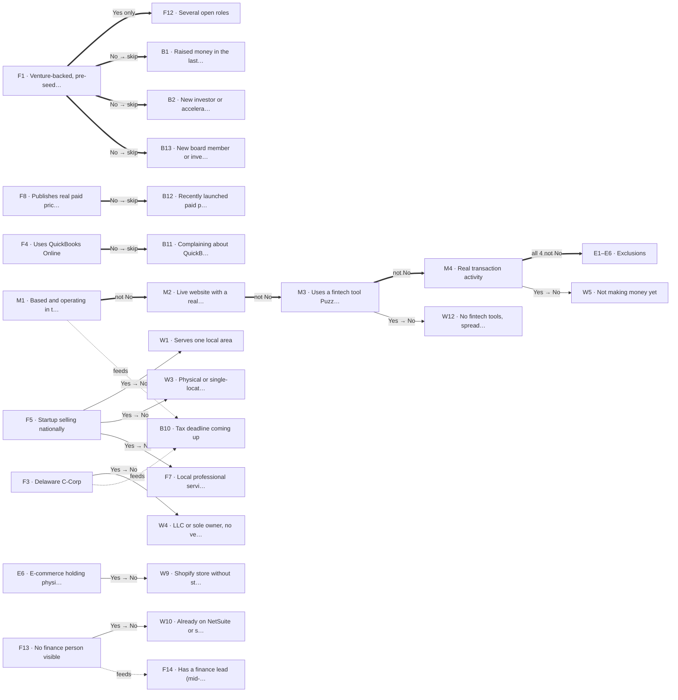

**Size first (segment)**: the list's employee count, then the Prospeo headcount (if already bought), then the YC team size, then the AI estimate, then SMB. Data points worth nothing for that size are skipped with no AI or credits spent (F14 for SMB, F13 for ENT).

**Step 1 sources**: page text, the raw page code (payment-code scan: Stripe.js, checkout and payment links, billing portal, publishable keys; plus Wappalyzer's 7,600 technology fingerprints), every open job post, and the job-board feed. **Step 2 sources**: YC, SEC (EDGAR, Form D), IRS (non-profits), Internet Archive, and the DNS check (domain verification records, SPF senders, email provider).

| ID | Data point | 1 Rules | 2 Directories | 3 AI pages | 4 AI web | 5 Prospeo | Depends on | Strategy |
|---|---|---|---|---|---|---|---|---|
| M1 | Based and operating in the US | Rules | YC, SEC | if open | if open | off | - | US address or US governing law on the site (proof keeps its page link); YC / SEC location agrees or decides. |
| M2 | Live website with a real product | Rules | - | if open | off | n/a | after M1 | The site loads with real pages. Web search off: search results can't prove a site is live. Services pipeline (`website_optional: true` in roles.json): a coming-soon page or a 404 is Unknown, not No, because established local businesses often don't keep a website (Ridgeline Drilling and CanAm Logistics, both paying customers, Nov 9, 2026); with no must-have proven the verdict is 'Needs a call: no website' (PENDING, no AI or Prospeo spend). A domain that doesn't resolve or is for sale stays No in every pipeline. |
| M3 | Uses a fintech tool Puzzle connects to | Rules + Wappalyzer + payment-code scan | DNS | if open | if open | off | after M1; after M2 | Tool proven in the site's code (payment-code scan, Wappalyzer) or its DNS (domain verified with Rippling, Stripe...), or named as used (privacy policy). |
| M4 | Real transaction activity | Rules | - | if open | if open | off | after M1; after M2; after M3 | Prices, a checkout, or open jobs from the job-board feed. |
| E1 | Series C or later, or public | Rules | SEC, YC | if open | if open | off | after M1–M4 | Exclusion needs a stated Series C+ round, IPO or ticker. High = clearly stated, about this company (domain), under ~2 years old. |
| E2 | New company, no website, no funding | Rules | SEC Form D | if open | if open | n/a | after M1–M4 | A live site alone rules it out (rules: No). Only dead/parked sites stay open. |
| E3 | Accounting or bookkeeping firm | Rules | - | if open | if open | n/a | after M1–M4 | Rules look for accounting services; else AI reads the pages, then the web. |
| E4 | Mainly operates outside the US | Rules | YC | if open | if open | off | after M1–M4 | Same address proof as M1 (with its page link). |
| E5 | Non-profit or government body | Rules | IRS, YC | if open | if open | off | after M1–M4 | Legal suffix is a weak clue; IRS register (non-profit) and YC decide. |
| E6 | E-commerce holding physical stock | Rules | - | if open | if open | n/a | after M1–M4 | AI reads the pages: a stocked store, shipping, warehouse jobs. |
| F1 | Venture-backed, pre-seed to Series B | Rules | YC, SEC Form D | if open | if open | off | - | A bare 'Backed by' (logo images) is only a clue; a named investor counts. YC / Form D prove venture-backed, and the AI steps continue until the stage is confirmed; a confirmed round becomes the proof (Series C+ turns it No). |
| F2 | Uses Stripe for billing | Rules + Wappalyzer + payment-code scan | DNS | if open | if open | off | - | Payment-code scan (raw pages, the site's JS bundles, the app's sign-in page), Wappalyzer, DNS stripe-verification. The note says 'found in code' or 'stated on the site, not seen in code'. |
| F3 | Delaware C-Corp | Rules | SEC | if open | if open | n/a | - | Governing law is only a clue; the SEC state of incorporation decides. |
| F4 | Uses QuickBooks Online | Rules + Wappalyzer | DNS | if open | if open | off | - | Every job post is read (rules and AI); a finance job asking for QuickBooks is Yes. 'Nothing found' lists the job posts checked. |
| F5 | Startup selling nationally | Rules | - | if open | if open | n/a | - | A clearly stated software product counts as selling nationally; a services firm needs stated customers beyond its city. |
| F6 | B2B SaaS or tech-enabled service | Rules | - | if open | if open | n/a | - | Software (or a tech service) sold to businesses, stated on the site. |
| F7 | Local professional services firm | Rules + derived from F5 | - | if open | if open | n/a | No when F5 is Yes | Opposite of F5: a stated scalable product is No. |
| F8 | Publishes real paid pricing | Rules | - | if open | if open | n/a | - | No pricing page after the full search (links, sitemap, /pricing, /plans) and only 'Contact sales', or no prices and no pricing words anywhere: No. Prices elsewhere: Needs check. |
| F9 | Payroll on Gusto, Rippling or Deel | Rules + Wappalyzer | DNS | if open | if open | off | - | DNS verification (Rippling, Gusto, Deel) = Yes at medium (account stated, payroll use not); job posts read in full. |
| F10 | AI is core to the product | Rules | - | if open | if open | n/a | - | The product itself is AI (model, agent, assistant), stated on the site. |
| F11 | YC or similar accelerator | Rules | YC | if open | if open | n/a | - | YC directory: exact website domain plus a name match; acquired or renamed entries don't count. |
| F12 | Several open roles | Rules | - | if open | if open | off | after F1 (Yes only) | 3+ open roles from the job-board feed (Ashby, Greenhouse, Lever, Workable, Rippling). Runs only when F1 is Yes (`run_if`); otherwise Not applicable. |
| F13 | No finance person visible | Rules | - | if open (needs team page) | off | if open | - | Size first. SMB / MM: one Prospeo whole-team search (1 credit): a full list (2-24 people) with no finance title = Yes. Skipped for ENT. Web search off: absence can't be found online. |
| F14 | Has a finance lead (mid-size and up) | Rules | - | if open (needs team page) | if open | if open | uses F13 | Size first. Skipped for SMB. MM: the same whole-team search (no finance title = No). ENT: Prospeo finance-department search. |
| F15 | Publishes revenue or growth numbers | Rules | - | if open | if open | n/a | - | Rules read pages and job posts for the company's own ARR, revenue, customer count or growth ('7-figure ARR up 5x'); others' numbers don't count. The AI prompt also rejects counts of people helped, patients, projects done or years of experience (Nov 9, 2026). |
| F16 | Remote-first or hybrid | Rules | - | if open | if open | n/a | - | Job locations and 'In person' / remote wording. Watch: 'hybrid search' is a technology, not hybrid work. 'Hybrid' counts only next to work words ('hybrid team', 'hybrid role', '(Hybrid)', 'remote/hybrid', 'Location: Hybrid', 'Hybrid - Austin'); 'a hybrid between direct mail and digital' or 'our hybrid model' describes the product (Nov 9, 2026). |
| F17 | Runs several US companies | Rules | - | if open | on clue | n/a | - | Several named entities under one owner; boilerplate 'subsidiaries' doesn't count. |
| F18 | Early adopter | Rules | - | if open | if open | n/a | - | Product Hunt launch or engineering blog. Gap: blogs loaded by JavaScript aren't read yet. |
| F19 | Banks with Mercury or Brex | Rules + Wappalyzer | DNS | off | off | off | - | Rules (names in text and code), DNS and Wappalyzer only: an AI reading the same text adds cost, not proof. |
| F20 | Uses Ramp or Brex cards | Rules + Wappalyzer | DNS | off | off | off | - | Rules, DNS and Wappalyzer only (as F19). |
| F21 | Cap table in Carta or Pulley | Rules + Wappalyzer | DNS | off | off | off | - | Rules, DNS and Wappalyzer only (as F19; a Carta fingerprint exists). |
| B1 | Raised money in the last 6 months | Rules | SEC Form D | if open | if open | off | after F1 | Dated round in the last 6 months; SEC Form D date. |
| B2 | New investor or accelerator | Rules | YC | if open | if open | n/a | after F1 | New investor / accelerator; LinkedIn posts. |
| B3 | Hiring for several roles | Rules | - | if open | if open | off | - | 3+ open roles (same proof as F12). |
| B4 | Hiring a finance lead | Rules | - | if open | if open | n/a | - | An open finance role (job board or careers page). |
| B5 | Hiring ops or chief of staff | Rules | - | if open | if open | n/a | - | An open ops / chief-of-staff role. |
| B6 | Converted from an LLC to a C-Corp | Rules | Wayback, SEC | if open | if open | n/a | - | SEC Form D previous names (LLC → Inc.). |
| B7 | Incorporated in the last 12 months | Rules | Wayback | if open | if open | n/a | - | SEC Form D year of incorporation. |
| B8 | Registered a new subsidiary | Rules | - | if open | on clue | n/a | - | A second entity registered recently. |
| B9 | Lost or replacing a bookkeeper | Rules | - | if open | on clue | n/a | - | Bookkeeper / fractional CFO change. |
| B10 | Tax deadline coming up | Rules (calendar) | - | off | off | n/a | uses F3; uses M1 | Calendar rule: confirmed C-Corp + US-based + 0-45 days before Apr 15 or Oct 15 = Yes; otherwise Unknown. A timing flag, the same for every C-Corp. |
| B11 | Complaining about QuickBooks | Rules | - | if open | on clue | n/a | after F4 | Company or founder complaining about QuickBooks. |
| B12 | Recently launched paid pricing | Rules | SEC | if open | if open | n/a | after F8 | Pricing or product launch in the last 6 months (blog). |
| B13 | New board member or investor updates | Rules | - | if open | on clue | n/a | after F1 | Board member or investor updates (LinkedIn posts). |
| B14 | Preparing for a first audit | Rules | - | if open | on clue | n/a | - | Financial audit or diligence (not SOC 2). |
| W1 | Serves one local area | Rules + derived from F5 | - | if open | if open | n/a | No when F5 is Yes | The opposite of F5: when F5 (startup selling nationally) is proven Yes, W1 is No for free with F5's proof. Its prompt uses the F5 rule: a stated software product = national; a services firm needs stated customers beyond its city. |
| W2 | Sells hours of labour, not a product | Rules | - | if open | if open | n/a | - | Billed hours, not a product. |
| W3 | Physical or single-location business | Rules + derived from F5 | - | if open | if open | n/a | No when F5 is Yes | A venue with hours / menu / storefront. |
| W4 | LLC or sole owner, no venture funding | Rules + derived from F3 | Wayback | if open | if open | n/a | No when F3 is Yes | LLC and no funding. |
| W5 | Not making money yet | Rules + derived from M4 | - | if open | if open | n/a | No when M4 is Yes | Waitlist only, no revenue or jobs. |
| W6 | Needs more than one currency | Rules | - | if open | if open | n/a | - | Non-USD or multi-currency (terms, prices). USD and foreign prices or fees on one pricing page: in services, where W6 is a hard stop, Needs check (the AI decides; a currency switcher or a UK fee table doesn't prove multi-currency books: Dueflow, a paying customer, Nov 9, 2026); in product, where it only scores down, Yes from code as before. |
| W7 | Manufacturing or hardware | Rules | - | if open | if open | n/a | - | Makes physical products. |
| W8 | Heavy invoicing and bill-paying | Rules | - | if open | if open | n/a | - | Invoicing on net terms vs subscriptions. |
| W9 | Shopify store without stock | Rules + derived from E6 | - | if open | if open | n/a | No when E6 is Yes | Store platform in code, no stock. |
| W10 | Already on NetSuite or similar | Rules + derived from F13 | - | if open | if open | off | No when F13 is Yes | NetSuite / QB Enterprise + a finance team. |
| W11 | Accountant picks the tools | Rules | - | if open | on clue | n/a | - | An outside accountant picks the tools. |
| W12 | No fintech tools, spreadsheets and a traditional bank | Rules + derived from M3 | - | if open | off | n/a | No when M3 is Yes | No fintech tools at all. |
| S1 | Sole proprietorship or partnership | Rules | - | if open | if open | n/a | services: after M1–M4 | A self-statement ("X is a general partnership") or a legal name ending in LLP or LP. Terms about customers ("if you are a sole proprietor") don't count. The No is free: a corporation or LLC on record, or a legal name ending in Inc., Corp., PBC or LLC (reviewed on argon-ai.com). |
| S2 | Marketplace | Rules | - | if open | off | n/a | services: after M1–M4 | Says it is a marketplace ("we are a … marketplace", "the marketplace for …", connects hosts and guests). Cloud and app marketplaces don't count; Stripe Connect in the code is only a clue. |
| S3 | Books behind or messy | Rules | - | if open | on clue | n/a | - | A finance or bookkeeping job post asking for catch-up, cleanup or a reconciliation backlog. |
| S4 | Looking for bookkeeping help | Rules | - | if open | on clue | n/a | - | An open bookkeeper, staff accountant, AP/AR or fractional finance role, or a public request for a bookkeeper. |
| S5 | Does its own books (DIY) | Rules | - | if open | on clue | n/a | - | "We do our own books" or a founder who is an accountant keeping them. An AI product alone is not DIY. |
| S6 | Series D or later, or public | Rules + derived from E1 | - | if open | if open | n/a | services: after M1–M4 | Yes when E1's proof names Series D or later, an IPO or a ticker; No when it names Series C, the stage is earlier, or the company announces its own round of seed to Series C (reviewed on argon-ai.com). |
| S7 | 100 or more people | Rules (size sources) | - | off | off | n/a | services: after M1–M4 | The $500K monthly-expense proxy: the list's count (lower band), a Prospeo headcount already bought, or the YC team size; credited to that source (rules, provider, directories). |
| S8 | 50 to 99 people | Rules (size sources) | - | off | off | n/a | - | Same sources as S7; scores down in services. |
| S9 | Takes payments through several processors | Rules | - | off | off | n/a | - | Two or more processors in the site's code, or a Whop link. Yes only. |
| S10 | Subscription or membership revenue | Rules | - | off | off | n/a | - | Subscription billing in the code, a recurring price on a pricing page, or membership wording. Yes only. |
| S11 | Uses field-service or construction software | Rules | - | off | off | n/a | - | A field-service or construction tool's widget or link in the site's code. Yes only. |
| S12 | In business 10 or more years | Rules | - | off | off | n/a | - | The company's own "since 1998" or "25 years in business"; never a person's experience. Yes only. |

### 6.10 How the answers are used

The ICP verdict (phase 1) and the lead score (phase 2) are calculated from these answers as described in [Decide the ICP verdict](#48-decide-the-icp-verdict-phase-1) and [Lead score](#410-lead-score-phase-2) for product, and in [section 5](#roles) for services. Weights are in the pipeline's scoring.json.

---

## 7. Integrations

How other tools talk to the pipeline. Keys and settings are in [section 2](#keys-and-settings).

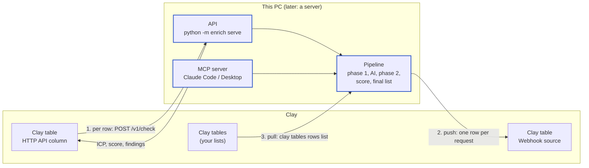

| Flow | What happens | Needs |
|---|---|---|
| **1. Per row** | A Clay table calls our API for each company and fills columns with ICP YES/NO, score, tier and findings | Our API reachable from the internet (tunnel or server) |
| **2. Push** | After a list finishes, every row (all original columns + findings) is sent to a Clay table | A Clay table with a Webhook source |
| **3. Pull** | A Clay table is read as a new list and run through the pipeline; results can then be pushed back | `clay login` on this PC; the table needs a Domain or Website column |

### API

```bash
.venv/bin/python -m enrich serve                 # http://127.0.0.1:8787, this PC only
.venv/bin/python -m enrich serve --host 0.0.0.0  # reachable from your network
```

Interactive docs, where you can try every call: http://127.0.0.1:8787/docs

Every `/v1` call needs the key as a header: `x-api-key: <key>` (or `Authorization: Bearer <key>`). Wrong or missing key: `401`. Show the key with `python -m enrich settings --show-key`.

The full description of every call (fields, types, examples) is in [openapi.json](openapi.json), which any API tool (Postman, Insomnia, code generators) can import without the server running. Every call takes `?icp=product`; without it, services is used.

**Safety rules:**
- AI only runs when a request says `"ai": true` (or calls the AI endpoint).
- Every AI run is estimated first. If the worst case is above `max_cost_usd` (default `API_AI_MAX_COST_USD` in `.env`, else $5), the request is refused with `402` and nothing is sent. The message gives the cheap-mode worst case too.
- Nothing can be deleted through the API.

| Group | Method and path | What it does |
|---|---|---|
| | `GET /health` | Is the API up (no key needed) |
| Companies | `POST /v1/check` | One company, answered while you wait: ICP, reason, score, tier, reasoning, every data point. Cached. Body: `{"domain": "acme.com", "company": "Acme", "employees": "12"}`; options `signals`, `ai`, `ai_options`, `refresh`, `wait_seconds` |
| | `POST /v1/check/batch` | Up to 25 companies at once, answered while you wait; their free steps run at the same time. Body: `{"companies": [{"domain": "acme.com"}, {"domain": "beta.io"}]}`; options `signals`, `wait_seconds` (default 300) |
| Lists | `GET /v1/lists` | Every list with state and counts |
| | `POST /v1/lists` | Start a whole list in the background. Body: `{"name": "q4", "rows": [{"Domain": "..."}], "ai": false, "callback_url": "https://..."}`; your other columns are kept |
| | `POST /v1/lists/upload` | The same with a CSV file (form fields `name`, `ai`, `mode`, `max_cost_usd`, `callback_url`) |
| | `GET /v1/lists/{name}` | Progress: state, step, AI usage and cost, counts, push and callback result |
| | `GET /v1/lists/{name}/results` | Every row: original columns + findings. `?format=csv`, `?only_icp=true`, `?limit=50` |
| | `GET /v1/lists/{name}/companies/{domain}` | One company: its row, every answer with proof (quote, page, source: code, directory or AI), directory findings |
| | `POST /v1/lists/{name}/rules` | Re-apply rules to saved pages after changing scoring or rules. Free. Body: `{"phase": "both"}` |
| AI | `GET /v1/lists/{name}/ai/estimate?phase=icp` | What the AI step would cost, in both modes. Nothing is sent |
| | `POST /v1/lists/{name}/ai` | Run the AI step on an existing list in the background. Body: `{"phase": "icp", "ai_options": {"mode": "accurate", "max_cost_usd": 2}}` |
| Quality | `POST /v1/lists/{name}/evaluate` | Accuracy against right answers, with every disagreement. Body: `{"labels": [{"Domain": "acme.com", "Expected ICP": "YES", "Expected tier": "Strong fit"}]}` |
| | `GET /v1/lists/{name}/runs` | Run log with AI cost per run and in total |
| Reference | `GET /v1/lookup?domain=puzzle.io&legal_name=Puzzle Financial Inc.` | YC, SEC and IRS for one company. Free |
| | `GET /v1/signals` | Every data point: its column name, group and points |
| Providers | `POST /v1/lists/{name}/providers` | Prospeo company data for data points still open. Body: `{"phase": "icp", "max_credits": 50}` |
| | `POST /v1/lists/{name}/people` | Decision-makers at ICP companies. Body: `{"emails": true, "per_company": 3, "max_credits": 100}` |
| | `GET /v1/lists/{name}/contacts` | Contacts found, one row per person. `?format=csv` |
| Clay | `POST /v1/lists/{name}/push` | Send a list to a Clay webhook. Body: `{"only_icp": false}` |
| | `GET /v1/clay/tables` | Tables in the signed-in Clay workspace |
| | `POST /v1/clay/pull` | Read a Clay table and run it as a new list. Body: `{"table_id": "t_abc123", "push_to_clay": true}` |

`ai_options` (on `check`, `lists`, `clay/pull` and the AI endpoint): `mode` (`accurate` default, or `cheap`), `web` (true), `search_signals` (true; the web-only buying signals), `max_cost_usd`.

**Callback:** give `callback_url` and, when the list finishes (or stops at the cost limit), its status with the summary is POSTed there as JSON, with 3 tries. The result is shown under `callback` in the list's status.

**Status codes:** `200` done, `202` started in the background, `400` bad request, `401` key, `402` above the AI cost limit (nothing sent), `404` no such list or company.

**Speed:** a new company takes about 5 to 35 seconds with `/v1/check` (a site read with the real browser is slower), and is instant from the cache after that. If a check takes longer than `wait_seconds`, the answer is `"status": "still running"` and the check keeps going; calling again returns the result.

#### Examples

```bash
KEY=$(.venv/bin/python -c "from enrich import settings; print(settings.api_key(create=False))")
API=http://127.0.0.1:8787

# one company
curl -s -X POST $API/v1/check -H "x-api-key: $KEY" -H "Content-Type: application/json" \
     -d '{"domain": "linear.app", "company": "Linear"}'

# a CSV in the background, with AI capped at $3 and a callback
curl -s -X POST $API/v1/lists/upload -H "x-api-key: $KEY" \
     -F file=@leads.csv -F name=q4 -F ai=true -F max_cost_usd=3 -F callback_url=https://example.com/hook
curl -s $API/v1/lists/q4 -H "x-api-key: $KEY"                       # progress
curl -s "$API/v1/lists/q4/results?format=csv&only_icp=true" -H "x-api-key: $KEY" > q4_icp.csv
```

```python
import httpx, time

api = httpx.Client(base_url="http://127.0.0.1:8787", headers={"x-api-key": "<key>"}, timeout=120)
api.post("/v1/lists", json={"name": "q4", "rows": [{"Company Name": "Linear", "Domain": "linear.app"}]})
while api.get("/v1/lists/q4").json()["state"] in ("queued", "running"):
    time.sleep(5)
print(api.get("/v1/lists/q4/ai/estimate", params={"phase": "icp"}).json())       # cost first
api.post("/v1/lists/q4/ai", json={"phase": "icp", "ai_options": {"max_cost_usd": 1}})
for row in api.get("/v1/lists/q4/results", params={"only_icp": True}).json()["rows"]:
    print(row["Domain"], row["Lead score"], row["Lead tier"])
```

#### Making the API reachable for Clay

Clay runs in the cloud, so it can't reach `127.0.0.1`. Two options:

| Option | How | Good for |
|---|---|---|
| Tunnel from this PC | `brew install cloudflared`, then `cloudflared tunnel --url http://localhost:8787`. It prints a public `https://...trycloudflare.com` address that forwards to the API while both are running. | Trying it out; the address changes each time |
| Server | Run `python -m enrich serve --host 0.0.0.0` on a server with HTTPS in front ([setup step 4](#install-and-first-test-run)) | Everyday use by the team |

Keep the API key secret in both cases: anyone with the address and the key can run checks.

### Clay

#### Clay HTTP API column (flow 1)

In any Clay table:

1. **Add column → HTTP API.**
2. Method `POST`, endpoint `https://<your public address>/v1/check`.
3. Header `x-api-key` = your API key.
4. Body (pick the table's columns where shown):
   ```json
   {"domain": "<Domain column>", "company": "<Company Name column>", "employees": "<Employee count column>"}
   ```
5. Map the response fields you want into columns: `ICP`, `ICP status`, `Why` (the reason), `Lead score`, `Lead tier`, `Route`, `Value angle`, `Segment`, `Fit signals found`, `Funding stage`, `Partners found`.
6. In the column's rate limit settings, start with about 5 requests per 10,000 ms. A new company takes 5 to 35 seconds; repeats are instant. Clay's HTTP column has its own timeout; a slow answer shows as an `ETIME` error, so keep `wait_seconds` below it.

#### Push to Clay (flow 2)

1. In Clay, create a table and add a **Webhook** source. Copy its URL (and its auth token, if you turn one on).
2. Save it once: `python -m enrich settings --clay-webhook <URL>` (plus `--clay-webhook-token <token>` if set).
3. Push a finished list:
   ```bash
   .venv/bin/python -m enrich push leads              # every row
   .venv/bin/python -m enrich push leads --only-icp   # only ICP = YES
   ```
   Or set `push_to_clay` when starting a list through the API or MCP.

Each row is one request, with all your original columns plus the findings (74 columns in testing). Rate limits and server errors are retried. Clay accepts up to 50,000 rows per webhook.

The token is sent as the `x-clay-webhook-auth` header. Check it against your webhook's settings in Clay on the first push.

Decision-makers found through Prospeo go into a second Clay table, with its own webhook (`CLAY_CONTACTS_WEBHOOK_URL`, MCP `push_contacts_to_clay`).

#### Pull from Clay (flow 3)

```bash
.venv/bin/python -m enrich pull                                # list the Clay tables in your workspace
.venv/bin/python -m enrich pull t_abc123 --list q4_clay         # read the table and run both phases
.venv/bin/python -m enrich pull t_abc123 --list q4_clay --push  # ...then push the results to the webhook
```

The table needs a column the pipeline recognises as the domain (Domain, Website, URL, Company Domain). For bulk enrichment tables, Clay only shows a sample of rows; the pull reports this as `truncated`.

### MCP server (Claude Code, Claude Desktop)

#### Connect Claude Code (one time)

**Option A, automatic (recommended):** register the server for this project in your own Claude Code config. It then connects by itself every time you open Claude Code in this folder (terminal or VS Code), with no approval prompt:

```bash
cd /path/to/ICP
claude mcp add puzzle-lead-scoring --scope local -e PYTHONPATH="$PWD" -- "$PWD/.venv/bin/python" -m enrich mcp
claude mcp list
```

On Windows (PowerShell): `claude mcp add puzzle-lead-scoring --scope local -e PYTHONPATH="$PWD" -- "$PWD\.venv\Scripts\python.exe" -m enrich mcp`.

`claude mcp list` should show `puzzle-lead-scoring ... ✔ Connected`. In a chat, `/mcp` shows it too; after code changes (and after any change to rules, prompts or roles.json), reconnect it there (or restart Claude Code) so the new code loads: until then `submit_answers` re-scores with the old code.

**Option B, shared with the team (macOS and Linux):** the repo's `.mcp.json` registers the same server for anyone who opens the project, and `.claude/settings.json` pre-approves it. Claude Code applies project settings only once the folder is trusted: run `claude` in the folder once and accept the trust prompt (or approve **puzzle-lead-scoring** in `/mcp`). If you also did option A, `claude mcp list` notes the server is defined in two places; that's harmless (yours wins).

**Check it works:** ask Claude Code *"Use puzzle-lead-scoring to check linear.app"*. To remove it: `claude mcp remove puzzle-lead-scoring -s local`.

#### Connect Claude Desktop

Settings > Developer > Edit Config opens `~/Library/Application Support/Claude/claude_desktop_config.json` (Windows: `%APPDATA%\Claude\claude_desktop_config.json`; there, `command` is the full path to `.venv\Scripts\python.exe`, with double backslashes in JSON). Add this inside it under `mcpServers` (keep what's already there), with your own project path, then quit Claude Desktop fully (Cmd+Q) and open it again. Use full paths: Claude Desktop doesn't start in the project folder, which is why `PYTHONPATH` points to it. Keys, lists and settings are found from the project folder automatically.

```json
{
  "mcpServers": {
    "puzzle-lead-scoring": {
      "command": "/Users/<you>/path/to/PuzzleLeadScoring/.venv/bin/python",
      "args": ["-m", "enrich", "mcp"],
      "env": {"PYTHONPATH": "/Users/<you>/path/to/PuzzleLeadScoring"}
    }
  }
}
```

To run it on a server later, the same tools can be served over HTTP instead of stdio.

#### Claude Code skills and helpers

In `.claude/`, loaded automatically when you open the project:

| Name | Use it for |
|---|---|
| `check-company` (skill) | One company through the full waterfall, Claude answering, Prospeo only after your yes |
| `/enrich-chat <csv> [list]` (command) + `company-answerer` (subagent) | Lists up to about 100 companies, answered in chat, 5 companies at a time |
| `bulk-enrich` (skill) | Bigger lists: free steps, `list_ai` with an approved cost cap, costs, Clay push |
| `icp-answering` (skill) | The answering rules: stated proof only, confidence scale, same-name traps, cannot_answer |
| `review-datapoints` (skill) | The manual data point review (resume, one data point at a time, record decisions) |
| `datapoint-dev` (skill) | Changing a data point in the code with config, defaults, tests and docs kept in sync |
| `improve-pipeline` (skill) | After a run: what the pipeline learned, safe fixes applied, the rest proposed with proof for your OK |

#### Which AI answers, by list size

| List | Steps 1-2 and 5 | Steps 3-4 (AI) |
|---|---|---|
| One company or a list up to about 100 | `check_company` / `enrich_list` (+ `use_prospeo`) | **Claude in the chat** (`open_questions`, `submit_answers`): $0 API. In Claude Code, `/enrich-chat <csv>` runs it all, one `company-answerer` subagent per company, 5 at a time |
| Bigger lists (over about 100, up to thousands) | `enrich_list` (+ `use_prospeo`) | **OpenAI** via `list_ai`: estimate first, then only with your approved cap. Claude can't answer tens of thousands of questions in a chat |

**Up to about 100 companies in Claude Code:** type `/enrich-chat path/to/list.csv my_list`. It runs the free steps, answers every company's open questions with the `company-answerer` subagent (`.claude/agents/`: its own fresh context per company, so the main chat stays short; 5 in parallel), asks you before any Prospeo credit, and shows the results. About 1,000-1,500 answers for 100 companies; expect roughly an hour and a good share of your Claude plan's usage.

**Bigger lists, bulk workflow:** `enrich_list` (free, background) → `list_status` until done → `list_ai(list, "icp")` shows the estimate → approve a cap → `list_ai(list, "icp", max_cost_usd=<cap>)` → when done, the same for `"signals"` → `list_results` / `push_list_to_clay`.

**In the chat path the model you're chatting with is the only AI** (Claude in Claude Code or Claude Desktop), at no API cost. The tool never calls OpenAI there; `list_ai` is the only way OpenAI is used through MCP:

1. `check_company` (or `enrich_list`) runs the free layers: website rules and directories.
2. `open_questions` gives the model the data points still open, with **the same prompts the OpenAI step uses**, built from `config/prompts`: the system prompt from `_shared.json` (role, ground rules, confidence scale; no ICP description, since the questions ask for facts), each question's instructions from its own prompt file (named in `prompt_file`, with its version), the company's page text, the answer fields, and whether to answer from the pages or the web. Edit a prompt file and both OpenAI and the MCP model follow the change.
3. The model answers, quoting its proof, and calls `submit_answers`. Questions come in rounds: a data point that depends on another (`run_if`, or an opposite) appears only after that one is answered, and is dropped as Not applicable when the answer rules it out. Keep calling `open_questions` until nothing is left; phase 2 also stops early once no answer can change the lead tier.
4. The answers pass the same quality checks as any AI answer (exact quote, confidence, domain match for web answers, dated events for recent signals). The result says which counted, the new verdict and score, and what's next.
5. Step 5, Prospeo, runs only for the finance-person check (F13, F14) and only when you agree: when the finance check is still open after the model's answers, `submit_answers` says so, and the model asks you before calling `check_company(..., use_prospeo=true)` (1 credit at most per company).
6. A question the model can't answer the way it asks (usually a web search in a client without a web tool) is sent back as `cannot_answer` and **stays open**; nothing is sent to another AI.

Just ask in plain words, for example: "Check resend.com with puzzle-lead-scoring and answer its open questions". The terminal, the API and Clay keep using OpenAI as configured.

| Tool | What it does |
|---|---|
| `check_companies` | Several companies at once (up to 25): their free steps run at the same time, so ten take about as long as the slowest one. Then answer each one's questions as usual |
| `check_company` | One company through the free waterfall steps (size, rules and code checks, YC, SEC, IRS, DNS): ICP, score, tier, signals. `use_prospeo=true` (after your yes) adds step 5, the Prospeo finance check, at most 1 credit |
| `open_questions` | The questions still open for a company, for the model to answer (phase 1, then phase 2). 3 at a time by default (the page text is repeated per question); they arrive in waterfall order, so call it again after each submit until it returns none. `next` says how many are left and when to move to phase 'signals' |
| `submit_answers` | Saves the model's answers through the quality checks; returns what counted and the new verdict and score. `cannot_answer` items stay open (no other AI is used) |
| `questions_overview` | For a whole list: open questions per company |
| `list_ai` | **Big lists only.** The AI steps for a whole list with the OpenAI engine, in the background. Called without a cap it only returns the cost estimate; it runs only with `max_cost_usd` set to a cap you approved, and never above it or the monthly budget |
| `enrich_list` | Start a CSV file as a list in the background (free waterfall steps); `use_prospeo=true` adds step 5 for each company where the finance check is still open (1 credit each at most) |
| `list_status` | Progress and counts of a list |
| `list_results` | Rows of a finished list (ICP = YES by default) |
| `explain_company` | Every answer with its proof |
| `clay_tables` | Tables in your Clay workspace |
| `pull_clay_table` | Read a Clay table and run it as a list |
| `push_list_to_clay` | Send a finished list to a Clay webhook |
| `push_contacts_to_clay` | Send a list's Prospeo contacts, one row per person with the company's ICP, score and tier, to a Clay contacts table. Uses its own webhook (`webhook_url`, else `CLAY_CONTACTS_WEBHOOK_URL`), never the companies one |
| `prospeo_status` | Prospeo key, plan, credits left, credits our lists used this month and the monthly cap. Free |
| `prospeo_companies` | Prospeo company data for a list's companies whose Prospeo-covered data points are still open (1 credit each at most, never twice). Called without a cap it only returns the plan; it runs only with `max_credits` set to a cap you approved |
| `find_contacts` | Decision-makers at a list's ICP YES companies (founder, CEO, owner first, then finance, then operations); `emails=true` also reveals verified emails (1 credit each); `strong_only` for Strong fit only. Plan first; runs only with an approved `max_credits` |
| `list_contacts` | The contacts already bought for a list (or one company). Free |
| `improvement_report` | What the pipeline learned from its runs, as proposals with proof; safe setting changes are applied automatically (tests run, reverted if they fail) |
| `apply_improvement` | Apply a setting proposal after your yes (tests run, reverted if they fail) |
| `mark_improvement` | Record a proposal's outcome: done (fixed by hand), rejected, applied or failed |
| `dp_test_setup`, `dp_test_run`, `dp_test_answer`, `dp_test_record`, `dp_test_summary` | Test mode: one data point at a time on an isolated test list ([section 8](#one-data-point-at-a-time-through-mcp-live-review)) |

#### The GTM engineer and the learning loop

Through MCP, Claude works as an **experienced GTM engineer who owns this pipeline**, and the shared prompt (`config/prompts/_shared.json`) gives OpenAI and Claude the same role when answering: someone who knows how B2B company data goes wrong (shared names, an acquirer's news, stale funding articles, job sites mixing up employers, customer logos taken for tools). The proof rules don't change: only stated proof counts, Unknown is never a No.

Every run feeds a learning log (`learning/events.jsonl`, not in git, each event tagged with its pipeline): each AI answer and what became of it (counted, rejected and why, unknown), crashes and where they happened, questions the chat model couldn't answer, and your corrections in test mode. `improvement_report` turns it into proposals:

| Pattern | Proposal | Who decides |
|---|---|---|
| A crash | Fix the code, add a test, run all tests | **Automatic** (Claude fixes it in Claude Code, tests must pass), you're told after |
| A phase 2 data point's web search found nothing in 90%+ of 8+ answers | Search only on a clue (`ai_web.run: if_clue`) | **Automatic** (applied, tests run, reverted if they fail), you're told after |
| Answers rejected the same way 3+ times (no quote, wrong company, too old, …) | A line in that data point's prompt, or a looser check if the answers were right | **You** |
| Questions the chat model couldn't answer, 3+ times | A free rule or directory for it, or `list_ai` | **You** |
| Your corrections in test mode | Find and change the rule, prompt or setting behind the wrong answer | **You** |

Must-haves and exclusions are never changed automatically. A rejected proposal only comes back if it keeps happening. Every decision is logged in `learning/improvements.md` (in git). `LEARNING_AUTO_APPLY=0` in `.env` makes everything wait for you. `/enrich-chat`, `check-company` and `bulk-enrich` end with the `improve-pipeline` skill.

### List viewer

A local web page (optional) that opens an enriched list as a table. Click a cell to see its answer, reasoning, proof quote and source link in a side panel.

    .venv/bin/python viewer/server.py      # then open http://127.0.0.1:8790
    # open a specific list: http://127.0.0.1:8790/?list=<list folder name>

- Read-only: it only reads `lists/`. It never runs AI, Prospeo or any other paid step and changes nothing.
- No extra packages: Python standard library plus this project's own code.

**Using it:**

- **Quick tabs** All / ICP YES / NO / Pending, plus the stats at the top.
- **Columns**: starts on "Data points" (ICP, score, tier and every data point with proof). "Overview" is the short version, "Everything" shows all columns. Tick groups (Must-have, Exclusion, Fit, Buying signal, Weak fit) or single columns. The choice is remembered per list.
- **Filter**: Clay-style builder with Where/And/Or, operators, groups, eye to disable a row, ⋯ to duplicate or delete.
- **Sort**: click a header (asc, desc, off), shift-click to add a level, or use the Sort button for "Then by" levels. Empty values always sort last.
- **Details panel**: answer, reasoning, proof quote, "Open source" link, confidence, who decided it. ↑ ↓ ← → move between cells, Esc closes. Cells without proof show their value plus related context (for example Why for ICP).
- **Export**: the current view (filters, sort, visible columns) as CSV, optionally with reasoning, proof, source and confidence for each data point.
- Text from websites is shown as plain text, never as HTML. Light theme.

**Put it on GitHub Pages behind a password:**

    .venv/bin/python viewer/build_static.py <list name> --out docs/viewer

It asks for a username and password, then writes the page and one encrypted data file to [viewer/](viewer/) (AES-256-GCM, key from username + password via PBKDF2, 600,000 rounds). The browser asks for the login and decrypts the data on the visitor's machine; nothing readable is ever published. In the repo settings, set Pages to deploy from `main` / `docs`.

- The encrypted file is public, so the password is the only protection. Use a long one (12+ characters is enforced).
- Anyone who knows the login can read the data. To change it or refresh the data, build again and commit `docs/`.
- Never commit anything but the build output; lists/ stays git-ignored.
- The "Lock" button forgets the login. The local server (above) needs no login and listens on 127.0.0.1 only.

Files in `viewer/`: `server.py` (data and static files), `index.html` (markup), `style.css` (styles), `app.js` (behaviour), `build_static.py` (encrypted Pages build).

---

## 8. Testing

How to check that the tool gives the right answers, step by step: from a quick free run, to one company in depth, to reviewing every data point yourself and measuring accuracy. What each data point means and what counts as proof: [section 6](#6-data-point-reference).

Commands below assume you are in the project folder with the virtual environment active (`source .venv/bin/activate`). Without it, start each command with `.venv/bin/python` instead of `python`.

### 8.1 The levels at a glance

| Level | What you check | Command | Cost |
|---|---|---|---|
| 1. Smoke test | Everything runs; the test list gets its known answers | `python -m enrich run examples/accuracy_test.csv --list accuracy_test` | Free |
| 2. AI run | AI settles the open questions within budget | `python scripts/ai_check.py accuracy_test --phase icp` | About $0.05 per 10 companies |
| 3. One company in depth | Every step for one company | `python -m enrich trace linear.app` | Free (`--ai` asks first) |
| 4. One data point in depth | Each data point through all 5 layers | `python -m enrich waterfall linear.app --group all` | Free (`--ai`, `--providers` ask first) |
| 5. Manual review | You mark every data point right or wrong, one data point (`--only M1`) or one company at a time | `python -m enrich review accuracy_test --only M1` | Free |
| 6. Accuracy | Numbers: right, wrong, good companies wrongly NO | `python -m enrich evaluate accuracy_test --labels ...` | Free |
| 7. After any change | Nothing that was right broke | [Regression checklist](#810-after-any-change-regression-checklist) | Free |

### 8.2 Before you start

```bash
python -m enrich settings
python -m enrich directories
python -m enrich cache
python -m enrich usage
```

These show your keys and limits (set or not, values hidden), the YC and IRS downloads, the shared company cache, and AI cost and provider credits used this month.

Set a monthly cap so testing can't overspend: `AI_MONTHLY_BUDGET_USD=10` (and `PROVIDER_MONTHLY_CREDITS=50` if Prospeo is set) in `.env`.

### 8.3 The test set

[examples/accuracy_test.csv](../examples/accuracy_test.csv) has 11 companies, each chosen to test one part of the profile, with the right answers in their own columns:

| Column | Example |
|---|---|
| `Expected ICP` | YES or NO |
| `Expected tier` | Strong fit or Weak fit (companies expected YES only) |
| `Expected: <data point>` | `Expected: Series C or later, or public` = Yes |
| `Expected reason` | Free text, shown next to disagreements |
| `What it tests` | Why the company is in the set |

| Company | Tests |
|---|---|
| Mintlify | Clean early-stage ICP, Strong fit |
| thoughtbot | Services firm: passes, Weak fit |
| Pulley | Shutdown notice on its homepage |
| Ramp | Late-stage private ($44B valuation), no ticker |
| Linear | Late stage; its own site never mentions funding |
| Asana | Public company (SEC) |
| Khan Academy | Non-profit with "Inc." in its name |
| Givebutter | Trap: for-profit software for non-profits (site blocks bots) |
| Kruze Consulting | Accounting firm |
| Pennylane | Non-US company on a .com |
| Brooklinen | Holds physical stock |

**Add a company:** add a row with its domain and the answers you are sure of, then run level 1 again. Every mistake found in testing should become a row here, so it stays fixed.

**The real answer key** comes from Puzzle: about 50 current customers (expected YES, mostly Strong fit) and 50 lost or "not a fit" deals (with the reason). `python -m enrich evaluate --template labels.csv` writes a blank file to fill in. For the services pipeline the labels are buyer types and deal outcomes ([calibrate](#calibrate-the-services-pipeline-calibrate)).

### 8.4 Smoke test (free)

```bash
python -m enrich run examples/accuracy_test.csv --list accuracy_test --keep all
python -m enrich evaluate accuracy_test --labels examples/accuracy_test.csv
```

**Expected:** ICP 9 or 10 decided right, 0 good companies wrongly marked NO. Givebutter stays PENDING (its site blocks automated visits). Before the AI step some companies are PENDING ("Needs AI check"); that is normal.

**Look at:** the final list `lists/accuracy_test/output/accuracy_test_enriched.csv`: every original row kept, `ICP`, `Why`, `Lead score`, `Lead tier`, `Reasoning` ending in a `Funding stage:` line, one column per data point (empty = not found).

### 8.5 AI run

```bash
python scripts/ai_check.py accuracy_test --phase icp
python -m enrich signals accuracy_test --keep all
python scripts/ai_check.py accuracy_test --phase signals
python -m enrich evaluate accuracy_test --labels examples/accuracy_test.csv
python -m enrich usage
```

That is: AI for phase 1 (shows the cost and asks), phase 2 again (verdicts may have changed), AI for phase 2, then the accuracy check and the month's cost.

**Expected:** 10 of 10 decided right (Givebutter still PENDING), tiers right, cost well under $1. Answers already paid for by another list are reused for free.

**Options worth testing:** `--mode cheap` (grouped calls, about 3 times cheaper; compare it, see [Comparing two runs](#comparing-two-runs)), `--no-search-signals` (skips the web-only buying signals), `--limit 3`.

### 8.6 One company in depth: `trace`

```bash
python -m enrich trace linear.app --company Linear
python -m enrich trace linear.app --company Linear --ai
```

It runs the whole flow for one company and stops after each step (Enter = next, q = stop): input → download → rules → directories → ICP verdict and the AI questions still open (with why each is asked) → AI → phase 2 pages and signals → score. Saved as `lists/trace_linear_app/output/trace_linear_app.md`.

**Check in each step:**

| Step | Right looks like |
|---|---|
| Download | Status live; the pages found really are what their names say (an "engineering" page is an engineering blog, not an integrations listing); open roles from the job board |
| Rules | Each Yes or No has a quote that says it, from the company's own page |
| Directories | Matches are the same company (strong = domain or legal name); weak matches change nothing |
| Verdict | The reason names real proof; open AI questions are only for things the free layers couldn't answer |
| AI | Each counted answer has a quote that proves it; "not mentioned" is never a No |
| Score | Every point in the breakdown comes from a confirmed Yes |

### 8.7 One data point in depth: `waterfall`

```bash
python -m enrich waterfall linear.app
python -m enrich waterfall linear.app --group all
python -m enrich waterfall linear.app --ai --providers
```

Each data point shows the 5 layers of [the waterfall](#42-the-waterfall-per-data-point) in order, cheapest first (this view counts AI on pages at about $0.0003 a question).

**Status of each layer:**

| Status | Meaning |
|---|---|
| DECIDED | This layer gave the final answer |
| not needed | An earlier layer already decided |
| clue only, passed on | It found a hint, not proof (Needs check), so the next layer was asked |
| nothing found, passed on | It looked and found nothing |
| not counted, passed on | It answered, but the quality checks rejected it (no quote, low confidence, not the same company...) |
| doesn't cover this | This layer can't answer this data point |
| not run (--ai) / not run (--providers) | That layer wasn't run for this company |

Each panel also shows that data point's settings and its file (`config/datapoints/...`). To change how a data point is answered, edit its file, then re-run that company: `python -m enrich rules <list>` is free; new AI questions need `scripts/ai_check.py` (asks first). A layer you switched off shows as "off in its file".

**A good waterfall:** the deciding layer is the cheapest that could know; later layers say "not needed"; a data point still empty after every layer is genuinely not findable.

### 8.8 Manual review: you check every data point

There are two ways to review in the terminal: **one data point at a time across every company** (best for judging a data point's waterfall), or **one company at a time** (best for judging a company as a whole). A third, through MCP, is the live review the 57 data points went through ([section 10](#9-decisions-and-reviews)).

#### Step by step, one data point at a time

```bash
cd /Users/ali/Desktop/BtB/puzzle/ICP
source .venv/bin/activate
python -m enrich datapoints
python -m enrich datapoints --show M1
python -m enrich review accuracy_test --only M1
```

The first two commands show every data point's waterfall settings and then one in full. The last shows M1's waterfall for each company in turn. Then do M2, M3 and so on in this order:

| Group | Ids | Companies shown (test list) |
|---|---|---|
| Must-haves | M1, M2, M3, M4 | all 10 |
| Exclusions | E1, E2, E3, E4, E5, E6 | all 10 |
| Fit | F1 to F21 | the companies that pass phase 1 (Mintlify, thoughtbot) |
| Buying | B1 to B14 | the companies that pass phase 1 |
| Weak fit | W1 to W12 | the companies that pass phase 1 |

Several at once: `python -m enrich review accuracy_test --only E1,E2,E3,E4,E5,E6`. All ids and their names: [Quick reference](#62-quick-reference).

#### One company at a time

```bash
python -m enrich review accuracy_test --group all
python -m enrich review linear.app
```

The first reviews every company in the list, section by section (Must-haves, Exclusions, Fit, Buying, Weak fit), and asks after each company whether its ICP verdict is right. The second reviews one company that isn't in a list. Groups: `--group must`, `exclusions`, `fit`, `buying`, `weak`, `all`.

#### Your keys

| Key | Meaning |
|---|---|
| Enter | Right |
| n | Wrong: then the right answer (y = Yes, n = No, u = can't tell) and a short note |
| s | Skip this data point |
| c | Skip the rest of this company (one company at a time) |
| q | Stop. Saved as you go |

Running the same command again skips what you've already reviewed; add `--redo` to see those again.

**What each panel shows:** the final answer and the layer that decided it, the proof and its page, the five layers with what each found and its status, and the data point's waterfall settings with the file to edit (for example `config/datapoints/must_haves/based_in_us.json`).

**How much to review:** the pipeline's data points (57 for product, 64 for services) for a company that passes phase 1; 10 (must-haves and exclusions) for one that doesn't, because phase 2 never counts for a NO. The test list is about 204 checks.

#### When a data point's waterfall needs changing

```bash
open config/datapoints/must_haves/uses_fintech_tool.json
python -m enrich rules accuracy_test
python -m enrich review accuracy_test --only M3 --redo
```

Edit its file (for example set `ai_pages.run` to `if_open`), re-apply for free, and check it again. If the change adds AI questions, run `python scripts/ai_check.py accuracy_test --phase icp` (or `--phase signals` for fit, buying and weak data points); it shows the cost and asks first. The settings are explained in [The waterfall per data point](#42-the-waterfall-per-data-point) and by `python -m enrich datapoints`.

**What makes an answer wrong:**

| Mark wrong when | Example note |
|---|---|
| The quote doesn't prove the answer | "quote says $100M ARR, that's revenue not a round" |
| The proof is about someone else | "Ramp is a customer here, not their card provider" |
| The page is the wrong kind | "this 'engineering blog' is an integrations listing" |
| A Yes or No was a guess | "California law in the terms doesn't mean not Delaware" |
| It's empty but the answer was clearly findable | "the US address is in the footer of /contact" |
| The deciding source is out of date | "that funding round is from 2019; they've raised since" |

Keep the note short and specific: what is wrong and where the right proof is. That tells us exactly which rule or prompt to fix.

**Where it goes:**

| File | Use |
|---|---|
| `lists/<list>/output/review.csv` | Every verdict with our answer, deciding layer, proof, page, your verdict, right answer and note. Tell Claude **"check the review"** to go through what you marked wrong |
| `lists/<list>/output/labels.csv` | Your answers as labels: `python -m enrich evaluate <list> --labels lists/<list>/output/labels.csv` |

#### One data point at a time through MCP (live review)

Isolated test lists only (names start with `dp_test`): the source list is copied read-only (production is never touched), answers stay in the test list, nothing goes to the shared answer cache, no OpenAI or Prospeo calls (the attached model answers AI stages, $0 API).

In Claude Desktop or Claude Code, after `enrich_list` on a CSV (for example `examples/mcp_test.csv` as list `mcp_test`):

1. "Set up a dp_test list from mcp_test" (`dp_test_setup`)
2. "Run M1 for resend.com in dp_test" (`dp_test_run`; `confirm_next=true` only after you say yes): every stage with status, evidence, source, confidence, why the next stage ran or not, cost, final answer. Claude then waits for you. `dp_test_answer` lets Claude answer an AI step (test list only).
3. Your review (`dp_test_record`): **approve**, **reject**, **correct** (give the expected value and notes), **partially_correct**, **investigate** (more evidence; stays on this data point), **retry** (re-runs only this data point), **stop**.
4. Claude asks "Ready to move to the next data point?" and runs the next one only after you say yes.
5. "Show dp_test progress" (`dp_test_summary`): tested, reviewed, approved, rejected, corrected, investigating, retries, current and remaining of the pipeline's data points.

Test mode asks every question, also those a normal run would hold back (a data point waiting for its parent, or skipped because the tier can't change); the result says what a normal run would do. For the services facts use `icp="services"`.

Reviews: `lists/<test list>/output/dp_test_log.csv` (one row per review). Session: `lists/<test list>/output/dp_test_session.json` (current data point, reviews, retries). Automated tests for this mode (offline): `.venv/bin/python -m unittest discover -s tests -v`.

**To resume the review** of the 57 data points, say in Claude Code (with the puzzle-lead-scoring MCP server connected):

> Resume the manual review in dp_test_lead_scoring: show me F21 for argon-ai.com and wait for my review.

### 8.9 Measure accuracy: `evaluate`

```bash
python -m enrich evaluate accuracy_test --labels examples/accuracy_test.csv
python -m enrich evaluate accuracy_test --labels lists/accuracy_test/output/labels.csv
python -m enrich evaluate --template labels.csv
```

The first uses the test set, the second your review, and the third writes a blank answer key.

| Number | Meaning | Target |
|---|---|---|
| Good companies wrongly marked NO | Leads lost for good: the most important number | 0 |
| Companies wrongly marked YES | Costs a sales look, not a lead | As low as possible |
| ICP accuracy (decided) | Right YES/NO among companies not PENDING | 95%+ |
| Not decided | PENDING: site not reached or a check still open | Low; each one should have a clear reason |
| Tier accuracy | Strong / Weak fit right | 90%+, once the cut-off is set from Puzzle's labels |
| Per data point | Right, wrong, empty for each data point you labelled | Find the weakest ones |

Every disagreement, with our proof, is in `lists/<list>/output/evaluation.csv`. Each run is logged: `python -m enrich runs accuracy_test`.

**Setting the Strong fit cut-off:** once Puzzle's labelled list is in, compare the scores of customers with lost deals and pick the cut-off (now 12 in the pipeline's scoring.json) that separates them best.

### 8.10 After any change: regression checklist

Run after changing a rule, a prompt, `scoring.json` or `profile.yaml`:

1. `python -m enrich rules accuracy_test` (free; re-applies rules and saved answers without downloading)
2. `python -m enrich evaluate accuracy_test --labels examples/accuracy_test.csv`: same or better, and still 0 good companies wrongly NO
3. `python -m enrich evaluate accuracy_test --labels lists/accuracy_test/output/labels.csv`: your review still agrees
4. `python -m enrich trace linear.app --no-pause`: still NO, with the Series C proof
5. For a prompt change: answers made with the old prompt are re-asked automatically (version stamps); run `python scripts/ai_check.py accuracy_test --phase icp` and evaluate again

#### Calibrate the services pipeline: `calibrate`

The services weights and the Strong-fit cut-off are guesses until they are checked against real buyers.

1. **Labels:** a CSV with `Domain`, `Buyer type` (`help` = wants the work done, `review` = does it and wants a check, `diy` = does it themselves) and, if known, `Outcome` (`closed_won`, `open`, `lost`). Blank file: `python -m enrich calibrate --template labels.csv`; example: `examples/calibration_labels_template.csv`.
2. **Enrich them with the services pipeline** (free steps, then the AI answers in chat or with `list_ai`), e.g. `python -m enrich run labels.csv --list calibration`.
3. **Report:** `python -m enrich calibrate calibration --labels labels.csv`. It shows:
   - how well the scores separate the groups: the chance a help-seeker scores above a DIY buyer (0.5 is chance, 1.0 is perfect), now and with the suggested weights
   - for each fact, how often it's Yes among help-seekers and DIY buyers, and the weight that ratio suggests. Facts that are Yes for fewer than 5 labelled companies keep their weight
   - the cut-off that best separates the groups, and how many closed-won deals reach it
   - help-seekers that a hard stop excludes (check those exclusions)

   It saves `output/calibration.json` and `calibration.csv` and changes nothing.
4. **Apply:** `--apply` writes the suggested weights and cut-off to `config/icps/services/scoring.json`, only if the tests pass. Re-run it whenever more labels arrive.

#### Speed: `bench`

`python -m enrich bench leads.csv --label before` runs the free steps (download, job boards, code scan, directories, rules; no AI, no Prospeo) on a fresh copy of the list, the same way MCP and the API do, and saves the wall time, seconds per stage per company (median and slowest) and every answer. After a change, run it again with another label and `python -m enrich bench --compare before after`: the speed-up, and every answer that differs. Live sites can change between runs, so check any difference before calling it a regression. `bench` takes `--icp`.

#### Comparing two runs

```bash
python -m enrich copy accuracy_test accuracy_test_b
python scripts/ai_check.py accuracy_test_b --phase icp --mode cheap
python -m enrich compare accuracy_test accuracy_test_b
```

`copy` clones the list without its AI answers. Then run the other setting on the copy, and `compare` lists every answer that differs. Use it for AI modes, prompt changes or a different model. Then evaluate both.

### 8.11 Testing the connections

**API** (`python -m enrich serve`, docs at http://127.0.0.1:8787/docs):

```bash
KEY=$(python -c "from enrich.core import settings; print(settings.api_key(create=False))")
curl -s http://127.0.0.1:8787/health
curl -s -X POST http://127.0.0.1:8787/v1/check -H "x-api-key: $KEY" -H "Content-Type: application/json" -d '{"domain": "linear.app"}'
curl -s -X POST http://127.0.0.1:8787/v1/lists/accuracy_test/ai -H "x-api-key: $KEY" -H "Content-Type: application/json" -d '{"phase": "icp", "ai_options": {"max_cost_usd": 0.01}}'
```

Expected: `{"ok":true}`; then a result with `ICP`, `Lead score`, `Reasoning`; then `402`, because the cost limit is too low and nothing is sent. Also: a wrong key gives `401`; a list started with `POST /v1/lists` carries on by itself if the server is restarted.

**MCP** (Claude Desktop or Claude Code): ask "What's the status of accuracy_test?", "Explain mintlify.com from accuracy_test", "Show my Clay tables". Setup: [MCP server](#mcp-server-claude-code-claude-desktop).

**Prospeo** (needs `PROSPEO_API_KEY`): `python -m enrich waterfall thoughtbot.com --providers` (1 credit), then `python -m enrich people accuracy_test --limit 2` (2 credits, emails off). Check: the data points Prospeo decided are right, contacts work at that company, and a "public" or "outside the US" from Prospeo only shows as Needs check.

**Clay:** `python -m enrich pull` lists your tables; pushing needs a Clay table with a Webhook source ([Push to Clay](#push-to-clay-flow-2)).

### 8.12 Reporting a problem

Send (or tell Claude): the domain, the data point, what we said, what is right, and where the right proof is. A `review.csv` row has all of it. Each fix is added to the test set or your labels, so `evaluate` keeps checking it.

---

## 9. Decisions and reviews

### 9.1 Manual review of the data points

A data point by data point review of the waterfall, run through MCP (Claude Code) in test mode on **argon-ai.com** from `examples/Lead-Scoring-(Template)-Default-view-export-1791793022697.csv`. Each data point was run alone, its full waterfall shown, and approved, corrected or changed before moving on. How to run or resume it: [One data point at a time through MCP](#one-data-point-at-a-time-through-mcp-live-review).

**Status (2026-10-14): complete. All 57 data points reviewed on argon-ai.com: 56 approved, 1 partially correct (E2), 29 retries after fixes.** (Before it was completed, F21, then buying signals B1 to B14 and weak signals W1 to W12 were left: 27 of 57.) Next: the open offers ([section 11](STATUS.md#3-open-decisions-and-questions)), then a second company to confirm the fixes.

| | |
|---|---|
| Test list | `lists/dp_test_lead_scoring` (an isolated copy of `lead_scoring_template`; production is never touched) |
| Review log | `lists/dp_test_lead_scoring/output/dp_test_log.csv` (one row per review) |
| Session state | `lists/dp_test_lead_scoring/output/dp_test_session.json` (current data point, reviews, retries) |
| Contacts found | `lists/dp_test_lead_scoring/output/dp_test_lead_scoring_contacts.csv` |
| Waterfall per data point | [Waterfall per data point](#69-waterfall-per-data-point) |

#### Standing instructions

These apply to every data point, in the review and in every run.

1. **Only stated proof.** Every part of a definition must be shown by a quote. Something only implied is Unknown and the waterfall moves on. Unknown is never a No. Short explanations: proof first, little reasoning.
2. **High confidence = the source clearly states it** (any source type: news, the company, an official record), about this company (domain match), not older than about 2 years. Medium = clearly stated but matched by name and location. Low = implied, name-only, outdated or conflicting (never counts).
3. **Waterfall rule for all:** steps 1 and 2 (rules, directories) are free; if they find nothing, run step 3 (AI on our pages), then step 4 (AI web search) if still open, unless the data point's file switches a step off with a reason.
4. **Through MCP, Claude answers AI questions for single companies and lists up to about 100** (in Claude Code: `/enrich-chat`, one `company-answerer` subagent per company), with the prompts in `config/prompts`; OpenAI is never called on that chat path. A question Claude can't answer the way it asks stays open. **Bigger lists use OpenAI** through the `list_ai` tool only (cost estimate first, then only with a cap the user approved), or the terminal, API and Clay.
5. **Prospeo only for the finance-person check (F13, F14), at most 1 credit per company** (one team search, cached 90 days; the company details that come with it go to the contacts CSV only, `<list>_contacts.csv`, not into other answers). Ask before using it anywhere else.
6. **Size first:** work out the segment before the finance checks, and skip data points that can't score for that size. YC team size is part of the size waterfall.
7. **Rules over AI where the words are in our data:** when the pages, code and DNS already show (or don't show) a tool name, no AI step (F19, F20).
8. **Save contacts** found by Prospeo in a separate CSV with company details.

### 9.2 Decisions per data point

| ID | Result for Argon AI | Review | What was decided or changed |
|---|---|---|---|
| M1 | Yes (rules: NY address, privacy policy) | Approved | — |
| M2 | Yes (site loads, 6 pages) | Approved | Web search stays off (can't prove a site is live). |
| M3 | Yes (Stripe named in the privacy policy) | Approved | — |
| M4 | Yes (3 open roles, Ashby) | Approved | — |
| E1 | No (company press release: $5.5M seed; SEC: one Form D) | Approved | High confidence redefined as "clearly stated" (instruction 2). |
| E2 | No (rules: live site) | Partially correct | A live site now rules E2 out in the rules (it was decided late, by SEC). |
| E3 | No (AI on pages: AI software, not accounting) | Approved | Waterfall rule for all data points (instruction 3): 45 data point files changed. |
| E4 | No (NY address) | Approved | E4 and M1 proofs now keep their page link. |
| E5 | No (rules: "Argon AI Inc.") | Approved | Noted: an "Inc." suffix is a weak proof (non-profits can be Inc.). Not changed yet. |
| E6 | No (AI on pages: software, no stock) | Approved | — |
| F1 | Yes, Seed (confirmed) | Approved | "Backed by" without a named investor is only a clue; F1 stays open for AI until the stage is confirmed; a confirmed round becomes the proof (Series C+ turns it No). |
| F2 | Yes (Stripe in the privacy policy, not seen in code) | Approved | Payment-code scan added (raw pages, JS bundles, the app's sign-in page; every Stripe method and 12 other gateways); note says "found in code" or "stated on the site". |
| F3 | Yes (SEC: incorporated in Delaware) | Approved | — |
| F4 | Unknown | Approved | Job posts always checked: rules list the posts read; the AI gets every job post. |
| F5 | Yes (homepage states a software product) | Approved | Rule: stated software = sells nationally; services need stated customers beyond their city. |
| F6 | Yes ("AI Native Workspace for Clinical & Commercial Teams") | Approved | — |
| F7 | No (stated scalable product) | Approved | — |
| F8 | No (no pricing page, only "Contact Sales") | Approved | Rules: no pricing page after the full search plus contact-only, or no prices and no pricing words anywhere = No. `/plans` added to the search. |
| F9 | Yes, medium (DNS: rippling-domain-verification) | Approved | DNS check added (free) and Wappalyzer fingerprints (free, local). |
| F10 | Yes (the product is AI assistants) | Approved | — |
| F11 | Yes (YC directory, Winter 2024) | Approved | Discussed name confusion (stratifyd.com vs trystratify.com): our match is by exact domain. Proposed safeguards not built yet. |
| F12 | Yes (3 open roles) | Approved | Source link (job board) still missing on F12; offered, not done. |
| F13 | Yes (Prospeo: 9 people, no finance title) | Approved | Prospeo connected (key in .env). Size first; whole-team search, 1 credit per company; F13/F14 only; contacts CSV. Prospeo people-search filter bug fixed. |
| F14 | No (same team list) | Approved | Size waterfall: list, Prospeo headcount, YC team size, AI estimate, SMB. F14 skipped for SMB, F13 for ENT; ENT uses Prospeo's finance-department search. Argon AI is MM (10 people). |
| F15 | Yes ("7-figure ARR up 5x year-to-date", job post) | Approved | Job post excerpts keep fact sentences; rules read job posts for the company's own growth numbers. |
| F16 | No, medium ("In person", New York City) | Approved | — |
| F17 | Unknown | Approved | — |
| F18 | Unknown | Approved | Gap: blogs loaded by JavaScript aren't read. |
| F19 | Unknown | Approved | Rules, DNS and Wappalyzer only (no AI). |
| F20 | Unknown | Approved | Rules, DNS and Wappalyzer only (no AI). Wappalyzer page-structure rules added and false matches fixed. |
| F21 | Unknown (no Carta or Pulley in text, code, fingerprints or DNS) | Approved (2026-10-14) | Rules, DNS and Wappalyzer only (no AI), like F19 and F20. |

**The B and W groups (2026-10-14):**

| ID | Result for Argon AI | Review | What was decided or changed |
|---|---|---|---|
| B1 | No, medium (latest round: $5.5M seed, 2025-07-02) | Approved | — |
| B2 | No, medium (investors from July 2025, YC W24) | Approved | Offer: one shared funding search for B1 and B2. |
| B3 | Yes (3 open roles, Ashby) | Approved | Job-board link still missing as source (same as F12). |
| B4 | No, high (3 open roles listed, none in finance) | Waiting | Job sites added to step 4 for all job-based data points (Built In, ZipRecruiter, LinkedIn Jobs, YC, Wellfound via search). A web search confirmed the same 3 roles and no finance role. LinkedIn automation tools (logged-in bots) were rejected: against LinkedIn's terms. |
| B5 | No, high (no ops or chief-of-staff role among 3 listed) | Approved | — |
| B6 | No (SEC Form D: Delaware corporation since 2023, previous name Incyte Bio, Inc.) | Approved | Step 2 now reads Form D year of incorporation, entity type and previous names (SEC contact email set). |
| B7 | No (SEC Form D: incorporated 2023) | Approved | Decided free by step 2. |
| B8 | Unknown | Approved | — |
| B9 | Unknown | Approved | — |
| B10 | Yes (1 day to the Oct 15 C-Corp deadline) | Approved | Details added to the B10 definition. |
| B11 | Unknown | Approved | — |
| B12 | No, medium (blog: latest launch 2025-10-07) | Approved | JavaScript pages rendered in the real browser (`render`): the blog is now read. |
| B13 | Unknown | Approved | LinkedIn-post searches (company or founder) added for B2, B9, B11, B12, B13. |
| B14 | Unknown | Approved | SOC 2 / Trust Center correctly not counted as a financial audit. |
| W1 | No (stated software product) | Approved | W1 prompt gets the F5 rule; W1 = No for free when F5 is Yes (opposites). |
| W2 | No (software, not billed labour) | Approved | — |
| W3 | No (online software; an office address is not a venue) | Approved | — |
| W4 | No ("Argon AI, Inc.", YC-backed) | Approved | Test mode now asks questions a normal run skips (tier locked) and says so. |
| W5 | No ("7-figure ARR", 3 open jobs) | Approved | Prospeo's old "waitlist" description ignored: current pages win. |
| W6 | No ("All payments shall be in US dollars", terms) | Approved | — |
| W7 | No ("Argon builds AI software") | Approved | A different "Argon AI" making chips was ignored. |
| W8 | No, medium (subscription billing in the terms; template-like) | Approved | Long pages now keep decisive sentences past the cut-off (`excerpt`). |
| W9 | No (no store platform in the code; software) | Approved | — |
| W10 | Unknown | Approved | No from F13 (no finance team) for free: opposites, built 2026-10-14. |
| W11 | Unknown | Approved | Web search only on a clue for F17, B8, B9, B11, B13, B14, W11. |
| W12 | No ("All payment data is stored by Stripe"; Rippling in DNS) | Approved | Opposite of M3. |

**Conditional runs and opposites** were built during the review (2026-10-14); the full list, and the links left out on purpose, are in [Waterfall per data point](#69-waterfall-per-data-point).

### 9.3 Services facts review

From 2026-10-28, on test list `dp_test_services` (copied from `lead_scoring_template`), company `argon-ai.com`. At the user's request the LLM checks each result against the page text; the user can still reject or correct any of them.

| ID | Result | Review | Decision |
|---|---|---|---|
| S1 | No: legal name Argon AI, Inc. (terms) | Approved (checked by the LLM) | Rules now answer No for free when the legal name ends in Inc., Corp., PBC or LLC; before, it needed an AI question. Also removed "ICP summary" from the answering instructions. |
| S2 | No: sells its own AI software (about page) | Approved (LLM) | AI page answer; web search is off for S2 by design. |
| S3 | Unknown: no finance job, nothing about the books | Approved (LLM) | Clean Unknown ends the waterfall (web only on a clue). |
| S4 | Unknown: open roles are business development and engineering | Approved (LLM) | Unknown, never a No. |
| S5 | Unknown: no statement about its own books | Approved (LLM) | An AI product alone is not DIY. |
| S6 | No: "Argon AI Raises $5.5 Million Seed Round" (blog) | Approved (LLM) | Rules now answer No for free from the company's own announced round of seed to Series C (funding words required). |
| S7 | No: 2 people per the YC directory | Approved (LLM) | Now credited to the source of the count (YC: directories; Prospeo: provider; the list: rules). |
| S8 | No: same count | Approved (LLM) | Same as S7. |

All S1–S8 reviewed for argon-ai.com (8 approved, 3 rule fixes). Most services facts are Unknown there, so they were checked on more companies where they fire (2026-10-28):

| ID (company) | Result | Review | Decision |
|---|---|---|---|
| S2 (hyperguest.com) | Yes: "The B2B Marketplace for the Travel and Hospitality Industry" (about page) | Approved (LLM) | Free rule; the quote should start at the sentence, not the menu text (cosmetic). |
| S6 (cibc.com) | Yes: "TSX: CM.TO … NYSE: CM" (investor relations) | Approved (LLM) | Free rule; a public company. |
| S4 (repool.com) | Unknown: the Fund Accounting director serves its fund-admin clients | Approved (LLM) | Not help with its own books. Found: B4 counts this client-facing role as "hiring a finance lead" (false positive in both pipelines), and Repool's fund accounting service may make it an accounting-services firm (E3). Open for a decision. |

S9–S12 have not been through the manual review.

### 9.4 Earlier plan for the two pipelines

Before the stages below, the build was planned as:

1. **Separate facts from roles, with no change in behaviour.** Move each data point's group and weight out of the code into `config/icps/product/`. The product pipeline then equals the old model exactly. To prove it, run `python -m enrich bench` before and after; every answer must be identical.
2. **Add** `config/icps/services/` from the [services decisions](#the-services-operator-decisions): its roles, weights, hard stops and conditional runs. Make it the default.
3. **Add the new services facts:** books behind, wants help, DIY signal, sole proprietorship or partnership, marketplace. The product pipeline gives them weight 0.
4. **Output names the pipeline** in the CSV, MCP, API and Clay.
5. **Prospeo:** one search per company returning the finance person and the buyer titles (still 1 credit).
6. **Per-pipeline views:** review (test mode and the waterfall table get an `--icp` option), the workflow page (one view per pipeline), the learning log (each event tagged with its pipeline).
7. **Calibrate the services pipeline** on Alexey's 152 companies and the closed-won deals. The product pipeline keeps its calibration.

### 9.5 Build plan for the services pipeline

Five stages. Each one ends with a check that has to pass before the next starts, and each can be pushed on its own. Rule throughout: the product pipeline must keep giving the same answers.

#### Stage 1: separate facts from roles (no change in behaviour)

**Status: done (2026-10-28).** Groups, conditional runs and opposites live in `config/icps/product/roles.json`; `profile.yaml` and `scoring.json` moved there too. `enrich/core/icp.py` says which pipeline runs; `SIGNALS` takes its groups from it, results are stored per pipeline, and the AI system prompt no longer carries an ICP description. Checked: on the 100-company lead list, re-running the rules offline gives exactly the same answers, verdicts and scores as before (with saved directory findings and without directories), and all tests pass, including new `tests/test_icp.py`.

Before, each data point's group was fixed in the code (`SIGNALS` in `enrich/checks/rules.py`). About 100 places in 19 files read it, most in `rules.py`, then `review.py`, `__main__.py`, `directories.py`, `phase2_signals.py`, `waterfall.py`, `final.py` and `merge.py`.

1. **`config/icps/product/`** holds the product `profile.yaml` and `scoring.json`, plus a new **roles** list: each data point's group (must-have, exclusion, fit, buying, weak), weight, conditional runs and opposites. `config/datapoints/` stays shared: it holds how each fact is found, not how it counts.
2. **`enrich/core/icp.py`:** the chosen pipeline and what it says about each data point: `group(sid)`, `weight(sid, segment)`, `phase_of(sid)`; `run_if(sid)`, `opposites()`; `profile()`, `scoring()`.
3. **Replace every hard-coded group** with these calls. `SIGNALS` keeps only the names.
4. **The phases come from the pipeline:** phase 1 is that pipeline's must-haves and exclusions, phase 2 the rest. F17 (several entities) belongs to phase 2 in product. In services it's a hard stop, so it moves to phase 1 there.
5. **Storage:** results are saved per pipeline in each list. The product pipeline keeps its old tables, so existing lists keep working. AI answers stay shared, since they're facts.
6. **Neutral fact questions:** the AI system prompt keeps the GTM-engineer role and the proof rules but drops the ICP summary. The answers then mean the same in both pipelines and can be reused. This changes prompt versions once.

**Check:** all tests pass, and `python -m enrich bench` on the 100-company list gives exactly the answers it gave before the change.

#### Stage 2: the services pipeline and how to choose it

**Status: done (2026-10-28), provisional weights.** `config/icps/services/` (profile, roles, weights) is the default everywhere: CLI `--icp product`, MCP `icp="product"`, API `?icp=product` choose product. Output files and results are kept per pipeline, with a `Pipeline` column. Checked: product still gives exactly the baseline answers; services runs on all 100 companies (56 ICP YES, 4 newly excluded by its hard stops: manufacturing 2, non-US operations 1, several entities 1). Only 1 company reaches the provisional Strong-fit line, because the services situation facts arrive in stage 3 and the weights and cut-off are set in stage 5. The open items are listed under `provisional` in `config/icps/services/roles.json`.

1. **`config/icps/services/`:** the profile rewritten from the Notion page, and roles and weights from the planned changes. That means hard stops (F17, B8 and W6 become exclusions), score up and score down, and its own conditional runs.
2. **Services becomes the default** everywhere: CLI, MCP, API and Clay (see [Two ICP pipelines](#two-icp-pipelines-services-default-and-product)).
3. **The output names its pipeline:** the file is `<list>_enriched.csv` for services and `<list>_product_enriched.csv` for product, with a `Pipeline` column.
4. **Per-pipeline views and logs:** stop-when-decided and the cost estimate use the chosen pipeline's weights; learning events are tagged with their pipeline; `bench` gets an `--icp` option.

**Check:** product runs are still identical to stage 1. Services runs give a verdict for every company. The new tests cover the flips: F17 is a fit signal in product and a hard stop in services; LLCs are scored down in product and pass in services.

#### Stage 3: the new services facts

**Status: built (2026-10-28); the manual review of S1–S8 is done ([10.3](#93-services-facts-review)).** S1–S8 are in the rules, with AI questions for S1–S6 and waterfall files. They are info in product and count in services; E1 is info in services (S6, Series D or later, replaces it). Rho counts as a fintech tool (M3). No pipeline asks AI questions about data points worth 0 points in it (services: funding, AI, YC and the like). Checked: on identical data, product gives exactly the same answers as the code before stage 1; services: 56 ICP YES, with marketplaces (2), 100+ people (1) and the earlier hard stops excluding, and Series C companies now passing. Tests: `tests/test_services_facts.py`. Known limit found: E1's existing "publicly traded" proof sometimes comes from a founder's bio or a public customer, and S6 inherits it (to fix through the learning loop).

| New fact | Found by (free first) | Then AI |
|---|---|---|
| Sole proprietorship or partnership | Legal suffix, terms of service, SEC entity type, "sole proprietor" | Pages, then the web |
| Marketplace | "Marketplace", buyers and sellers, payment splits (Stripe Connect in the code) | Pages |
| Books behind or messy | Job posts: catch-up, cleanup, "behind on books", reconciliation backlog | Web, on a clue only |
| Wants help, will hand it over | Job posts for a bookkeeper or accountant (contract, part-time, fractional), "looking for a bookkeeper" | Web: posts, Upwork-style requests |
| DIY signal | AI, MCP or API workflows for their own books, a founder who is a CPA, "we do our own books" | Pages, then the web on a clue |

Also: widen E6 to physical goods, change E1 to Series D or later, add the $500K proxy hard stop (NetSuite with a finance team, Series D or later, or 100+ people), and add Rho to M3, partners and the payment and DNS checks.

Each new fact gets a waterfall file, a prompt, rules, tests, and a row in the data point reference and on the workflow page. Then it gets reviewed by hand, one at a time in test mode (`dp_test` with `icp="services"`), like the original 57.

**Check:** every new fact approved in the manual review, and all tests pass.

#### Stage 4: routing and outreach columns

**Status: done (2026-10-28).** Route, Arrival and Value angle are in the services output; partners and competitors are filled for every company read (also ICP NO); Gradient and Minerva are competitors (only in an accounting context); the Prospeo search ranks founders, owners and CEOs, then the finance person, then COO / chief of staff / operations. On the lead list: 56 to qualify on the call, 23 partner referrals, 11 retries (site not reached), 10 not ICP; the strong services triggers are rarely public, so most routes need the call. Product answers unchanged (checked against the committed code; only partners now show for 5 ICP NO companies).

1. **Route** (services): Full Service, Catch-Up, Expert Review, Platform only, or Partner referral, from the routing table. A hard stop means a partner referral, books behind means Catch-Up first, and a DIY signal with no need means Platform only.
2. **Arrival:** reactive (something broke: books behind, provider failed, a deadline) or proactive.
3. **Value angle:** the operator value proposition, chosen from the proof found.
4. **Partners and competitors:** add Rho; add Gradient, Minerva and Kick as competitors. Fill both columns for every company that was read, ICP NO included.
5. **Prospeo:** one search per company (1 credit) that returns the finance person and the buyer titles (founder, owner, CEO, COO, chief of staff, operations or finance lead).

**Check:** on a sample of 20 companies, each route and arrival matches what the ICP doc's routing table would say.

#### Stage 5: calibrate, document and launch

**Status: tooling done (2026-10-28); waiting for the labels.** `python -m enrich calibrate` reports how well the services scores separate help-seekers from DIY buyers, the Yes rate of each fact in each group, the weights those suggest, the best Strong-fit cut-off and how many closed-won deals reach it ([calibrate](#calibrate-the-services-pipeline-calibrate)). It changes nothing unless `--apply` is given and the tests pass. Needed from Alexey: the domains of the 152 coded companies with their buyer type, and the closed-won services deals (template: `examples/calibration_labels_template.csv`).

1. **Calibrate on outcomes:** load Alexey's 152 coded companies (help / DIY / review) and the closed-won services deals as labels. Run `python -m enrich evaluate --icp services`, then tune the weights and the Strong-fit cut-off until help-seekers score above DIY buyers and the closed-won deals land in Strong fit.
2. **Re-run the lead list** with services, and compare it with the product tiers.
3. **Docs and tools:** this documentation, the workflow page (one view per pipeline), the MCP instructions and the Claude Code skills (icp-answering, check-company, bulk-enrich, enrich-chat).
4. **Team:** a short update with the new columns and how to choose the pipeline.

**Check:** labelled help-seekers score higher than DIY buyers by a clear margin, the closed-won deals are Strong fit, and Oz and Alexey sign off on the sample.

#### Risks and how we handle them

| Risk | Handling |
|---|---|
| Stage 1 touches ~100 places and could change product answers | The bench check must show identical answers before anything else is built |
| "Books behind" and "wants help" are rarely public | Search the web only on a clue; Unknown stays Unknown, never a No |
| Weights are guesses until the labels arrive | Stage 5 depends on Alexey's domains; until then services tiers are marked provisional |
| The $500K proxy blocks a lean company by mistake | Hard stop only on strong proof; 50–100 people only scores down |
| Old lists have product results only | They stay readable; running services on them reuses the cached downloads and fact answers |

### 9.6 First test on 26 real deals (2026-11-09)

26 companies picked from the HubSpot export `services-deals-all.csv` (931 rows, 81 companies): 17 won (incl. quote accepted), 6 lost, 3 interested. Full waterfall, AI answered in chat, no Prospeo. List: `services_test`.

| | First run | After the rule fixes |
|---|---|---|
| Won (17) | 11 YES, 4 NO, 2 PENDING | 15 YES, 1 NO, 1 PENDING |
| Lost (6) | 5 YES, 0 NO, 1 PENDING | 5 YES, 1 NO |
| Average score of YES, won vs lost | 1.9 vs 3.2 | 1.8 vs 3.2 |

The test found and fixed three rules that rejected paying customers, plus one prompt (188 tests):
- **M2 in services** (`website_optional: true` in roles.json; turned off again on 2026-11-13, see [9.7](#97-cold-outreach-test-on-82-real-leads-2026-11-13)): a coming-soon page or a 404 is Unknown, not No. Ridgeline Drilling (coming-soon page) and CanAm Logistics (404) are paying customers. With nothing proven the verdict is "Needs a call: no website" (PENDING, sales confirms it on the call; no AI or Prospeo spend). A domain that doesn't resolve or is for sale still fails.
- **W6 in services:** USD plus foreign prices or fees on a pricing page is Needs check, not Yes; the AI decides with an updated prompt (Dueflow shows a UK fee table). Product keeps the free Yes.
- **F16:** "hybrid" counts only next to work words ("hybrid team", "(Hybrid)"), not "a hybrid between direct mail".
- **F15 prompt:** counts of people helped, patients, projects done or years of experience are not growth numbers.

The model now passes 15 of 17 won deals, but its score does not yet rank won deals above lost ones. Still open:
- **The score doesn't separate won from lost.** The weights reward startup traits (Delaware C-Corp, B2B SaaS, subscription); the lost deals are startups, the won deals mostly local businesses with thin websites. Buying signals (books behind, looking for help) were Unknown for all 26, although 8 of the 17 won deals bought Historical Catchup. Proposal: lower the startup weights and feed HubSpot data (service type, deal stage) in as signals.
- **Verse** (won) is excluded as e-commerce holding physical stock. Fixed in [9.7](#97-cold-outreach-test-on-82-real-leads-2026-11-13): stock is a weak signal now.
- **Entity mismatches:** the contact's email domain is not always the company's (Eng Hua: a Malaysian firm on a US domain; 32 Ivory Lane Dental on dental-architects.com). Several names are shared with other companies.
- The Sense Lab's domain no longer resolves; All Seasons Wild Bird Store timed out.

### 9.7 Cold-outreach test on 82 real leads (2026-11-13)

**Goal.** The model is a cold-outreach filter: Puzzle contacts every lead it approves. All 82 leads (HubSpot, `services_deals82`) were real leads, so what matters is recall, not rejecting good leads. Matching won or lost is not the goal; the score only sets the outreach order. Decided without further input from Puzzle.

**Before.** 18 of the 82 were rejected: 11 pre-launch startups (waitlist or coming-soon page), Verse and BoxHero (stock), SEYA (marketplace), Wealthie (several companies), Phoenix Bikes and Trinity River Church (non-profit), and nineteen58.co.za (South Africa). Several of the rejected ones were won deals.

**Changes** (all in roles.json, scoring.json and rules.py, tested):
- Pre-launch passes as "Yes (pre-launch)", priority C. Only a parked, for-sale, shut-down or non-resolving domain still fails M2.
- E6, E5, S2, F17 and B8 are weak signals (-2, check on the call) instead of hard stops. Hard stops left: outside the US, accounting firm, sole proprietorship or partnership, non-USD books, manufacturing, too big.
- New column **Outreach priority** (A, B, C).
- Rule fixes: a Stripe donation button is not billing (F2); founder bios are not company age (S12); the site's own headcount ("our 150+ team") counts for S7; "work from anywhere" counts only on the careers page (F16); GoDaddy for-sale pages are parked; a 3PL warehouse does not hold its own stock (E6 prompt v2).

- A domain that is registered but has no web address for it or www (public DNS) is a dead site: no website (Starson Tech, The Sense Lab, Benath Dev).
- A builder placeholder ("Launching Soon" repeated, a contact form and a cookie banner) counts as a coming-soon page, judged by its few distinct words, not only its length (Harmonic Systems).
- **Bot check fallback:** a site behind a bot check (CAPTCHA) is never forced. Its must-haves and hard stops go to the AI web step instead (OpenAI with `python -m enrich ai`, or the chat model through MCP); if the web finds nothing about the company, it stays PENDING.

**After** (rules, signals and the AI checks answered in chat; no OpenAI or Prospeo spend):

| | Before | After |
|---|---|---|
| ICP YES | 50 | 72 (9 of them pre-launch) |
| NO | 10 | 8: nineteen58.co.za (South Africa), and 7 with no working website (CanAm Logistics, Ridgeline Drilling, Hub & Ranch, Harmonic Systems, Starson Tech, The Sense Lab, Benath Dev) |
| PENDING | 22 | 2: Wild Bird Store (server has not answered since Nov 9) and Daybook (bot check; the web has nothing on this domain) |
| Contacted (has a priority) | | 72 of 82: A 9, B 22, C 41 |

**No website is a NO** (decided 2026-11-13): cold outreach skips leads without a working website (a 404, a coming-soon or parked page, a dead domain), so `website_optional` is off again. This rejects 5 won deals without a working website on purpose. A pre-launch company with a real site and a waitlist still passes.

The score favours startups, so won deals (mostly local businesses) land in C more often than lost ones (won: A 2, B 8, C 19; lost: A 3, B 6, C 3). This sets the order only, not who is contacted.
