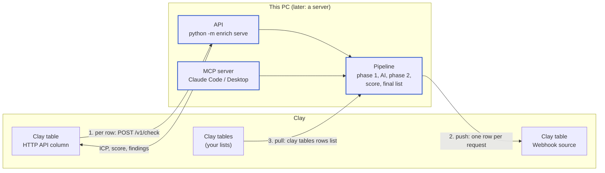

# Integrations: API, MCP and Clay

How other tools talk to the pipeline. Setup and the pipeline itself are in [README.md](../README.md) and [PIPELINE.md](PIPELINE.md).



| Flow | What happens | Needs |
|---|---|---|
| **1. Per row** | A Clay table calls our API for each company and fills columns with ICP YES/NO, score, tier and findings | Our API reachable from the internet (tunnel or server) |
| **2. Push** | After a list finishes, every row (all original columns + findings) is sent to a Clay table | A Clay table with a Webhook source |
| **3. Pull** | A Clay table is read as a new list and run through the pipeline; results can then be pushed back | `clay login` on this PC; the table needs a Domain or Website column |

---

## Set up once

All keys live in `.env` at the project root, each with a comment saying what it's for and where to get it. `.env` is readable only by you and never committed to git. `.env.example` is the blank copy in git, so teammates see which keys to fill in.

| Group | Key | Used for | Status |
|---|---|---|---|
| This project | `PUZZLE_API_KEY` | Key callers send to our API | Created automatically |
| AI | `OPENAI_API_KEY` | AI step (gpt-4o-mini) and its web search | Used |
| AI | `ANTHROPIC_API_KEY` | Claude as an alternative AI provider | Not used yet |
| Clay | `CLAY_WEBHOOK_URL` | Default Clay table to push results to | Used |
| Clay | `CLAY_WEBHOOK_TOKEN` | That webhook's auth token, if it has one | Used |
| Clay | `CLAY_API_KEY` | Clay Public API (pull and push work without it, through `clay login`) | Not used yet |
| Data providers | `PROSPEO_API_KEY` | Prospeo: company data (last layer of the waterfall) and people | Used when set |
| Data providers | `PROVIDER_MONTHLY_CREDITS` | Cap on provider credits per month | Optional |
| Free directories | `SEC_CONTACT_EMAIL` | Contact email SEC EDGAR asks automated tools to send (YC, SEC and IRS need no key) | Optional |
| Other data tools | `CRUNCHBASE_API_KEY`, `APOLLO_API_KEY`, `PDL_API_KEY`, `SEARCH_API_KEY` | Funding, headcount, company data, a separate web search service | Planned |

Fill them in by editing `.env`, or from the terminal:

```bash
.venv/bin/python -m enrich settings                                   # every key and whether it's set
.venv/bin/python -m enrich settings --openai-key sk-...               # AI step
.venv/bin/python -m enrich settings --clay-webhook https://...        # default Clay table for pushes
.venv/bin/python -m enrich settings --clay-webhook-token ...          # only if that webhook has an auth token
.venv/bin/python -m enrich settings --clay-api-key ...                # Clay Public API (from `clay api-keys create`)
.venv/bin/python -m enrich settings --set APOLLO_API_KEY=...          # any other key
.venv/bin/python -m enrich settings --show-key                        # print the full API key for callers
.venv/bin/python -m enrich settings --rotate-api-key                  # replace the API key (callers need the new one)
```

The API key is created once and stays the same until you rotate it.

**Clay command-line tool:** installed at `~/.local/bin/clay` and signed in with `clay login`. Check with `clay whoami`. For Clay's own skills in Claude Code, type these two lines in the Claude Code chat:

```
/plugin marketplace add clay-run/agent-plugins
/plugin install clay@clay-plugins
```

---

## API

```bash
.venv/bin/python -m enrich serve                 # http://127.0.0.1:8787, this PC only
.venv/bin/python -m enrich serve --host 0.0.0.0  # reachable from your network
```

Interactive docs, where you can try every call: http://127.0.0.1:8787/docs

Every `/v1` call needs the key as a header: `x-api-key: <key>` (or `Authorization: Bearer <key>`). Wrong or missing key: `401`. Show the key with `python -m enrich settings --show-key`.

The full description of every call (fields, types, examples) is in [docs/openapi.json](openapi.json), which any API tool (Postman, Insomnia, code generators) can import without the server running.

**Safety rules:**
- AI only runs when a request says `"ai": true` (or calls the AI endpoint).
- Every AI run is estimated first. If the worst case is above `max_cost_usd` (default `API_AI_MAX_COST_USD` in `.env`, else $5), the request is refused with `402` and nothing is sent. The message gives the cheap-mode worst case too.
- Nothing can be deleted through the API.

| Group | Method and path | What it does |
|---|---|---|
| | `GET /health` | Is the API up (no key needed) |
| Companies | `POST /v1/check` | One company, answered while you wait: ICP, reason, score, tier, reasoning, every data point. Cached. Body: `{"domain": "acme.com", "company": "Acme", "employees": "12"}`; options `signals`, `ai`, `ai_options`, `refresh`, `wait_seconds` |
| | `POST /v1/check/batch` | Up to 25 companies at once, answered while you wait; their free steps run at the same time. Body: `{"companies": [{"domain": "acme.com"}, {"domain": "beta.io"}]}`; options `signals`, `wait_seconds` (default 300) |
| Lists | `GET /v1/lists` | Every list with state and counts |
| | `POST /v1/lists` | Start a whole list in the background. Body: `{"name": "q4", "rows": [{"Domain": "..."}], "ai": false, "callback_url": "https://..."}`; your other columns are kept |
| | `POST /v1/lists/upload` | The same with a CSV file (form fields `name`, `ai`, `mode`, `max_cost_usd`, `callback_url`) |
| | `GET /v1/lists/{name}` | Progress: state, step, AI usage and cost, counts, push and callback result |
| | `GET /v1/lists/{name}/results` | Every row: original columns + findings. `?format=csv`, `?only_icp=true`, `?limit=50` |
| | `GET /v1/lists/{name}/companies/{domain}` | One company: its row, every answer with proof (quote, page, source: code, directory or AI), directory findings |
| | `POST /v1/lists/{name}/rules` | Re-apply rules to saved pages after changing scoring or rules. Free. Body: `{"phase": "both"}` |
| AI | `GET /v1/lists/{name}/ai/estimate?phase=icp` | What the AI step would cost, in both modes. Nothing is sent |
| | `POST /v1/lists/{name}/ai` | Run the AI step on an existing list in the background. Body: `{"phase": "icp", "ai_options": {"mode": "accurate", "max_cost_usd": 2}}` |
| Quality | `POST /v1/lists/{name}/evaluate` | Accuracy against right answers, with every disagreement. Body: `{"labels": [{"Domain": "acme.com", "Expected ICP": "YES", "Expected tier": "Strong fit"}]}` |
| | `GET /v1/lists/{name}/runs` | Run log with AI cost per run and in total |
| Reference | `GET /v1/lookup?domain=puzzle.io&legal_name=Puzzle Financial Inc.` | YC, SEC and IRS for one company. Free |
| | `GET /v1/signals` | Every data point: its column name, group and points |
| Providers | `POST /v1/lists/{name}/providers` | Prospeo company data for data points still open. Body: `{"phase": "icp", "max_credits": 50}` |
| | `POST /v1/lists/{name}/people` | Decision-makers at ICP companies. Body: `{"emails": true, "per_company": 3, "max_credits": 100}` |
| | `GET /v1/lists/{name}/contacts` | Contacts found, one row per person. `?format=csv` |
| Clay | `POST /v1/lists/{name}/push` | Send a list to a Clay webhook. Body: `{"only_icp": false}` |
| | `GET /v1/clay/tables` | Tables in the signed-in Clay workspace |
| | `POST /v1/clay/pull` | Read a Clay table and run it as a new list. Body: `{"table_id": "t_abc123", "push_to_clay": true}` |

`ai_options` (on `check`, `lists`, `clay/pull` and the AI endpoint): `mode` (`accurate` default, or `cheap`), `web` (true), `search_signals` (true; the web-only buying signals), `max_cost_usd`.

**Callback:** give `callback_url` and, when the list finishes (or stops at the cost limit), its status with the summary is POSTed there as JSON, with 3 tries. The result is shown under `callback` in the list's status.

**Status codes:** `200` done, `202` started in the background, `400` bad request, `401` key, `402` above the AI cost limit (nothing sent), `404` no such list or company.

**Speed:** a new company takes about 5 to 35 seconds with `/v1/check` (a site read with the real browser is slower), and is instant from the cache after that. If a check takes longer than `wait_seconds`, the answer is `"status": "still running"` and the check keeps going; calling again returns the result.

### Examples

```bash
KEY=$(.venv/bin/python -c "from enrich import settings; print(settings.api_key(create=False))")
API=http://127.0.0.1:8787

# one company
curl -s -X POST $API/v1/check -H "x-api-key: $KEY" -H "Content-Type: application/json" \
     -d '{"domain": "linear.app", "company": "Linear"}'

# a CSV in the background, with AI capped at $3 and a callback
curl -s -X POST $API/v1/lists/upload -H "x-api-key: $KEY" \
     -F file=@leads.csv -F name=q4 -F ai=true -F max_cost_usd=3 -F callback_url=https://example.com/hook
curl -s $API/v1/lists/q4 -H "x-api-key: $KEY"                       # progress
curl -s "$API/v1/lists/q4/results?format=csv&only_icp=true" -H "x-api-key: $KEY" > q4_icp.csv
```

```python
import httpx, time

api = httpx.Client(base_url="http://127.0.0.1:8787", headers={"x-api-key": "<key>"}, timeout=120)
api.post("/v1/lists", json={"name": "q4", "rows": [{"Company Name": "Linear", "Domain": "linear.app"}]})
while api.get("/v1/lists/q4").json()["state"] in ("queued", "running"):
    time.sleep(5)
print(api.get("/v1/lists/q4/ai/estimate", params={"phase": "icp"}).json())       # cost first
api.post("/v1/lists/q4/ai", json={"phase": "icp", "ai_options": {"max_cost_usd": 1}})
for row in api.get("/v1/lists/q4/results", params={"only_icp": True}).json()["rows"]:
    print(row["Domain"], row["Lead score"], row["Lead tier"])
```

### Making the API reachable for Clay

Clay runs in the cloud, so it can't reach `127.0.0.1`. Two options:

| Option | How | Good for |
|---|---|---|
| Tunnel from this PC | `brew install cloudflared`, then `cloudflared tunnel --url http://localhost:8787`. It prints a public `https://...trycloudflare.com` address that forwards to the API while both are running. | Trying it out; the address changes each time |
| Server | Run `python -m enrich serve --host 0.0.0.0` on a server with HTTPS in front | Everyday use by the team |

Keep the API key secret in both cases: anyone with the address and the key can run checks.

### Clay HTTP API column (flow 1)

In the Clay table:

1. **Add column → HTTP API.**
2. Method `POST`, endpoint `https://<your public address>/v1/check`.
3. Header `x-api-key` = your API key.
4. Body (pick the table's columns where shown):
   ```json
   {"domain": "<Domain column>", "company": "<Company Name column>", "employees": "<Employee count column>"}
   ```
5. Map the response fields you want into columns: `ICP`, `ICP status`, `Why`, `Lead score`, `Lead tier`, `Segment`, `Fit signals found`, `Funding stage`, `Partners found`.
6. In the column's rate limit settings, start with about 5 requests per 10,000 ms. Clay's HTTP column has its own timeout; a slow answer shows as an `ETIME` error, so keep `wait_seconds` below it.

---

## Push to Clay (flow 2)

1. In Clay, create a table and add a **Webhook** source. Copy its URL (and its auth token, if you turn one on).
2. Save it once: `python -m enrich settings --clay-webhook <URL>` (plus `--clay-webhook-token <token>` if set).
3. Push a finished list:
   ```bash
   .venv/bin/python -m enrich push leads              # every row
   .venv/bin/python -m enrich push leads --only-icp   # only ICP = YES
   ```
   Or set `push_to_clay` when starting a list through the API or MCP.

Each row is one request, with all your original columns plus the findings (74 columns in testing). Rate limits and server errors are retried. Clay accepts up to 50,000 rows per webhook.

The token is sent as the `x-clay-webhook-auth` header. Check it against your webhook's settings in Clay on the first push.

---

## Pull from Clay (flow 3)

```bash
.venv/bin/python -m enrich pull                                # list the Clay tables in your workspace
.venv/bin/python -m enrich pull t_abc123 --list q4_clay         # read the table and run both phases
.venv/bin/python -m enrich pull t_abc123 --list q4_clay --push  # ...then push the results to the webhook
```

The table needs a column the pipeline recognises as the domain (Domain, Website, URL, Company Domain). For bulk enrichment tables, Clay only shows a sample of rows; the pull reports this as `truncated`.

---

## MCP server (Claude Code, Claude Desktop)

### Connect Claude Code (one time)

**Option A, automatic (recommended):** register the server for this project in your own Claude Code config. It then
connects by itself every time you open Claude Code in this folder (terminal or VS Code), with no approval prompt:

```bash
cd /path/to/ICP
claude mcp add puzzle-lead-scoring --scope local -e PYTHONPATH="$PWD" -- "$PWD/.venv/bin/python" -m enrich mcp
claude mcp list
```

`claude mcp list` should show `puzzle-lead-scoring ... ✔ Connected`. In a chat, `/mcp` shows it too; after code
changes, reconnect it there (or restart Claude Code) so the new tools load.

**Option B, shared with the team:** the repo's `.mcp.json` registers the same server for anyone who opens the
project, and `.claude/settings.json` pre-approves it. Claude Code applies project settings only once the folder is
trusted: run `claude` in the folder once and accept the trust prompt (or approve **puzzle-lead-scoring** in `/mcp`).
If you also did option A, `claude mcp list` notes the server is defined in two places; that's harmless (yours wins).

**Check it works:** ask Claude Code *"Use puzzle-lead-scoring to check linear.app"*. To remove it:
`claude mcp remove puzzle-lead-scoring -s local`.

**Claude Code skills and helpers** (in `.claude/`, loaded automatically when you open the project):

| Name | Use it for |
|---|---|
| `check-company` (skill) | One company through the full waterfall, Claude answering, Prospeo only after your yes |
| `/enrich-chat <csv> [list]` (command) + `company-answerer` (subagent) | Lists up to about 100 companies, answered in chat, 5 companies at a time |
| `bulk-enrich` (skill) | Bigger lists: free steps, `list_ai` with an approved cost cap, costs, Clay push |
| `icp-answering` (skill) | The answering rules: stated proof only, confidence scale, same-name traps, cannot_answer |
| `review-datapoints` (skill) | The manual data point review (resume, one data point at a time, record decisions) |
| `datapoint-dev` (skill) | Changing a data point in the code with config, defaults, tests and docs kept in sync |
| `improve-pipeline` (skill) | After a run: what the pipeline learned, safe fixes applied, the rest proposed with proof for your OK |

**Claude Desktop:** add the same command to `~/Library/Application Support/Claude/claude_desktop_config.json` under
`mcpServers` (command = the full path to `.venv/bin/python`, args `["-m", "enrich", "mcp"]`, env `PYTHONPATH` = the
project folder), then quit (Cmd+Q) and reopen Claude Desktop.

**Which AI answers, by list size:**

| List | Steps 1-2 and 5 | Steps 3-4 (AI) |
|---|---|---|
| One company or a list up to about 100 | `check_company` / `enrich_list` (+ `use_prospeo`) | **Claude in the chat** (`open_questions`, `submit_answers`): $0 API. In Claude Code, `/enrich-chat <csv>` runs it all, one `company-answerer` subagent per company, 5 at a time |
| Bigger lists (over about 100, up to thousands) | `enrich_list` (+ `use_prospeo`) | **OpenAI** via `list_ai`: estimate first, then only with your approved cap. Claude can't answer tens of thousands of questions in a chat |

**Up to about 100 companies in Claude Code:** type `/enrich-chat path/to/list.csv my_list`. It runs the free steps,
answers every company's open questions with the `company-answerer` subagent (`.claude/agents/`: its own fresh
context per company, so the main chat stays short; 5 in parallel), asks you before any Prospeo credit, and shows the
results. About 1,000-1,500 answers for 100 companies; expect roughly an hour and a good share of your Claude plan's
usage.

Bigger lists, bulk workflow: `enrich_list` (free, background) → `list_status` until done → `list_ai(list, "icp")` shows the
estimate → approve a cap → `list_ai(list, "icp", max_cost_usd=<cap>)` → when done, the same for `"signals"` →
`list_results` / `push_list_to_clay`.

**In the chat path the model you're chatting with is the only AI** (Claude in Claude Code or Claude Desktop), at no API cost. The tool never calls OpenAI there; `list_ai` is the only way OpenAI is used through MCP:

1. `check_company` (or `enrich_list`) runs the free layers: website rules and directories.
2. `open_questions` gives the model the data points still open, with **the same prompts the OpenAI step uses**, built from `config/prompts`: the system prompt from `_shared.json` (role, ICP summary, ground rules, confidence scale), each question's instructions from its own prompt file (named in `prompt_file`, with its version), the company's page text, the answer fields, and whether to answer from the pages or the web. Edit a prompt file and both OpenAI and the MCP model follow the change.
3. The model answers, quoting its proof, and calls `submit_answers`. Questions come in rounds: a data point that
   depends on another (`run_if`, or an opposite) appears only after that one is answered, and is dropped as Not
   applicable when the answer rules it out. Keep calling `open_questions` until nothing is left; phase 2 also stops
   early once no answer can change the lead tier.
4. The answers pass the same quality checks as any AI answer (exact quote, confidence, domain match for web answers, dated events for recent signals). The result says which counted, the new verdict and score, and what's next.
5. Step 5, Prospeo, runs only for the finance-person check (F13, F14) and only when you agree: when the finance check is still open after the model's answers, `submit_answers` says so, and the model asks you before calling `check_company(..., use_prospeo=true)` (1 credit at most per company).
6. A question the model can't answer the way it asks (usually a web search in a client without a web tool) is sent back as `cannot_answer` and **stays open**; nothing is sent to another AI.

Just ask in plain words, for example: "Check resend.com with puzzle-lead-scoring and answer its open questions". The terminal, the API and Clay keep using OpenAI as configured.

| Tool | What it does |
|---|---|
| `check_companies` | Several companies at once (up to 25): their free steps run at the same time, so ten take about as long as the slowest one. Then answer each one's questions as usual |
| `check_company` | One company through the free waterfall steps (size, rules and code checks, YC, SEC, IRS, DNS): ICP, score, tier, signals. `use_prospeo=true` (after your yes) adds step 5, the Prospeo finance check, at most 1 credit |
| `open_questions` | The questions still open for a company, for the model to answer (phase 1, then phase 2) |
| `submit_answers` | Saves the model's answers through the quality checks; returns what counted and the new verdict and score. `cannot_answer` items stay open (no other AI is used) |
| `questions_overview` | For a whole list: open questions per company |
| `list_ai` | **Big lists only.** The AI steps for a whole list with the OpenAI engine, in the background. Called without a cap it only returns the cost estimate; it runs only with `max_cost_usd` set to a cap you approved, and never above it or the monthly budget |
| `enrich_list` | Start a CSV file as a list in the background (free waterfall steps); `use_prospeo=true` adds step 5 for each company where the finance check is still open (1 credit each at most) |
| `list_status` | Progress and counts of a list |
| `list_results` | Rows of a finished list (ICP = YES by default) |
| `explain_company` | Every answer with its proof |
| `clay_tables` | Tables in your Clay workspace |
| `pull_clay_table` | Read a Clay table and run it as a list |
| `push_list_to_clay` | Send a finished list to a Clay webhook |
| `improvement_report` | What the pipeline learned from its runs, as proposals with proof; safe setting changes are applied automatically (tests run, reverted if they fail) |
| `apply_improvement` | Apply a setting proposal after your yes (tests run, reverted if they fail) |
| `mark_improvement` | Record a proposal's outcome: done (fixed by hand), rejected, applied or failed |

### The GTM engineer and the learning loop

Through MCP, Claude works as an **experienced GTM engineer who owns this pipeline**, and the shared prompt
(`config/prompts/_shared.json`) gives OpenAI and Claude the same role when answering: someone who knows how B2B
company data goes wrong (shared names, an acquirer's news, stale funding articles, job sites mixing up employers,
customer logos taken for tools). The proof rules don't change: only stated proof counts, Unknown is never a No.

Every run feeds a learning log (`learning/events.jsonl`, not in git): each AI answer and what became of it (counted,
rejected and why, unknown), crashes and where they happened, questions the chat model couldn't answer, and your
corrections in test mode. `improvement_report` turns it into proposals:

| Pattern | Proposal | Who decides |
|---|---|---|
| A crash | Fix the code, add a test, run all tests | **Automatic** (Claude fixes it in Claude Code, tests must pass), you're told after |
| A phase 2 data point's web search found nothing in 90%+ of 8+ answers | Search only on a clue (`ai_web.run: if_clue`) | **Automatic** (applied, tests run, reverted if they fail), you're told after |
| Answers rejected the same way 3+ times (no quote, wrong company, too old, …) | A line in that data point's prompt, or a looser check if the answers were right | **You** |
| Questions the chat model couldn't answer, 3+ times | A free rule or directory for it, or `list_ai` | **You** |
| Your corrections in test mode | Find and change the rule, prompt or setting behind the wrong answer | **You** |

Must-haves and exclusions are never changed automatically. A rejected proposal only comes back if it keeps happening.
Every decision is logged in [IMPROVEMENTS.md](IMPROVEMENTS.md). `LEARNING_AUTO_APPLY=0` in `.env` makes everything
wait for you. `/enrich-chat`, `check-company` and `bulk-enrich` end with the `improve-pipeline` skill.

For **Claude Desktop**: Settings > Developer > Edit Config opens `~/Library/Application Support/Claude/claude_desktop_config.json`. Add this inside it (keep what's already there), with your own project path, then quit Claude Desktop fully (Cmd+Q) and open it again. Use full paths: Claude Desktop doesn't start in the project folder, which is why `PYTHONPATH` points to it. Keys, lists and settings are found from the project folder automatically.

```json
{
  "mcpServers": {
    "puzzle-lead-scoring": {
      "command": "/Users/<you>/path/to/PuzzleLeadScoring/.venv/bin/python",
      "args": ["-m", "enrich", "mcp"],
      "env": {"PYTHONPATH": "/Users/<you>/path/to/PuzzleLeadScoring"}
    }
  }
}
```

To run it on a server later, the same tools can be served over HTTP instead of stdio.
