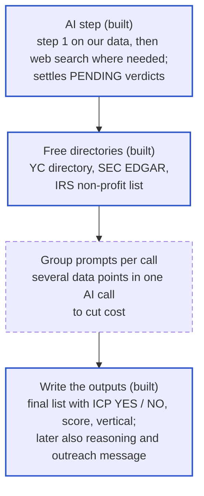

# Status and open items

## 1. Status and roadmap

**Built and tested** (on a 14-company sample, a 10-company accuracy test, the 100-company lead list and the 26-deal test):

| Part | Status |
|---|---|
| Read any CSV, clean domains, keep every row | Done |
| Phase 1 and phase 2 as separate scripts | Done |
| Downloading pages, job feeds, robots.txt, public DNS check, slim saving | Done |
| Rules for all 4 must-haves, 6 exclusions and 47 signals (21 fit, 14 buying, 12 weak) | Done. Yes / No only when confirmed; guesses stay empty or Needs check |
| Two ICP pipelines (services default, product) with the services facts S1–S12, Route, Arrival and Value angle | Done (build stages 1–4); services weights provisional until calibrated |
| Buying signals from free sources: Form D in the last 6 months, new YC batch, LLC-to-Inc. (SEC former names, old footers in the Internet Archive), pricing launched since last year (Internet Archive) | Done; the rest of the buying signals come from web search |
| Real-browser fallback (your Google Chrome) for JavaScript-only sites and short bot checks | Done; Khan Academy went from 209 to 8,682 characters of text. Hard Cloudflare blocks still fail |
| Reasoning column ending with the profile's "Funding stage: <value> (<basis>)" line | Done (built by code, no AI cost) |
| `evaluate` (accuracy against labels) and `runs` (run log with AI cost) | Done; the 10-company test scores 9 of 9 decided, 0 good companies wrongly NO |
| Built to scale on one machine (see [Architecture](DOCUMENTATION.md#414-architecture)): one company cache for all lists, rate limits shared across processes, version stamps, API jobs that survive restarts, monthly AI budget, configurable data folder | Done; tested with two lists sharing pages and answers, two processes sharing a limit, and a server restarted twice mid-list |
| Final list with ICP YES / NO / PENDING, lead score, tier and segment | Done |
| Free directories: YC (by domain), SEC EDGAR (public, Form D funding, Delaware, address), IRS non-profit list, with match-strength rules | Done; on the test list it caught HubSpot as public and confirmed Puzzle's Delaware status and funding |
| 62 AI prompt files with a web search step | Written |
| AI step with OpenAI (gpt-4o-mini): our data first, web search only if needed, cost estimate and confirmation, answers kept when rules re-run, a quote required for every Yes / No | Done; $0.11 for the 10-company test |
| Two AI modes: `accurate` (default) and `cheap` (grouped calls), with `copy` and `compare` to check one against the other | Built; tested with a stand-in for OpenAI (8 calls instead of 35 for one company) |
| Live dashboards, `explain`, `lists`, `rules`, `clean`, ask before deleting | Done |
| Version control | Done: private GitHub repo `PuzzleLeadScoring` |
| API: one company, whole lists, AI with cost estimate and a hard cost limit, per-company proof, rules re-run, evaluate, run log, directory lookup, data point list, Clay push and pull, completion callback | Built and tested locally (17 endpoints) |
| MCP server for Claude Code / Desktop | Built and tested with an MCP client; needs your one-time approval |
| Clay: pull tables, push to a webhook, per-row HTTP column | Pull tested on your workspace; push tested against a stand-in webhook; per-row needs a public address |
| Manual review of all 57 data points and S1–S8 | Done ([section 10](DOCUMENTATION.md#9-decisions-and-reviews)) |
| Calibration tooling (`calibrate`) | Done; waiting for the labels |

**Build status by signal group:**

| Signals | Answered by code today | Waiting on |
|---|---|---|
| All 4 must-haves, all 6 exclusions | Yes, with "Needs check" where unsure; directories add public companies (SEC, YC), non-profits (IRS, YC), US address (SEC, YC) | AI step to settle the "Needs check" ones |
| Fit: Stripe, Delaware C-Corp, paid pricing, open roles, growth numbers, remote, early adopter, payroll and banking tools, YC | Yes; directories add funding (SEC Form D, YC), Delaware (SEC) and YC backing | |
| Fit: startup selling nationally, B2B SaaS, local services, AI core, finance person, several companies | Clues only | AI step |
| Buying: several roles, finance hire, ops hire, bookkeeper, audit, tax deadline | Yes, from job posts and the calendar | |
| Buying: raised in last 6 months, new investor, LLC to C-Corp, incorporated recently, launched pricing | Yes, from Form D, the YC batch, SEC former names and Internet Archive snapshots | Web search (phase 2 AI) when the free sources find nothing |
| Buying: new subsidiary, QuickBooks complaints, board member | Web search only (phase 2 AI) | |
| Weak: local area, physical business, LLC with no funding, pre-revenue, multi-currency, manufacturing, Shopify without stock, NetSuite | Yes or clues | AI step for the clue-only ones |
| Weak: invoicing-heavy, accountant picks tools, no fintech tools | AI step (accountant: web search; no fintech tools: a spreadsheet clue in job posts, confirmed by AI) | |

**Data sources and what comes next:**

| Source | What it gives | Status |
| --- | --- | --- |
| Company website, read by code | Most must-haves, exclusions and signals (see [section 6](DOCUMENTATION.md#6-data-point-reference)) | Built |
| Job board feeds | Open roles, job descriptions | Built |
| AI reading our saved pages | Judgment calls: business type, industry, AI core, confirming "Needs check" | Built (OpenAI gpt-4o-mini); first real run pending |
| Free directories | YC directory, SEC EDGAR (public company, Form D funding, Delaware, address), IRS non-profit list | Built |
| AI web search | Step 2 for data points our pages can't answer | Built (OpenAI web search tool); model support to confirm on the first run |
| Paid data (Clay, Crunchbase, OpenCorporates) | Headcount, funding, entities, only for companies still missing them | Optional |

| When this lands | Effect on the final list |
| --- | --- |
| Free directories (built) | Public companies caught (HubSpot); funding and Delaware status confirmed (Puzzle); fewer AI calls |
| First real AI run | PENDING becomes YES or NO; the highest-weighted signals start counting, so scores rise for real startups; industry filled in |
| Grouped prompts | Same answers at roughly a third of the AI cost |
| Web search | Buying signals such as recent funding start counting |
| Reasoning and outreach message | Two new text columns per ICP company |

**Next, in order of impact:**

1. **Labelled list from Puzzle:** about 50 current customers and 50 lost or "not a fit" deals (for services: Alexey's 152 coded companies and the closed-won deals). Run them and `evaluate` / `calibrate`, to measure accuracy and set the Strong fit cut-off from data instead of the current 12.
2. **Pilot on 500 real rows** to measure speed, block rate and cost.
3. **Check the cheap mode** on the labelled list with `copy` + `compare` + `evaluate`, then decide whether it can be the default. OpenAI's half-price Batch API could come after that.

**Then:**

4. **Follow investor and careers subdomains** such as `ir.hubspot.com`.
5. **More directories:** Techstars and other accelerator portfolios.
6. **A server** for the API, so Clay can call it row by row.
7. Optional: Clay (already connected) for headcount and funding on PENDING companies; monthly re-checks of old lists; a shared page for the team to browse results.

## 2. Before go-live

The [26-deal test](DOCUMENTATION.md#96-first-test-on-26-real-deals-2026-11-09) found and fixed three rules that rejected paying customers. The model now passes 15 of 17 won deals, but its score does not yet rank won deals above lost ones.

- [x] Test a contractor such as Ridgeline Drilling: a missing or parked website no longer fails a services company
- [ ] Fix the ranking: lower the startup weights and add HubSpot data (service bought, deal stage) as signals
- [ ] Run Alexey's 152 companies and compare the scores with his judgement (`calibrate`)
- [ ] Decide the size limit: today 100 or more people excludes a company, which could cut out Brilliant-size customers
- [ ] Decide whether e-commerce holding physical stock is really out (Verse, a won deal, is excluded by it)
- [ ] Fix known wrong answers: some companies marked publicly traded by mistake, fund administrators caught by the wrong rule, one site that redirects to another company
- [ ] Add a Dockerfile and an automatic test run so the server deploys in one step
- [ ] Agree who owns the model (weights and rules) and who maintains the code

## 3. Open decisions and questions

| Question | Status |
|---|---|
| AI provider and models | OpenAI gpt-4o-mini for both steps (`providers.openai` in `config/prompts/_shared.json`). Claude settings are kept there as an alternative but not wired up (through MCP, the chat model answers instead) |
| OpenAI API key | Saved once in `.env` (git-ignored) |
| One AI call per data point, or grouped | Both: `accurate` (one call per data point, the default) and `cheap` (grouped, `--mode cheap`). Cheap stays opt-in until `compare` shows its answers hold up |
| Large rounds | A confirmed single round of $100M+ or a $1B+ valuation counts as "Series C or later" (`late_stage_proof` in config/icps/product/scoring.json) |
| Undecided companies | PENDING until the AI check or a retry settles them |
| Weak fit points | -2 each (in the pipeline's scoring.json) |
| Strong fit cut-off | 12 for now; to be set after the labelled check |
| Real lead list | A sample of 50 to 100 rows would help tune the rules |
| Old test folders | `data/`, `out/` and `lists/sample_leads/` are out of date; waiting on your OK to delete them |
| Services weights | Startup weights rank lost deals above won ones; lowering them and adding HubSpot signals needs the user's and Alexey's OK ([Improvements log](IMPROVEMENTS.md)) |
| B4 and E3 for fund administrators | B4 counts a client-facing accounting role as "hiring a finance lead" (false positive in both pipelines), and a fund administrator like Repool may be an accounting-services firm (E3) |

**Offers from the manual review (not built yet):**

- **W9:** No store platform in the code → W9 No at step 1.
- **B4/B5:** job board read and no finance / ops title → No at step 1 (B4: rules-only No when the job board was read and no title is a finance role).
- **B12:** skip "launched pricing" when the company publishes no pricing.
- **B1/B2:** one shared funding search.
- **YC safeguards (F11):** require a second agreeing fact for a strong YC match; count AI web answers about YC only when the listing's website is the company's domain; note near-name YC companies as "not a match".
- **F16:** a free rule when all job posts say "In person" / on-site.
- **E5:** treat "Inc." as a clue, decide by the IRS register / SEC Form D.
- **Other tool data points (F2, F4, F9):** rules only, like F19 and F20, if wanted.
- **F12, B3:** the job-board link as the source.
- **Prospeo company lookup** is untested live (only the people search is).
- **Prospeo funding totals are unreliable** (counted Argon AI's $5.5M seed three times as $16.5M): drop or mark the column.
- Job boards not built: JazzHR, Jobvite, Stardex.
- S6 inherits E1's "publicly traded" proof that sometimes comes from a founder's bio or a public customer (to fix through the learning loop).

Built since they were offered (2026-10-14): opposites (W2 and W7 left out), job boards (13 boards + careers-page roles; 4 → 13 test companies with jobs; glavel.com and repool.com now show finance hires for B4), re-fetching nearly empty pages with the real browser (`render`), and web search only on a clue for rarely public data points (F17, F19-style cost savers).
